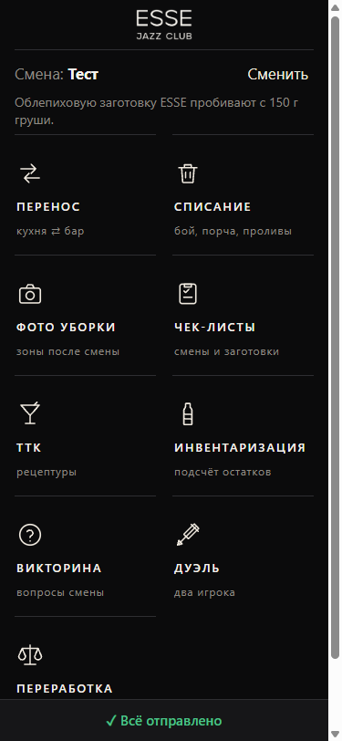
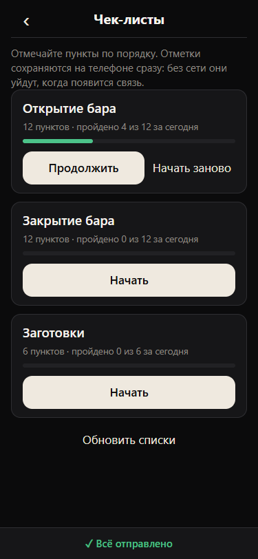
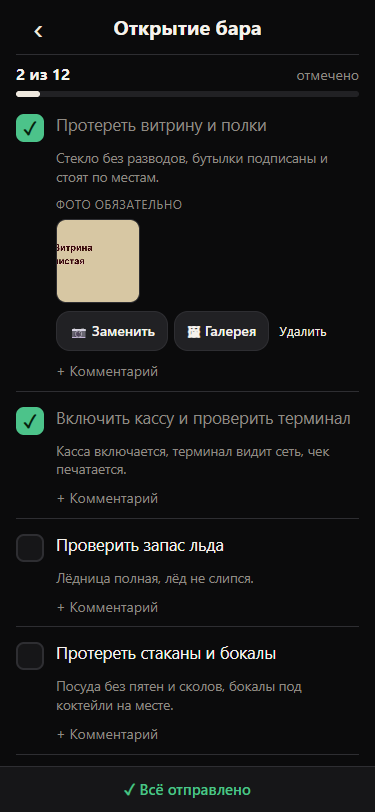
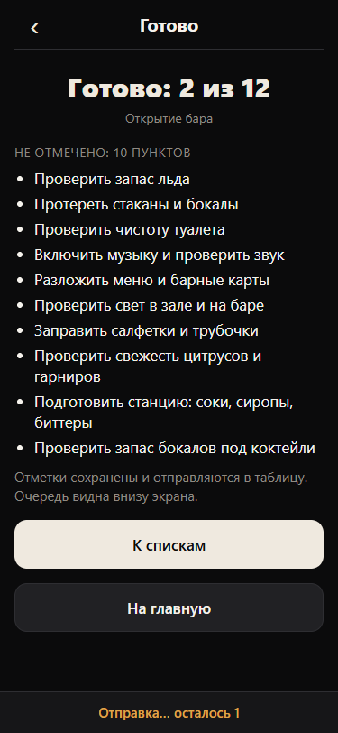
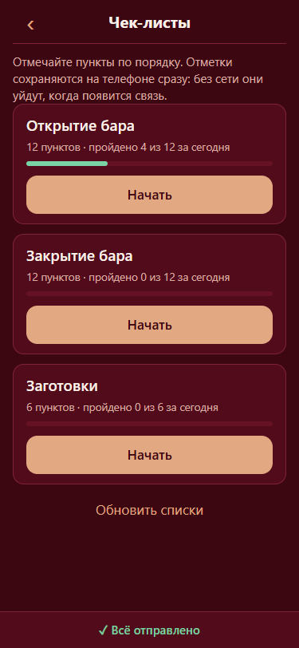
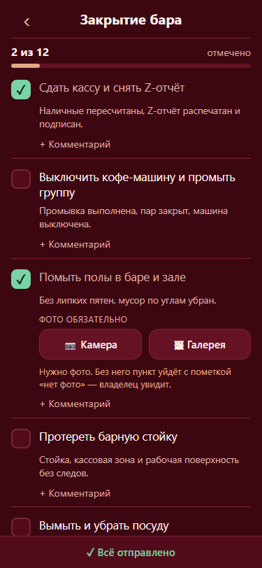
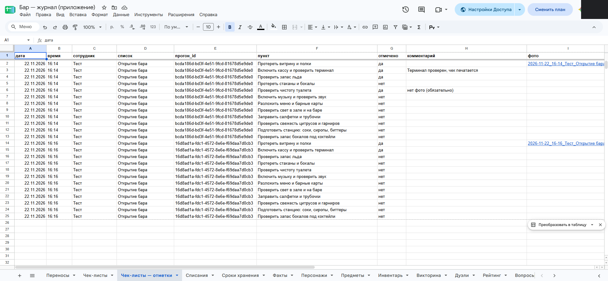
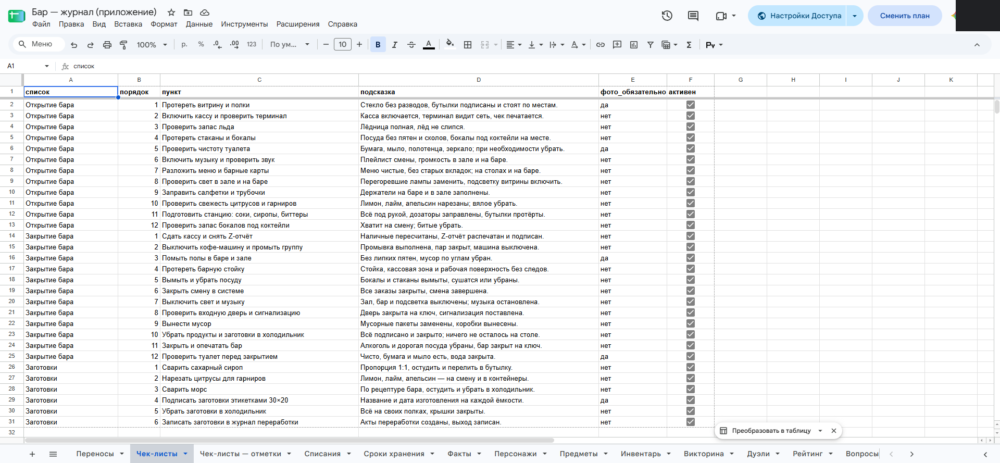

# «Чек-листы» — отчёт

Дата: 22.11.2026. Ветка: `dsh-threads/12-b56efb` (от `main` `3b13836`).
Коммиты: `0d032c3` — бэкенд, `43a9a8a` — приложение; отчёт и скриншоты —
отдельным коммитом. В `main` не пушилось.

## Что сделано

В приложении «ESSE — журнал бара» появились чек-листы: списки пунктов,
отметки сотрудника, прогресс и история в Google-таблице.

Содержимое — **данные, а не код**: владелец добавляет и правит пункты в листе
«Чек-листы», JavaScript трогать не нужно. Списки приходят на телефон вместе
с `config` — отдельного запроса на старте нет.

## Схема листов

### «Чек-листы» — что отмечать

| Колонка | Что внутри |
|---|---|
| `список` | название списка, например `Открытие бара` |
| `порядок` | число для сортировки пунктов внутри списка |
| `пункт` | формулировка в повелительном наклонении: «Протереть витрину и полки» |
| `подсказка` | короткое пояснение, что именно проверить; может быть пусто |
| `фото_обязательно` | `да` / `нет`; понимается также галочка и `true`/`1` |
| `активен` | галочка; снятая или `нет` выключает строку, пусто = включено |

Порядок: пункты сортируются по `порядок` (при равенстве — по строке листа),
списки идут в порядке первого появления в листе. Если владельцу нужно
переставить списки — он двигает блоки строк.

**Засеяно 30 пунктов** (первый и единственный посев при создании листа):

| Список | Пунктов | С обязательным фото |
|---|---:|---:|
| Открытие бара | 12 | 2 («Протереть витрину и полки», «Проверить чистоту туалета») |
| Закрытие бара | 12 | 2 («Помыть полы в баре и зале», «Проверить туалет перед закрытием») |
| Заготовки | 6 | 1 («Подписать заготовки этикетками 30×20») |

Формулировки конкретные и бытовые: касса и терминал, лёд, бокалы, туалет,
музыка, меню, свет, салфетки, цитрусы, станция, посуда; сдать кассу, кофе-машина,
полы, стойка, посуда, закрыть смену, свет, дверь и сигнализация, мусор,
холодильник, опечатать бар; сироп, цитрусы, морс, этикетки, холодильник, журнал
переработки. Экзотики и выдуманных процедур нет.

Повторный запуск `checklists_` ничего не дублирует. Если лист уже существует,
но пуст, он **не** досеивается: так владелец может временно убрать все пункты.
Для ручного восстановления есть `setupChecklists()` (обычно не нужна).

### «Чек-листы — отметки» — история

| Колонка | Что внутри |
|---|---|
| `дата` | дата начала прогона (Europe/Moscow) |
| `время` | время начала прогона, `ЧЧ:ММ` |
| `сотрудник` | имя из сессии |
| `список` | название списка |
| `прогон_id` | UUID прохождения, один на весь прогон |
| `пункт` | текст пункта |
| `отмечено` | `да` / `нет` |
| `комментарий` | комментарий бармена + серверные пометки |
| `фото` | имя файла на Диске, оформлено ссылкой |

Пишется **по строке на каждый пункт**, включая неотмеченные: владелец видит
не только «что сделано», но и «что осталось». `прогон_id` позволяет отфильтровать
один проход; второй проход за день — новый `прогон_id`, история не затирается.

## Бэкенд

`GET ?action=config` дополнительно отдаёт:

```json
"checklists": [
  { "name": "Открытие бара", "items": [
    { "text": "Протереть витрину и полки", "hint": "Стекло без разводов…", "photo": true }
  ] }
]
```

Ошибка чтения чек-листов не ломает `config`: она пишется в «Лог», а `checklists`
остаётся пустым.

`POST {action:'checklistSave', id, runId, employee, pin?, list, startedAt,
items:[{пункт, отмечено, комментарий, фото?}]}`:

* проверяет `runId` (8–64 символа `[A-Za-z0-9-]`), список, непустые пункты,
  лимит 200 пунктов;
* сотрудник должен быть активен; PIN необязателен (как у результата викторины),
  но если пришёл — проверяется;
* берёт блокировку `LockService` на 30 секунд — два запроса не перемешают строки;
* пишет строки через `addRow_`, `отмечено` — `да`/`нет`;
* фото сохраняет на Диск в папку **«Бар — фото чек-листов» / ГГГГ-ММ**,
  в колонку `фото` пишет имя файла и делает его ссылкой;
* если пункт с `фото_обязательно = да` пришёл без фото — **не отказывает**:
  строка пишется, в `комментарий` добавляется `нет фото (обязательно)`;
* если фото не удалось разобрать/оно больше 6 МБ — пишет
  `фото не сохранено: …` и всё равно сохраняет отметку.

Ответ: `{ok, id, runId, saved, duplicates, duplicate, noPhoto, results:[{id,status}]}`.
`results` сделан в формате обычной очереди, чтобы `sync.js` обрабатывал чек-лист
тем же кодом, что переносы и списания.

### Идемпотентность

Ключ — `прогон_id + пункт`.

1. Клиент придумывает `runId` в момент старта прогона и хранит его вместе
   с отметками в `kv`.
2. Перед записью сервер читает колонки E/F листа отметок и собирает
   `Set` уже записанных пунктов этого `runId`.
3. Уже существующие пункты пропускаются, недостающие пишутся.
4. Повторная отправка того же прогона возвращает
   `saved:0, duplicates:N, duplicate:true`; дублей в листе нет.
5. Если запрос оборвался после частичной записи, повтор дописывает только
   отсутствующие строки — то, что уже записано, не задваивается.

Проверено на реальном листе: первый запрос `saved:3`, второй — `saved:0,
duplicates:3`; после второго в листе по-прежнему 3 строки.

## Офлайн

* Каждое изменение (чекбокс, комментарий, фото) сразу пишется в IndexedDB
  в `kv:checklistRun:<список>` (запись с задержкой 350 мс, плюс принудительная
  запись на `pagehide` и перед отправкой).
* «Отправить» не ждёт сети: сначала `enqueue` кладёт запись
  `type:'checklist'` в очередь IndexedDB, потом `syncNow()` пытается отправить.
* `sync.js` вынимает чек-листы из общей очереди и шлёт **по одному** запросу
  `checklistSave` с таймаутом 120 секунд (там фото пунктов). Обычные записи
  по-прежнему уходят пачками по 20, фото уборки — по одному.
* Нет сети — запись остаётся в очереди; полоска внизу показывает
  «Нет сети · ждут отправки: N». Отправка повторяется при старте, по `online`,
  при возврате в приложение и раз в 30 секунд.
* Сервер узнаёт `runId` и отвечает `duplicate`, поэтому потерянный ответ
  не создаёт дубль.
* Перезагрузка: незаконченный прогон остаётся; на экране списка —
  «Продолжить», все галочки, комментарии и фото на месте.
* Сегодняшний прогон не блокирует второй: «Начать» доступна всегда,
  после полного прохода появляется подпись «уже пройден, можно ещё раз».

## Что видит бармен

1. **Главная.** Плитка «Чек-листы» с иконкой планшета в существующей
   двухколоночной сетке, между «Фото уборки» и «ТТК». Размеры плиток не менялись;
   на 375 px сетка остаётся двухколоночной.
2. **Выбор списка.** Карточки «Открытие бара», «Закрытие бара», «Заготовки»:
   сколько пунктов, «пройдено X из Y за сегодня», тонкий прогресс-бар,
   «Начать» (или «Продолжить» + «Начать заново», если прогон не закончен).
   Внизу — «Обновить списки».
3. **Прохождение.** Пункты по порядку, крупный чекбокс, подсказка под пунктом.
   Для пунктов с `фото_обязательно` — «Камера»/«Галерея», превью, «Заменить»,
   «Удалить». Комментарий свёрнут в «+ Комментарий». Сверху — «X из Y»
   и прогресс-бар.
   Если обязательный пункт отмечен без фото, под ним появляется предупреждение
   «Нужно фото. Без него пункт уйдёт с пометкой „нет фото“». При отправке —
   подтверждение «Без фото: N. Отправить с пометкой?»; при отказе экран
   прокручивается к первому такому пункту.
4. **Готово.** «Готово: X из Y», список неотмеченных пунктов, предупреждение
   о пунктах без фото и строка про сеть. Если экран открыт, а связь вернулась,
   подпись меняется на «Отметки отправлены в таблицу». Кнопки «К спискам»
   и «На главную».

Обе темы (обычная чёрно-белая и зимняя бордо-золото) используют одни и те же
переменные; на 375 px всё читается, ничего не выезжает.

## Что видит владелец в таблице

* Лист **«Чек-листы»** — обычная таблица: добавить строку, поправить текст,
  поменять `порядок`, снять `активен`, поставить `фото_обязательно = да`.
  Никакого программиста.
* Лист **«Чек-листы — отметки»** — история: дата, время, сотрудник, список,
  `прогон_id`, пункт, `отмечено` (да/нет), комментарий, ссылка на фото.
  Видно и отмеченные, и пропущенные пункты; по `прогон_id` собирается один проход.
* Пункт с обязательным фото без фото: в комментарии `нет фото (обязательно)` —
  работа не потеряна, но нарушение видно.
* Фото лежат на Диске в отдельной папке «Бар — фото чек-листов» по месяцам,
  в листе — кликабельное имя файла.
* В листе оставлены два демонстрационных прогона сотрудника «Тест» (по 12 строк,
  22.11.2026). Технические строки с `runId test-checklists-*` удалены. Если демо
  не нужно — выделить строки 2–25 и удалить: на приложение это не влияет.

## Проверки

| Проверка | Результат |
|---|---|
| `?action=ping` после деплоя | `ok:true` |
| `?action=config` | `ok:true`; 3 списка, 12 + 12 + 6 = 30 пунктов; сотрудники 9, позиции 39, ТТК 63, `factOfDay` есть — прежние поля не сломались |
| `checklistSave`, первый запрос | `saved:3, duplicates:0` |
| Повтор того же `runId` | `saved:0, duplicates:3, duplicate:true`; в листе 3 строки, не 6 |
| Обязательное фото без фото | `noPhoto:["Протереть витрину и полки"]`; строка записана, комментарий `нет фото (обязательно)` |
| Фото есть | `saved:1, noPhoto:[]`; файл создан, в колонке `фото` — имя файла ссылкой |
| Офлайн из приложения | сеть отключена имитацией (`fetch` + `navigator.onLine`), пройдено 4 из 12, «Готово», очередь 1, полоска «Нет сети · ждут отправки: 1» |
| Возврат сети | полоска «Всё отправлено», в листе появились все 12 строк прогона |
| Перезагрузка посреди прогона | «Продолжить», 2 из 12, фото и комментарии восстановлены |
| Второй прогон в тот же день | разрешён; в листе два прогона с разными `runId`, по 12 строк |
| 375 px, обычная тема | главная с 9 плитками, список, прохождение, «Готово» — без горизонтальной прокрутки |
| 375 px, зимняя тема | список и прохождение читаются, бордо/золото |
| Викторина | экран открывается, 10 вопросов; `?action=questions` — 60 вопросов, `version v60-…` |
| Дуэль | экран открывается, рейтинг приходит |
| Этикетка | пустая этикетка 30×20, превью 240×160 рисуется |
| Факт дня | строка на главной есть, `config.factOfDay` непустой |
| `sw.js` | `VERSION` поднят с `v23` до `v24`; новых файлов приложения нет, `FILES` не менялся |

Офлайн проверялся в браузере: подменялись `window.fetch` и `navigator.onLine`,
чтобы запрос гарантированно не ушёл, а затем возвращались. Это не настоящий
авиарежим, но путь «запись в очередь → повтор → сервер» проверен целиком.

## Развёртывание

* Обновлено **существующее** развёртывание `AKfycbz…N7-w` — адрес `/exec`
  не менялся. `clasp push --force` (3 файла), затем
  `clasp deploy -i …` → **версия 25** от 22.11.2026.
* `?action=ping` и `?action=config` проверены уже после деплоя.
* Листы «Чек-листы» и «Чек-листы — отметки» созданы автоматически при первом
  `?action=config`; в «Чек-листах» 30 пунктов, в «отметках» — только шапка.
* `setupChecklists()` добавлена для ручного восстановления, но не запускалась:
  автоматического создания достаточно.
* Папка «Бар — фото чек-листов» создаётся на Диске при первом фото.
* Фронтенд (плитка, экраны, `sw.js` v24) лежит в ветке; на GitHub Pages он
  **не публиковался** — публикация после merge, как решит пользователь.

## Что не проверено

* Реальный телефон, реальная камера/галерея и настоящий авиарежим: 375 px —
  iframe 375×812, офлайн — подмена `fetch`/`onLine`.
* Открытие фото по ссылке из листа: файл создан, ссылка в ячейке есть, но
  вручную по ней не кликали.
* Два устройства одновременно с одним `runId`: идемпотентность проверена
  последовательными повторами, а не гонкой; на сервере стоит `LockService`.
* Правка листа владельцем в момент, когда бармен уже начал прогон: приложение
  хранит снимок пунктов, поэтому правка не ломает начатый чек-лист, но живой
  сценарий не проверялся.
* Роль «админ»: плитка чек-листов ей не показывается (как и остальные
  барменские плитки), отдельно с админ-сессией не проверялось.
* Печать на B21 / Label Expert: менялся только главный экран, этикетка
  проверена превью.

## Скриншоты
















