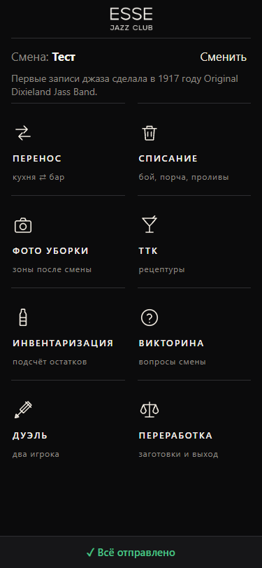
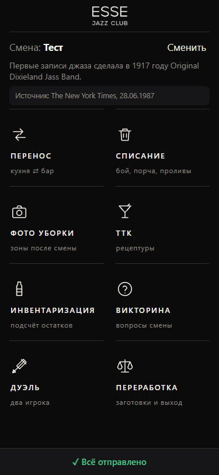
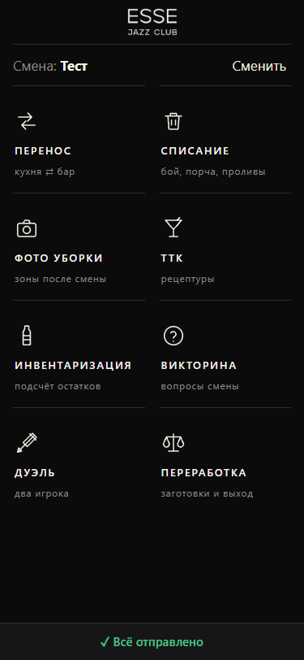
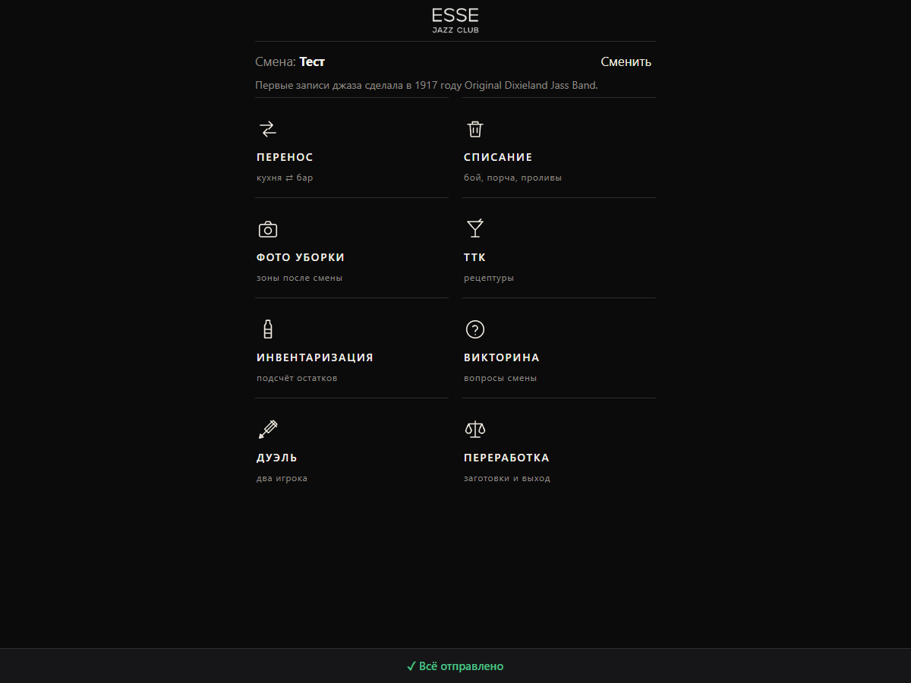

# «Факт дня» — отчёт

Дата: 21.11.2026. Ветка: `dsh-threads/11-7aaf93` (от `main` `7663be5`).
Коммиты: `d020e56` — бэкенд, `274b59d` — главный экран, отдельный коммит — этот отчёт.

## Что сделано

Одна короткая строка факта на главном экране приложения «ESSE — журнал бара».
Факт приходит вместе с `config`, который и так загружается при открытии:
отдельного запроса, ожидания и спиннера нет. Если факта нет — строки нет
вообще, без заглушек и ошибок. Выбор факта — только на сервере, один на всех
в течение дня.

## Лист «Факты»

Создаётся автоматически при первом чтении `config` (`ensureFactsSheet_`)
и один раз заполняется 40 фактами. Повторное чтение ничего не дублирует.

| Колонка | Что внутри |
|---|---|
| `id` | `f001`…`f040`, сортировка по нему |
| `текст` | короткая фраза, все ≤ 180 символов (средняя 70, максимум 104) |
| `источник` | книга, сайт или документ |
| `активен` | галочка-чекбокс; все 40 включены |
| `дата_показа` | `yyyy-MM-dd` по UTC+3; бэкенд пишет, когда факт реально выдан |

**Сколько фактов и откуда.** 40: 25 общих (история баров, коктейлей, ресторанов
и джаза) и 15 про ESSE. 15 «клубных» — из чек-листов бармена Эссе и коктейльной
карты «Лето 25» (документы папки «Методички, Обучение, бар эссе», те же источники,
что у банка вопросов викторины): подача газа к пиву на 2 этаже, морс, малиновая
и имбирная заготовки, «Красный дракон», грейпфрутовая пена, заготовка для
«Кровавой мэри», кордиал «Грейпфрут–клюква–тимьян», облепиха с грушей, чистка
бойлера и 5 коктейлей-посвящений альбомам.

25 общих — только проверяемые даты и первопечатные упоминания: 1798 и 1806
(слово и определение cocktail), Джерри Томас 1862, Angostura 1824, Carpano 1786,
Sazerac как официальный коктейль Нового Орлеана с 2008, «Дайкири» 1898,
Harry’s New York Bar 1911, абсент 1915/2011, первые записи джаза 1917, сухой
закон 1920–1933, «Кровавая мэри» 1921, Cotton Club 1923, «Мимоза» около 1925,
тики-бары 1934, Village Vanguard 1935, Blue Note 1939, «Московский мул» 1941,
«Беллини» 1948, Ньюпорт 1954, Монтрё 1967, «Мишлен» 1900 и звёзды 1926,
ледяная торговля 1806, происхождение слова restaurant.

Где версия происхождения не единственная, текст прямо это оговаривает:
«связывают», «по распространённой версии» (Дайкири, Кровавая мэри, Мимоза,
Московский мул). Выдуманных фактов нет.

**Сколько отброшено.** Из чернового списка 52 отброшено 12: 8 общих (спорные
даты рождения коктейлей, «первый бар в истории» и перекос в чистую историю)
и 4 бытовых пункта чек-листа (салфетки, бутылки, ковры, температура бойлера) —
они верные, но слишком мелкие для «факта дня». Лучше 40 аккуратных, чем 52
с сомнительными.

## Как выбирается факт дня

1. Берутся только строки с непустыми `id`/`текст` и включённым `активен`
   (понимает и галочку, и текст `да`/`true`/`1`).
2. Список сортируется по `id` — порядок строк в листе не важен.
3. Номер дня: `floor((now + 3 часа) / 24 часа)` — сутки по UTC+3 (Москва).
4. Индекс: `номер дня % число активных фактов`.
5. Выбранному факту в `дата_показа` пишется дата по Москве, но только если там
   ещё не сегодня. Один факт на всех в течение дня; на следующий день — следующий.
6. Если активных фактов нет — `factOfDay: null`, `дата_показа` не меняется.

Кэша выбора нет: при одном и том же списке результат детерминирован, а лишний
`CacheService` только помешал бы тесту «все выключены → null». Отдельного
запроса на старте тоже нет — поле едет внутри `config`.

## Что видно на экране

* Место — под строкой «Смена: …», над плитками; первым элементом после шапки.
* Кегль 14 px, цвет `var(--muted)`, без фона, рамки, иконки и анимации.
* Максимум две строки, дальше многоточие (`-webkit-line-clamp: 2`).
* Если есть `источник`, нажатие на строку раскрывает маленькую панель:
  полный текст (снимается двухстрочное ограничение) и «Источник: …».
  Это `
`, не модалка поверх экрана.
* Если `factOfDay = null` — элемента нет; плитки начинаются сразу после смены.
* Офлайн: `loadConfig` сначала читает `kv:config` из IndexedDB, потом пытается
  сеть. Отдельного кэша факта нет; при отказе сети остаётся последний `config`
  с фактом. `cache: 'no-store'` в `api.js` относится только к сетевому запросу
  и это поведение не меняет.

## Проверки

| Проверка | Результат |
|---|---|
| `?action=ping` | 200, `ok:true`, время |
| `?action=config` | 200, `ok:true`, `factOfDay` непустой: `f019`, текст и источник |
| Второй `config` в тот же день | тот же `f019` |
| `дата_показа` | у `f019` = `2026-11-21`, у остальных 39 пусто (проверено служебным действием, удалено до финального деплоя) |
| Другой день | предпросмотр дня 0 → `f001`, дня 1 → `f002`; локальный тест 40 дней подряд даёт 40 разных фактов |
| Все галочки сняты | `factOfDay: null`; затем галочки возвращены, снова `f019` |
| Пустой список | локальный тест `pickFactForDay_([], day) === null`; в листе пусто не оставляли, чтобы не разрушать 40 фактов |
| Приложение при `null` | строки нет, плитки на месте (верх плиток 104,8 px против 146,6 px с фактом), ошибок нет |
| Офлайн-путь | API отвечает 500, приложение берёт факт из кэшированного `config`; в консоли только `Справочник не обновлён`, тоста и падения нет |
| 375 px, обычная тема | аккуратно, две строки, без обрезки посреди слова |
| 375 px, длинный факт | ровно две строки с многоточием (`scrollHeight` 57 px против `clientHeight` 38 px) |
| 375 px, зимняя тема | бордо/золото, строка читается |
| 375 px, `factOfDay: null` | строки и зазора нет |
| Десктоп | строка в колонке 560 px, плитки не изменились |
| Викторина | экран открывается; реальный `?action=questions` — 60 вопросов |
| Дуэль | экран открывается, рейтинг 1000, матчей нет; ошибок нет |
| Этикетка | экран «Этикетка пустой заготовки» открывается, превью 240×160 рисуется |
| `sw.js` | `VERSION` поднят с `v22` до `v23` |

Скриншоты сняты с локальной копии приложения на 375 px (iframe 375×812)
и на десктопе; в локальном стенде в `config` подставлен тот же `factOfDay`,
что отдаёт боевой `config` (чтобы не тянуть 63 фото ТТК на каждом прогоне).

## Скриншоты

## Развёртывание

* Обновлено существующее развёртывание `AKfycbz…N7-w` (адрес `/exec`
  не менялся), **версия 24** от 21.11.2026.
* `?action=ping` и `?action=config` проверены уже после финального деплоя.
* Служебные действия диагностики (`factTest`/`factFix`), которыми выключались
  галочки, проверялся другой день и сбрасывались даты, удалены из кода до
  финального деплоя; сейчас `?action=factTest` и `?action=factFix` отвечают
  «Неизвестное действие».
* Лист «Факты» создан в боевой таблице и заполнен 40 фактами; все 40 активны,
  `f019` отмечен показанным 21.11.2026.

## Что не проверено

* Реальный телефон (только iframe 375×812) и реальный мобильный браузер.
* Настоящий перевод системных часов: другой день проверен предпросмотром
  функции и локальным тестом, без изменения даты машины.
* Настоящий авиарежим: офлайн проверен отказом API при живых статичных файлах.
* Печать этикетки на B21 / Label Expert — менялся только главный экран,
  но живой принтер не задействован.
* Одновременный вход двух барменов с двух устройств: стабильность проверена
  двумя последовательными запросами `config`; детерминированность выбора
  гарантируется сортировкой и номером дня.
* Буквально пустой лист «Факты» (удалять 40 строк не стали): путь
  `facts.length === 0` проверен локально и через «все галочки сняты».

## Как добавить внешний источник позже (в v1 не делали)

Внешний RSS/API в v1 сознательно не подключён: CORS, квоты, случайный мусор
и чужой тон. Если понадобится позже — только через бэкенд и с одобрением
владельца:

1. Отдельный лист **«Предложения фактов»**: `дата | текст | источник | ссылка |
   статус` (`новое` / `одобрено` / `отклонено`).
2. Раз в сутки триггер (`ScriptApp.newTrigger`) вызывает функцию импорта:
   `UrlFetchApp.fetch` по заранее одобренному короткому списку источников
   (2–3 RSS/API, не «весь интернет»), разбор, очистка HTML, обрезка до 180
   символов, проверка на дубликат по нормализованному тексту.
3. Импорт пишет только в «Предложения фактов» со статусом `новое`. В «Факты»
   строка попадает только после того, как владелец поставил `одобрено`
   и галочку `активен`. Никакой автоматической выдачи в приложение.
4. Ограничения: не копировать абзацы целиком (пересказ + ссылка), не брать
   картинки, отсекать политику/медицину/рекламу, следить за квотой
   `UrlFetchApp` и не чаще одного запуска в сутки. Браузер внешний источник
   не читает — только сервер.
