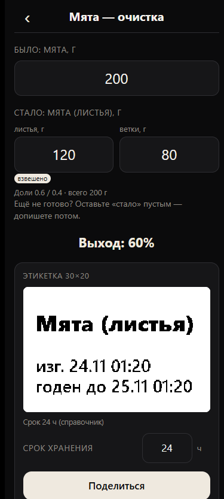
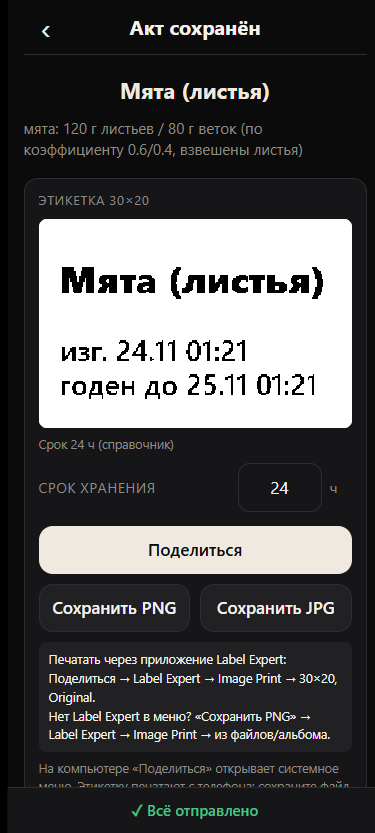

# Флаги разделов и мята (листья/ветки) — отчёт

**Дата:** 24.11.2026. **Ветка:** `dsh-threads/17-b33b2c` (от `main` `45cc815`).
В `main` не пушилось. **Бэкенд НЕ развёрнут** — почему, см. §«Деплой».

| Коммит | Что |
|---|---|
| `4e267f7` | `feat(флаги)` — лист «Настройки», `config.features`, плитки и защита входа |
| `926eb40` | `feat(мята)` — лист «Пары позиций», колонки Q–V, два поля в акте, пересчёт |
| следующий | `docs` — этот отчёт, схемы, скриншоты, `tools/demo-server.mjs` |

---

## Коротко

1. **Разделы включаются и выключаются из таблицы.** Лист **«Настройки»**: `ключ | значение | комментарий`,
   девять ключей вида `раздел_викторина`. Значение `выкл` — плитки нет, прямой вход возвращает на главную
   с сообщением «Раздел временно недоступен». Нет листа, нет ключа или пусто — раздел **включён**.
   Синк и очередь не трогаются: записи продолжают уходить.
2. **Мята учитывается и листьями, и ветками.** Лист **«Пары позиций»** с строкой
   `Мята (листья) | Мята (ветки) | 0.6 | 0.4`. В акте у такой позиции два поля; ввод в любое пересчитывает
   второе целыми граммами и помечает, что взвешено. В «Актах переработки» появились колонки **Q–V**
   с обоими значениями; итог акта пишет: `мята: 120 г листьев / 80 г веток (по коэффициенту 0.6/0.4, взвешены листья)`.
   Расчёт выхода не изменился: в него идёт только своя позиция (листья), ветки — справочная доля (отход).

---

## A. Флаги разделов

### Схема листа «Настройки»

Лист создаётся сам при первом чтении справочника (`ensureSettingsSheet_`), заполняется девятью строками:

| ключ | значение | комментарий |
|---|---|---|
| `раздел_викторина` | `вкл` | Викторина — вопросы смены |
| `раздел_дуэль` | `вкл` | Дуэль — игра на двоих |
| `раздел_чеклисты` | `вкл` | Чек-листы — смены и заготовки |
| `раздел_акты` | `вкл` | Переработка — акты и этикетки |
| `раздел_фото` | `вкл` | Фото уборки — зоны после смены |
| `раздел_инвентаризация` | `вкл` | Инвентаризация — подсчёт остатков |
| `раздел_ттк` | `вкл` | ТТК — рецептуры |
| `раздел_перенос` | `вкл` | Перенос — кухня ⇄ бар |
| `раздел_списание` | `вкл` | Списание — бой, порча, проливы |

Правила чтения:

* `вкл` / `выкл`, регистр не важен; понимаются `выкл.`, `ВЫКЛ`, `off`, `нет`, `0` и `вкл`, `on`, `да`, `1`.
* **Пусто = `вкл`**. **Нет листа = все включены**. **Нет ключа = этот раздел включён**.
* Непонятное значение (например, `может быть`) тоже считается включённым — чтобы опечатка не оставила
  бар без раздела — и пишется предупреждение в «Лог».
* В колонке «значение» стоит выпадающий список `вкл/выкл`, но вписать своё можно.
* Существующий лист не перезаписывается: значения владельца остаются.

Бэкенд отдаёт в `GET ?action=config` поле:

```json
"features": { "quiz": true, "duel": false, "checklists": true, "acts": true,
              "photo": true, "inventory": true, "ttk": true,
              "transfer": true, "writeoff": true }
```

### Как включить раздел обратно (одна фраза для инструкции)

**Откройте лист «Настройки», поставьте у нужного раздела «вкл» (или просто очистите ячейку) и закройте-откройте приложение.**

### Что делает приложение

* **Главная:** выключенная плитка не рисуется вообще — ни пустой плитки, ни серой кнопки.
  Для админа так же прячутся его плитки (`Gift-shop` относится к `раздел_инвентаризация`).
  Если выключено всё, вместо сетки — подсказка «Все разделы выключены… лист «Настройки»».
* **Прямой вход:** любой экран раздела проверяется в `render()` (`screenFeature` → `sectionOn`).
  История, `?duel=КОД`, deep-link — всё возвращает на главную с сообщением **«Раздел временно недоступен»**.
  Адрес `?duel=…` при этом очищается, как и раньше.
* **Обновление на лету:** при старте приложение берёт кэш, затем свежий config. Если флаги изменились,
  главная перерисовывается, а из выключенного раздела приложение уводит на главную. Включённый экран
  не перерисовывается, чтобы не стереть введённое.
* **Синк не тронут.** `js/sync.js` не знает про флаги: записи, уже лежащие в очереди (результат викторины,
  отметки чек-листа, акт), уходят на сервер как раньше. Сервер записи по флагам тоже не отклоняет.
  `flushQuizDisputes()` и автосинк работают всегда.
* **Служебные экраны** (вход, очередь/отправка) доступны всегда.

Код: `js/app.js` (`FEATURE_DEFAULT`, `featuresMap`, `sectionOn`, `screenFeature`, `guardSection`,
плитки `screenHome`, `openDuel`, `handleDuelEntry`), `apps-script/Код.gs` (`FEATURE_KEYS`, `featureOn_`,
`ensureSettingsSheet_`, `settingsValues_`, `features_`, `getConfig_`).

---

## Б. Мята: листья и ветки

### Схема листа «Пары позиций»

Лист создаётся сам при первом чтении справочника (`ensurePairsSheet_`) и заполняется одной строкой:

| позиция_A | позиция_B | доля_A | доля_B | активен | комментарий |
|---|---|---|---|---|---|
| `Мята (листья)` | `Мята (ветки)` | `0.6` | `0.4` | ☑ | стартовое значение 0.6 / 0.4 — поправьте по факту взвешивания |

* Доли — **от общей массы**: `A + B = 1.0`. `0.6 / 0.4` — стартовое значение, владелец меняет его
  по факту взвешивания (например, 0.55 / 0.45).
* **Сумма не 1.0** — сервер не падает: нормализует (`0.6/0.6 → 0.5/0.5`) и пишет предупреждение в «Лог».
  Приложение получает уже нормализованные доли.
* Строка с пустыми позициями, одинаковыми позициями, долей ≤ 0 или снятой галочкой «активен»
  пропускается (с записью в «Лог», кроме снятой галочки — это штатное выключение).
* Одна позиция — одна пара: если для позиции несколько активных строк, работает первая.
* Названия сравниваются без учёта регистра, «ё» и лишних пробелов; в акте позиция должна называться
  так же, как в шаблоне.

### Как это выглядит в акте

Для акта «Мята — очистка» (выход `Мята (листья)`) вместо одного поля «стало» — два:



* Поля подписаны **«листья, г»** и **«ветки, г»** (подпись берётся из скобок названия позиции).
* Ввод в любое поле **сразу** пересчитывает второе: `ветки = round(листья × 0.4 / 0.6)`.
  Пересчёт целыми граммами, с округлением.
* Поле, куда ввели вручную, помечается бейджем **«взвешено»**; второе — расчётное. Так нет спора,
  какое поле «главное».
* Под полями: `Доли 0.6 / 0.4 · всего 200 г`.
* Выход в % считается по-прежнему от **своей** позиции: 120 г листьев / 200 г мяты = **60 %**.
  Ветки в выход не входят.
* Если пара выключена (снят «активен» в листе) или её нет — форма выглядит как раньше, одно поле.
  Это проверено скриншотом `06-act-pair-off.png`.

Итог акта:



Текст: `мята: 120 г листьев / 80 г веток (по коэффициенту 0.6/0.4, взвешены листья)`.
Он же показывается после закрытия акта, если выход вписывали позже.

### Что пишется в «Акты переработки»

Колонки **A–P не менялись**. Справа, после `P «ID закрытия»`, добавлены **Q–V**
(создаются при первом акте с парой или вручную `setupPairs()`):

| Q | R | S | T | U | V |
|---|---|---|---|---|---|
| `пара_позиция` | `пара_кол-во` | `доля_A` | `доля_B` | `взвешено` | `всего, г` |
| `Мята (ветки)` | `80` | `0.6` | `0.4` | `Мята (листья)` | `200` |

* В `F «Кол-во»` — количество **своей** позиции (листья, 120).
* В `R` — вторая доля (ветки, 80). `U` — что именно взвесил бармен. `V` — общая масса.
* Если бармен взвесил ветки (80), сервер сам пересчитывает листья (120) и всё равно пишет оба значения;
  клиентскому «своему» числу сервер не верит.
* Колонки ищутся по названиям в шапке: порядок можно менять, код не сломается.
* Запись в акт идёт строкой на каждую позицию шаблона, как раньше; у строк без пары Q–V пустые.

### Как считается выход акта (важно)

Пара **не меняет** прежние формулы:

* В сумму «Сырья» и «Результата» идёт только количество **своей** позиции строки.
  Для мяты результат — **листья** (120 г). Ветки (80 г) — справочная доля, это отход, а не результат.
* `Выход, %` для простого акта = `результат / ключевое сырьё`. Было 200 г мяты → стало 120 г листьев = 60 %.
  Если бы в результат добавляли ветки, получилось бы 100 %, что неверно для себестоимости.
* Если пара стоит на **сырье**, в расход идёт своя доля строки; вторая доля остаётся справочной
  в Q–V. Это то же правило: пара — учёт двух частей одной массы, а не второй ингредиент.
* «Свод переработки» (формулы в таблице) читает A–P как раньше; новые Q–V стоят справа.
  После первого акта с парой стоит один раз проверить, что сводка не захватывает Q–V (см. §«Риски»).
* При закрытии акта, где выход вписывали позже, экран тоже показывает два поля, если результат — пара;
  в строку результата дописываются Q–V и пересчитанный выход.

### Как добавить новую пару (без программиста)

1. В листе **«Пары позиций»** добавьте строку: `позиция_A`, `позиция_B` — названия позиций
   **точно как в «Шаблонах переработки»** (допускаются отличия в регистре и «ё»),
   `доля_A` + `доля_B` = 1.0 (если не 1.0 — сервер нормализует и запишет предупреждение в «Лог»).
2. Поставьте галочку **«активен»** (пустая ячейка тоже считается включённой).
3. Напишите комментарий, что это за пара, и перезапустите приложение (обновится config).

Кода это не требует: механизм общий. Проверено локальным тестом на второй паре
`Апельсин (цедра)` / `Апельсин (мякоть)` `0.3 / 0.7`: она появилась в `config.pairs`, пересчитывалась,
затем была выключена снятием «активен». В боевой таблице тестовая пара не создавалась (бэкенд не выложен).

---

## Проверка

### Автотесты (локально, без Google)

```bash
node tools/test-features-pairs.mjs   # 19 из 19
node tools/test-photo-check.mjs      # 31 из 31 (регрессия проверки фото)
```

`tools/test-features-pairs.mjs` подменяет Apps Script таблицей-заглушкой и проверяет:

* нет листа «Настройки» → 9 ключей, все `true`; `выкл`/`нет`/`off`/`0`/`False` выключают; пусто,
  `вкл`, `да` и **отсутствующий ключ** включают; непонятное значение включается и пишет в «Лог»;
* `config.features` — объект с 9 булевыми полями; `config.pairs` — массив;
* лист «Пары позиций» создаётся с мятой `0.6/0.4`; сумма `1.2` → `0.5/0.5` + предупреждение;
  снятая галочка исключает пару; вторая пара добавляется строкой и выключается; пустые/одинаковые
  позиции и доли ≤ 0 пропускаются;
* акт с парой: `F=120`, `Q=Мята (ветки)`, `R=80`, `S=0.6`, `T=0.4`, `U=Мята (листья)`, `V=200`;
  выход `60 %`; источник «ветки» → сервер сам пересчитывает листья; неверное «своё» число исправляется;
  выключенная пара → колонки Q–V пустые, акт как раньше;
* закрытие акта с парой дописывает Q–V; акт без пары считается как раньше (лимон 1000→300 = 30 %);
  позиция не из шаблона по-прежнему отклоняется; выключенный `раздел_акты` не мешает записи акта.

### Проверка в браузере (мок-сервер, без боевой таблицы)

`tools/demo-server.mjs` отдаёт приложение и мок `/exec`; флаги и пары переключаются запросом
`/__state`. Скриншоты 375 px:

| Файл | Что показывает |
|---|---|
| `00-home-all-on.png` | главная со всеми разделами, факт дня на месте |
| `01-home-sections-off.png` | викторина и дуэль выключены — плиток нет |
| `02-deeplink-duel-off.png` | `?duel=WXYZ` при выключенной дуэли: главная + «Раздел временно недоступен» |
| `03-home-sections-on.png` | включили обратно — плитки вернулись |
| `04-act-mint-two-fields.png` | акт «Мята — очистка»: листья 120 / ветки 80, «взвешено», всего 200, выход 60 % |
| `05-act-done-summary.png` | итог акта: «мята: 120 г листьев / 80 г веток (…)» |
| `06-act-pair-off.png` | пара выключена — снова одно поле |
| `07-home-checklists-off.png` | чек-листы выключены, очередь пуста/отправлена |

Дополнительно проверено в браузере:

* **наоборот:** ввод `ветки 80` → `листья 120`, бейдж «взвешено» переехал на ветки;
* **очередь при выключенных чек-листах:** в IndexedDB положена запись `type:'checklist'`,
  после `online` ушёл `POST checklistSave`, запись переместилась из `queue` в `sent`,
  статус «✓ Всё отправлено» — флаг не мешает синку;
* остальные разделы открываются: фото уборки (зоны), ТТК (Хуго), инвентаризация (Ноябрь),
  чек-листы (2 списка), этикетка строится из акта, факт дня виден.

### Что НЕ проверено

* **Боевая Google-таблица:** бэкенд не развёрнут, листы «Настройки»/«Пары позиций» и колонки Q–V
  в ней не создавались. Проверка была на моке и на таблице-заглушке.
* Реальный телефон/офлайн: правки только в UI и чтении config; синк не менялся.
* «Свод переработки» с новыми колонками: формул не видели, нужен один взгляд после деплоя.

---

## Деплой

**Не выложено.** Причины:

1. В этом рабочем каталоге нет авторизации clasp (`~/.clasprc.json` / `.clasp.json`), а вход в Google
   требует интерактивного браузера.
2. Боевое развёртывание **уже содержит чужие изменения**, которых нет в `main`: `config` отдаёт
   `photoZones`, `photoRefs`, `photoRefLimit` (параллельная ветка фото-зон). Выкладка из этой ветки
   заменила бы файлы проекта и откатила бы их. Сначала нужно смержить ветки и выкладывать общий `main`.

После мержа порядок обычный (адрес `/exec` не меняется):

```bash
cd apps-script
npx @google/clasp push --force
npx @google/clasp deploy -i AKfycbzRXm4P2dC_xEmSrw4RjAXWk6J-Hav54iHrXK8xddGH9o5NcsdchIKkaZArwGqvAJN7-w -d "флаги разделов и мята"
```

Затем:

1. Открыть `GET <URL>/exec?action=config` — должны появиться `features` (9 полей) и `pairs`
   (строка мяты `0.6/0.4`). Листы **«Настройки»** и **«Пары позиций»** создадутся сами при этом чтении.
   Если что-то не создалось — выполнить в редакторе `setupSettings()` и `setupPairs()`.
2. Проверить на телефоне: выключить `раздел_викторина` и `раздел_дуэль` → плиток нет;
   открыть `?duel=ТЕСТ` → главная + сообщение; вернуть `вкл` → плитки вернулись.
3. Открыть «Мята — очистка» → два поля; ввести листья → ветки; сохранить → в «Актах переработки»
   появились Q–V; на экране итога — строка про коэффициент.
4. Проверить «Свод переработки»: новые Q–V не должны попасть в суммы (они справа от P).

---

## Риски и ограничения

* **«Свод переработки»** — формулы в таблице, код их не читает. Колонки Q–V добавлены справа от P,
  существующие A–P не тронуты, но если сводка использует диапазон «до конца листа», она может увидеть
  новые колонки. После деплоя — один взгляд на сводку.
* **Флаги обновляются не мгновенно:** приложение читает config при старте/открытии и не опрашивает его
  каждую секунду. После правки таблицы нужно закрыть-открыть приложение (главная перерисуется, если
  config обновился в фоне).
* **Кэш service worker:** `VERSION` поднят до `v27`; телефоны получат новую версию при следующем
  открытии (иногда нужно открыть дважды).
* **Доли — стартовые.** `0.6/0.4` для мяты нужно проверить взвешиванием; владелец правит лист.
* **Пары и «чистка»:** если позиция одновременно чистится (вес до/после) и входит в пару, пара
  пересчитывается от чистого веса; такой комбинации в текущих шаблонах нет, поведение описано в коде.
* **Одна позиция — одна пара.** Вторую строку для той же позиции сервер пропустит с записью в «Лог».

---

## Изменённые файлы

* `apps-script/Код.gs` — листы «Настройки»/«Пары позиций», `config.features`, `config.pairs`,
  колонки Q–V, запись/закрытие акта, `setupSettings()`, `setupPairs()`.
* `js/app.js` — флаги и защита разделов, два поля пары, пересчёт, строка итога.
* `styles.css` — стили блока пары.
* `sw.js` — `VERSION` `v25` → `v27`.
* `tools/test-features-pairs.mjs` — 19 локальных тестов.
* `tools/demo-server.mjs` — мок-сервер для скриншотов (не часть приложения).
* `docs/flags-pairs/` — отчёт и скриншоты.
* `apps-script/README.md` — разделы про «Настройки» и «Пары позиций» (в docs-коммите).
