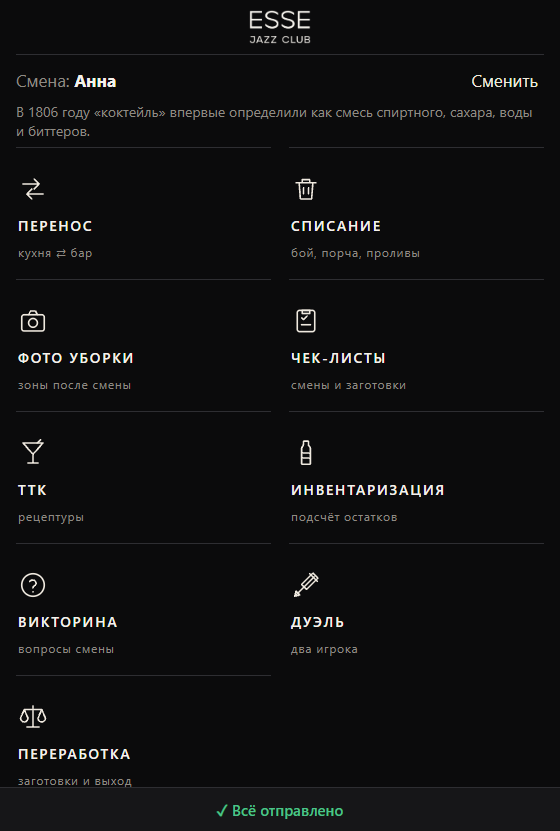
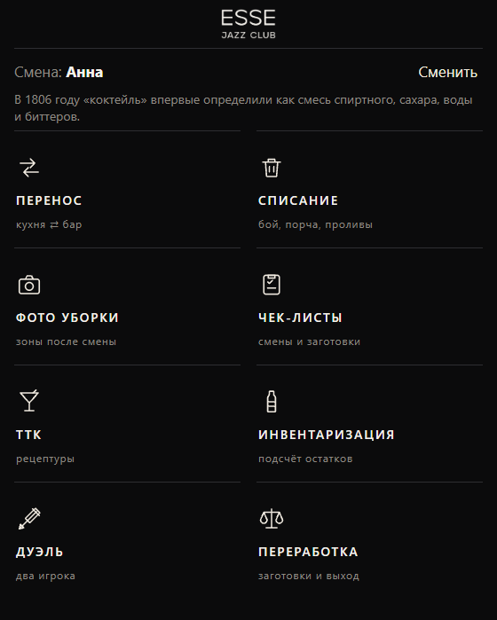
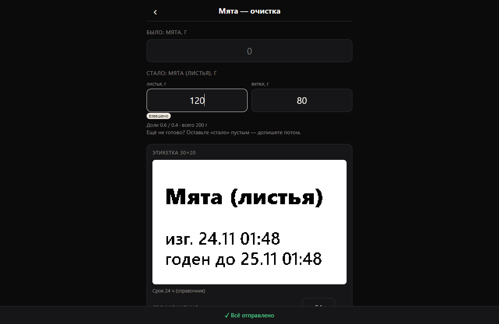
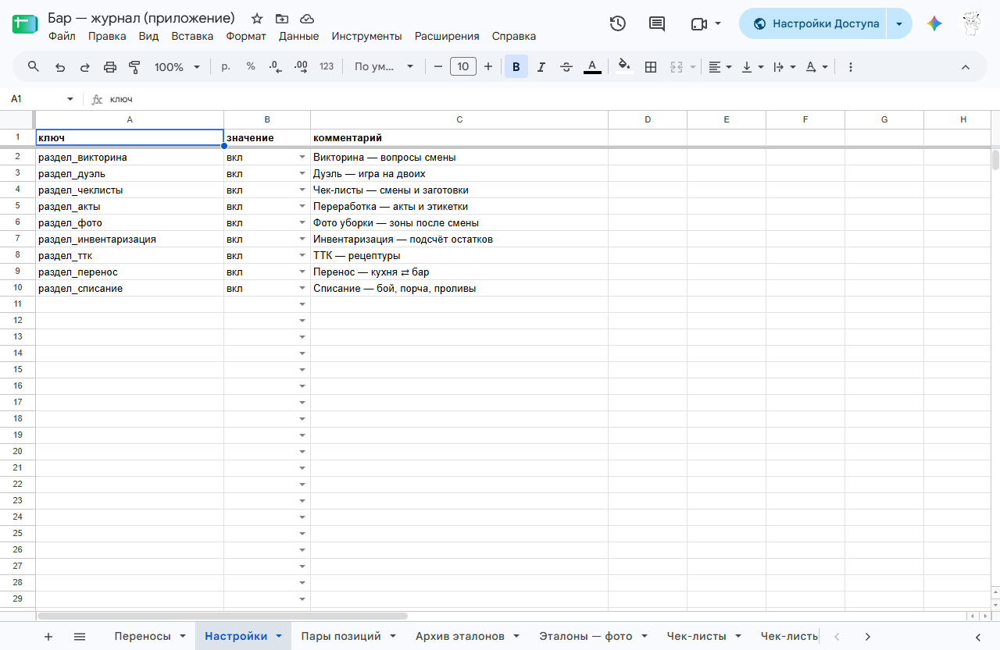

# Интеграция 16 + 17: отчёт

> **Обновление 25.11.2026:** мята переведена с долей 0.6/0.4 на вычитание
> из общего веса. См. [`../mint-subtract/ОТЧЁТ.md`](../mint-subtract/ОТЧЁТ.md).
> Прежние значения долей в листе и актах сохранены и помечены «не используется».

**Дата:** 24.11.2026. **Ветка:** `integration-16-17` (от `dsh-threads/16-06fda8`,
влита `dsh-threads/17-b33b2c`). В `main` не пушилось, ничего не пересоздавалось.

| Коммит | Что |
|---|---|
| `ba694c3` | merge 16 + 17: конфликты `Код.gs`/`README.md` разрешены по смыслу, `sw.js` → v28, интеграционные тесты |
| `79b10dd` … | ветка 16: 6 зон, этажи, до трёх эталонов |
| `c6d1bc5` … | ветка 17: флаги разделов, пары позиций (мята) |

**Деплой:** `clasp push` + `clasp deploy -i AKfycbzRXm4P2dC_xEmSrw4RjAXWk6J-Hav54iHrXK8xddGH9o5NcsdchIKkaZArwGqvAJN7-w`.
Развёртывание то же, теперь **@38**; URL не менялся. Живой бэкенд до слияния был
не 27, а **@37** (16 уже была выложена отдельно) — поэтому новая версия 38.

---

## Как разрешены конфликты

### `apps-script/Код.gs`

Конфликт был ровно один — `getConfig_()`, где обе ветки дописывали свои поля
в одно и то же место. Разрешено **объединением**, а не выбором стороны:

* блок 16 (`photoMigrate_`, `photoZones_`, `photoRefSummaries_` → `photoZones`,
  `photoRefs`, `photoRefLimit`) и блок 17 (`features_`, `pairs_` → `features`,
  `pairs`) стоят рядом, каждый в своём `try/catch`: падение одного набора не
  уносит второй;
* в возвращаемом объекте `config` теперь одновременно `photoZones`, `photoRefs`,
  `photoRefLimit`, `features`, `pairs`.

Остальное git слил сам — и это проверено, а не принято на веру:

* **дублей функций нет**: 162 объявления `function`, все имена уникальны;
* все функции `main`, 16 и 17 присутствуют (0 потерянных), новых безымянных нет;
* изменённые функции двух веток пересекались **только в `getConfig_`**
  (16 меняла фото-блок, 17 — `saveProcessing_`/`closeProcessing_`/`inventoryItems_`
  и добавляла настройки/пары); `savePhoto_` и акты разнесены по разным листам;
* `SHEETS` содержит и `refPhotos` (16), и `settings`/`pairs` (17);
* `doGet`/`doPost` не менялись ни одной веткой, поэтому все действия на месте;
  `features_` вызывается **только** из `getConfig_` — записи из очереди флаги
  не читают (это закреплено тестом).

### `apps-script/README.md`

Обе ветки правили одну строку таблицы «Файл | Проект | Строк». Оставлена одна
строка: развёртывание 38, перечислены оба набора (6 зон с этажами и эталонами +
флаги разделов и пары), число строк `Код.gs` — 4258. В шапку добавлен абзац про
слияние, в конце остались оба раздела — «Флаги разделов» (из 17) и «Пары позиций»
(из 17), фото-разделы 16 не тронуты.

### `js/app.js`, `styles.css`

Слились автоматически. Проверено глазами по диффам: в итоговом файле есть обе
группы — экран фото с этажами (`photoZoneGroups`, `floorLabel`, `screenPhoto` с
`floorBox`/`zoneStep`), флаги (`FEATURE_DEFAULT`, `featuresMap`, `sectionOn`,
`screenFeature`, `guardSection`, плитки главной) и мята (`pairFor`, `pairPart`,
`makePairBlock`, два поля в `screenAct`/`screenCloseAct`). CSS: блок
`.photo-floors`/`.floor-btn` (16) и блок `.pair-*` (17) — оба на месте.

### `sw.js`

Обе ветки независимо подняли `v25` → `v27`. Если оставить `v27`, телефоны с
закэшированным `js/app.js` из 16 не получили бы мятy и флаги. Поднято до **v28**.

---

## Схемы листов (после деплоя, живая таблица)

| Лист | Состояние |
|---|---|
| «Эталоны уборки» | 6 строк, схема `этаж | зона | критерии | эталонное_фото`; этажи 2/2/2/1/1/1, зоны Окно, Дверь, Склад, Бар, Холодильники, За баром |
| «Архив эталонов» | 11 старых строк с пометкой `до 24.11.2026` — на месте |
| «Настройки» | создан, 9 ключей от `раздел_викторина` до `раздел_списание`, все `вкл` |
| «Пары позиций» | создан: `Мята (листья) / Мята (ветки) / 0.6 / 0.4 / TRUE` |
| «Фото уборки» | A–S: прежние A–L + вердикт, уверенность, замечания, модель, проверено_в, эталон (M–R) + этаж (S) |
| «Акты переработки» | A–P не тронуты; при первом акте с парой добавлены Q–V (`пара_позиция`, `пара_кол-во`, `доля_A`, `доля_B`, `взвешено`, `всего, г`) |

Ничего из одного набора не затёрло другое: в конфиге одновременно 9 флагов,
6 зон с этажами и пара мяты.

---

## Тесты

```
node tools/test-photo-check.mjs      → 46 из 46
node tools/test-features-pairs.mjs   → 19 из 19
node tools/test-integration-16-17.mjs → 5 из 5   (новый)
```

`tools/test-integration-16-17.mjs` — проверки именно пересечений: `config` с
тремя наборами сразу; выключенные «фото»/«акты» не отнимают зоны и пары;
запись акта с мятой и закрытие акта при выключенном «акты» с проверкой-шпионом,
что обработчики записи флаги не читают; `js/sync.js` о флагах не знает.

---

## Пересечения — что проверено

1. **`config` = features + зоны с этажами + пара мяты.** Боевой ответ: 9 булевых
   `features` (все true), `photoZones` — 6 зон с этажами 2/2/2/1/1/1,
   `pairs` — мята 0.6/0.4, `zones` — прежний массив из 6 строк, `photoRefLimit` 3.
2. **Выключенный флаг не ломает обработку уже загруженных фото.** Сервер флаги
   читает только в `getConfig_`; `savePhoto_`/`submit_` их не спрашивают,
   `js/sync.js` (очередь) не содержит `sectionOn`/`features`. Плюс тест со
   шпионом: запись проходит, `features_` не вызван. Вживую флаг не щёлкал,
   чтобы не менять поведение приложения на смене; это проверено кодом и тестами.
3. **Акт с мятой при выключенном «акты».** Тест: раздел выключен, сервер всё равно
   пишет акт целиком, Q–V на месте, выход 120/200 = 60 %. В приложении экран
   закрыт `guardSection` — прямой вход возвращает на главную.
4. **«Свод переработки».** Проверены формулы из xlsx: суммы идут только по
   `'Акты переработки'!F:F` (SUMIFS по E/G/D/A) и FILTER по `E2:G1000`;
   Q–V не упоминаются ни в одной из 101 формулы. Новые колонки в суммы не попали.

---

## Боевая проверка (после деплоя @38)

| Что | Результат |
|---|---|
| `?action=ping` | `{"ok":true}` |
| `config` | features 9/9, 6 зон с этажами, мята 0.6/0.4 |
| `?action=questions` | 60 вопросов |
| `duelCreate` | комната создана (код 6 символов) |
| Фото, зона «Бар» без эталона (эталонов в листе 0) | `saved`, вердикт **crit** (уверенность 1, `gemini-flash-lite-latest`, `эталон: нет`, `этаж 1`) — не «не проверено» |
| Акт с мятой | `saved`: листья 120, ветки 80, доли 0.6/0.4, `взвешено: Мята (листья)`, всего 200, выход 60 %, Q–V заполнены |

Тестовые записи: фото `int1617-photo-1795473891133`, акт `int1617-mint-1795473904168`
(не удалял — как просили; комментарии помечены «проверка интеграции 16+17»).

---

## Скриншоты

Сняты на мок-сервере `tools/demo-server.mjs` (в него добавлены 6 зон и этажи —
без этого экран фото показывал бы один этаж). Не часть приложения.










---

## Что осталось владельцу

* **Доли мяты.** `0.6 / 0.4` — стартовое значение; поправить в «Парах позиций»
  по факту взвешивания (сумма должна быть 1.0, сервер нормализует).
* **Эталонные фото.** Сейчас в «Эталоны — фото» **0 эталонов**: проверка идёт
  только по критериям. Чтобы ИИ сравнивал с образцом, добавить до 3 ссылок на
  зону (лист «Эталоны — фото», колонки `зона | порядок | ссылка_на_фото | ракурс`).
* **Флаги.** Включать/выключать разделы — лист «Настройки», значение `выкл`.
  Изменения подхватываются при следующем чтении справочника.
* **Фронтенд.** Ветка не пушилась: `js/app.js`, `styles.css`, `sw.js` (v28) и
  скриншоты появятся на GitHub Pages после публикации ветки. Бэкенд уже живой.
* **«Свод переработки»** — формулы проверены по экспорту; если владелец добавит
  свои, стоит один раз глянуть глазами.
* ⚠️ **Таблица опубликована «всем, у кого есть ссылка»**: через публичный gviz
  читаются все листы, включая **PIN сотрудников**. Это не менялось этим
  слиянием, но это риск: PIN лучше убрать из публичного доступа или закрыть
  таблицу.
