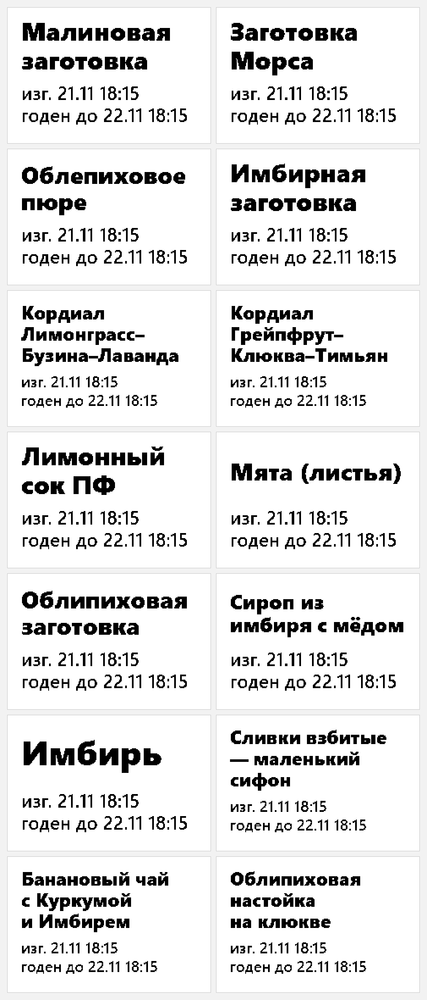
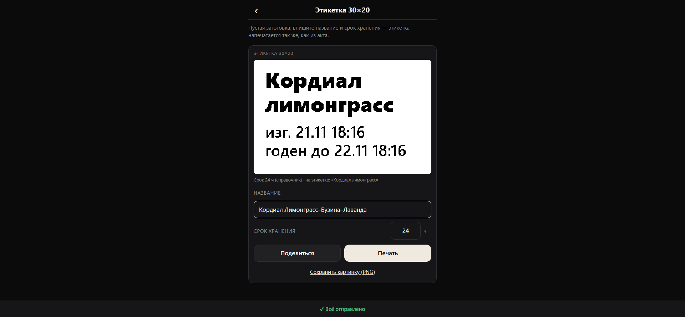
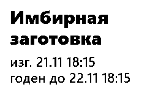
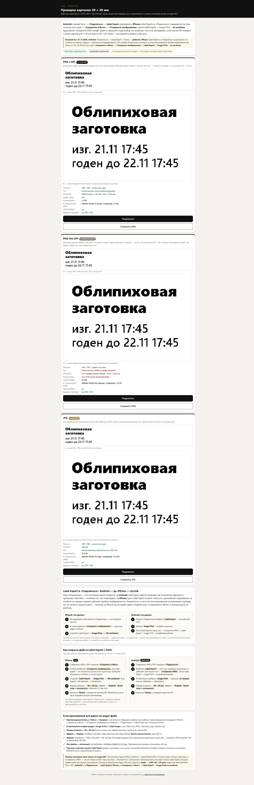
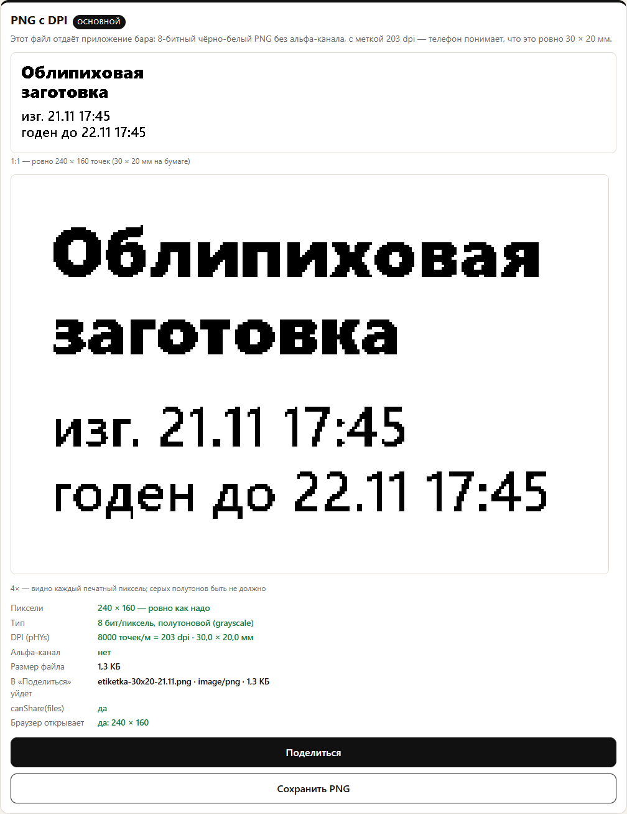
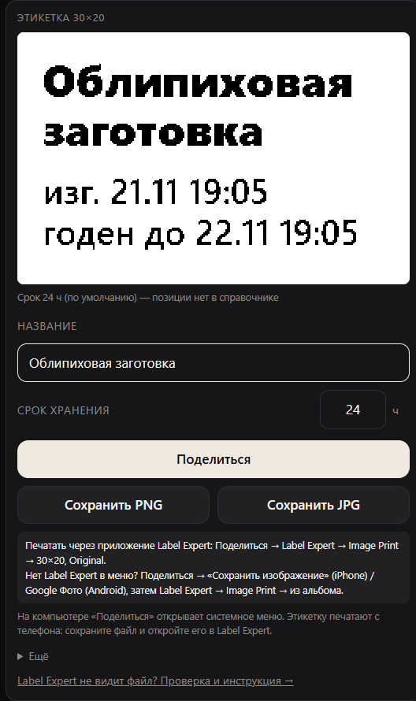
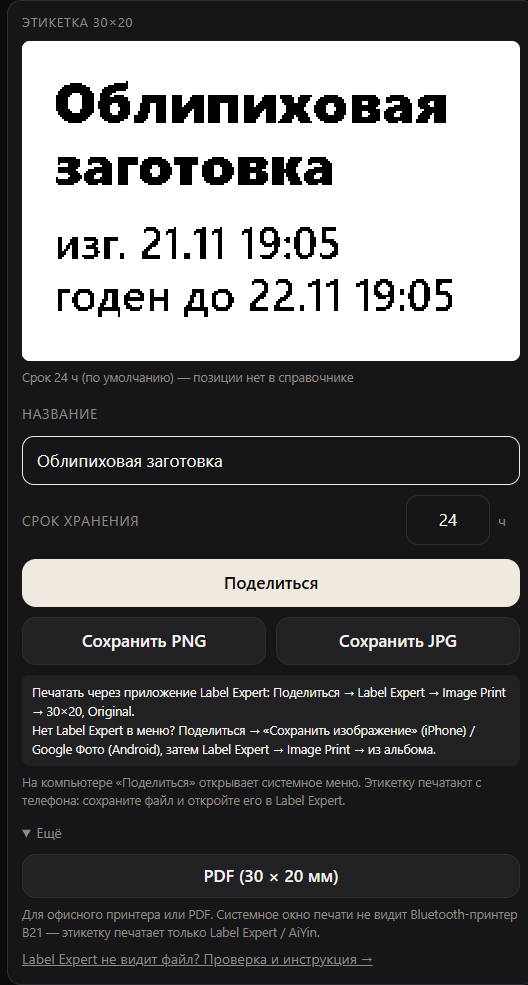
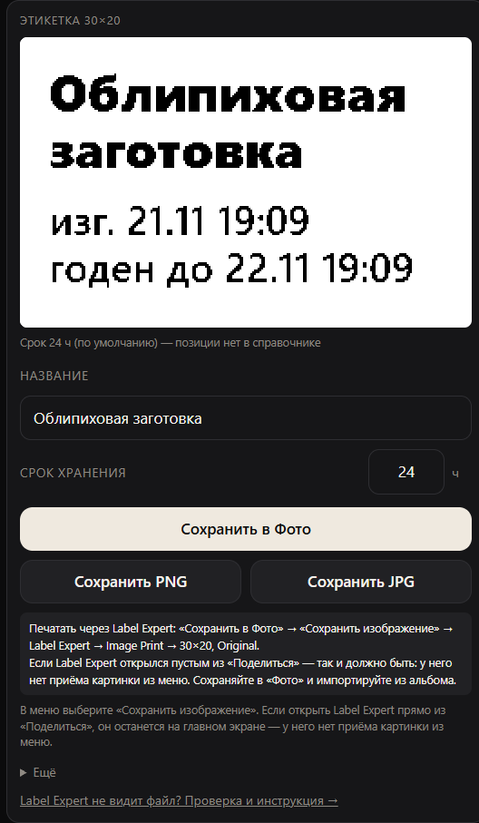

# Этикетка 30×20 мм из акта переработки — что сделано и как проверено

Дата: 21 ноября 2026. Ветка `dsh-threads/9-f26907`, база — `main` (`ec153fc`).
Бэкенд обновлён **тем же** развёртыванием `/exec` — версия **19**
(`AKfycbzRXm4P2dC_xEmSrw4RjAXWk6J-Hav54iHrXK8xddGH9o5NcsdchIKkaZArwGqvAJN7-w`),
URL не менялся, новых развёртываний не создавалось.

Ключевое из исследования (`docs/labels/ИССЛЕДОВАНИЕ.md`, ветка `dsh-threads/8-15a7ac`):
принтер AiYin B21, 203 dpi, печатает **импортированную картинку**, шаблоны не принимает.
Поэтому приложение рисует PNG **ровно 240 × 160** (30 × 20 мм), а печать выполняет
Label Expert / AiYin на iPhone и Android одинаково.

> **Обновление 21.11.2026, ветка `dsh-threads/10-483b0b`.** Приложение не видело наш PNG:
> файл был RGBA без DPI. Теперь PNG — 8-битный чёрно-белый, без альфа-канала, с pHYs
> 8000 точек/м (203 dpi). Полевой тест: **Android — «Поделиться» → Label Expert работает**;
> **iPhone — Label Expert из меню открывается пустым**, поэтому там главная кнопка
> «Сохранить в Фото» → Image Print из альбома. PDF/офисная печать убрана в «Ещё»;
> добавлена тестовая страница `docs/labels/test.html`. Разбор — §11.

---

## 1. Данные: лист «Сроки хранения»

Новый лист в таблице (5 колонок):

| Колонка | Что это |
|---|---|
| `заготовка` | полное название (для акта — название результата); по нему идёт поиск |
| `короткое_имя` | что печатать на этикетке вместо полного; пусто — печатается полное |
| `срок_часов` | срок в часах, можно дробный (0,5 = 30 минут) |
| `примечание` | свободный текст владельца |
| `активен` | галочка: снятая убирает строку из приложения, но не удаляет её |

* Лист создаётся **сам** при первом чтении справочника (`ensureShelfLifeSheet_`),
  как это уже сделано для «Дуэлей» и «Рейтинга». Повторный запуск ничего не дублирует.
* Колонка `короткое_имя` добавлена **миграцией**: если в шапке её нет, лист
  вставляет колонку B и пишет шапку — остальные данные остаются на месте.
  На боевом листе это уже сработало: шапка `заготовка | короткое_имя | срок_часов |
  примечание | активен`, 65 строк, короткие имена пустые (проверено выгрузкой листа в CSV).
* Колонки ищутся **по названиям в шапке**, а не по номеру — порядок можно менять.
* Первое заполнение — 65 строк: названия результатов всех актов переработки +
  названия из ТТК (без повторов), у всех срок **24 ч** и примечание
  `значение по умолчанию, проверьте`. Цифры владелец правит руками.
* Справочник уходит в `config` (`shelfLife: [{name, short, hours, note}]`), поэтому
  телефон не делает отдельный запрос перед печатью; строки лежат и в офлайн-копии.
* Пустой или нулевой `срок_часов` бэкенд отдаёт как 24 ч.

## 2. Как считается срок хранения и что печатается

1. Название акта (или введённое руками) сравнивается со справочником
   без учёта регистра, «ё/е» и лишних пробелов — точное совпадение по колонке `заготовка`.
2. Если заполнено `короткое_имя` — **на этикетке печатается оно**, а не полное
   название. Это решение владельца, а не обрезка алгоритмом.
3. Срок берётся из справочника; под превью мелкой строкой видно, откуда он:
   * `Срок 12 ч (справочник)` — значение из листа;
   * `Срок 24 ч (по умолчанию) — позиции нет в справочнике` — заглушка, видно сразу;
   * `Срок 48 ч (правили вручную; в справочнике 24 ч)` — если поправили на экране;
   * `… · на этикетке: «Кордиал лимонграсс»` — если сработало короткое имя.
4. «Годен до» = дата производства + срок. **На самой этикетке только срок**
   и две даты, никаких пометок о справочнике.

Дата производства: `дд.мм чч:мм`. Для акта, который только что создали, — текущее
время. Для акта, который закрывают позже, — **время начала акта**: в данных,
которые приложение получает из таблицы, времени закрытия нет, а заготовка
сделана тогда, когда акт начали. Это написано и на экране после закрытия.

## 3. Картинка этикетки (`js/label.js`)

* `canvas` ровно **240 × 160**, без масштабирования; белый фон, чёрный текст.
* Безопасная зона 2 мм = 16 точек; проверено по факту: чёрные пиксели лежат
  в диапазоне x 16…221, y 16…137 (границы 16…223 и 16…143).
* **Чистый чёрно-белый**: после рисования все пиксели прогоняются через порог
  по яркости (в проверке `gray = 0`). На экране canvas остаётся RGBA, а файл PNG
  теперь собирается 8-битным **полутоновым (color type 0), без альфа-канала**:
  значения только 0 и 255, с pHYs 203 dpi (см. §5 и §11).
* Три поля: название (1–3 строки), `изг. дд.мм чч:мм`, `годен до дд.мм чч:мм`.
* **Название: до трёх строк.** Порядок подбора: одна строка 40 → 28; две 30 → 22;
  три 22 (даты при этом уходят на 18 — единственный кегль, при котором всё влезает
  в 128 точек безопасной зоны). Перенос — по словам **и по тире/дефису**
  (`Лимонграсс–` / `Бузина–Лаванда`), поэтому длинные двойные названия влезают
  целиком. Слово по буквам не рвём, пока есть хоть один вариант без разрыва:
  сначала перебираются все раскладки без разрыва слов, и только если совсем
  не влезает — разрешается резать слово. «…» — последнее средство.
* **Раскладка по одной сетке:** даты всегда заканчиваются на одной линии —
  16 точек от нижнего края; между названием и датами не меньше 8 точек.
  У названий в 2–3 строки блок стоит у верхней границы (16), у однострочных —
  вертикально центрируется в зоне над датами, поэтому посреди этикетки нет
  «дыры» (именно на неё указывал владелец в «Мята (листья)»), а даты не упираются
  в название. Строго прижать однострочное название к верху — это одна константа
  в `titleTop` в `js/label.js`, если владельцу так больше нравится.
* Даты — кегль 22 (минимум 18), начертание 600: «годен до 22.11 17:45»
  влезает в 208 точек.
* Шрифт — системный sans-serif (`system-ui, -apple-system, "Segoe UI", Roboto…`),
  кириллица рисуется в Chrome на Windows (проверено) и в WebKit по стеку.

Замеры на реальных названиях (кегль названия / строк / кегль дат):

| Название | Кегль | Строк | Даты | Обрезка |
|---|---|---|---|---|
| Имбирь | 40 | 1 | 22 | нет |
| Мята (листья) | 28 | 1 | 22 | нет |
| Малиновая заготовка | 30 | 2 | 22 | нет |
| Заготовка Морса | 30 | 2 | 22 | нет |
| Облепиховое пюре | 28 | 2 | 22 | нет |
| Имбирная заготовка | 30 | 2 | 22 | нет |
| Лимонный сок ПФ | 30 | 2 | 22 | нет |
| Облипиховая заготовка | 28 | 2 | 22 | нет |
| Сироп из имбиря с мёдом | 24 | 2 | 22 | нет |
| Кордиал Лимонграсс–Бузина–Лаванда | 22 | 3 | 18 | нет |
| Кордиал Грейпфрут–Клюква–Тимьян | 22 | 3 | 18 | нет |
| Сливки взбитые — маленький сифон | 22 | 3 | 18 | нет |
| Банановый чай с Куркумой и Имбирем | 22 | 3 | 18 | нет |
| Облипиховая настойка на клюкве | 22 | 3 | 18 | нет |
| *«Сверхдлинное название заготовки для проверки обрезки»* (искусственное, 49) | 22 | 3 | 18 | **да** |

**Проверены все 65 названий из справочника: обрезанных нет ни одного.**
В три строки печатаются шесть самых длинных позиций (это и есть кандидаты
на `короткое_имя`, если владелец захочет крупнее шрифт):

| Позиция | Символов |
|---|---|
| Банановый чай с Куркумой и Имбирем | 34 |
| Кордиал Лимонграсс–Бузина–Лаванда | 33 |
| Сливки взбитые — маленький сифон | 32 |
| Кордиал Грейпфрут–Клюква–Тимьян | 31 |
| Сливки взбитые — большой сифон | 30 |
| Кордиал холодный чай п/ф | 24 |

Обрезка с «…» осталась только для заведомо искусственно длинных строк
(пример в таблице выше): на этикетке появляется «…», а на экране —
предупреждение «название не помещается целиком — сократите его или заполните
«короткое_имя»».

## 4. Где кнопки

Блок «ЭТИКЕТКА 30×20»: превью картинки в 2× (480 × 320), мелкая строка про срок,
поле срока, затем:

* **«Поделиться»** (Android) / **«Сохранить в Фото»** (iPhone) — главная кнопка.
  Android: системное меню → Label Expert (проверено, работает). iPhone: меню →
  «Сохранить изображение» → «Фото», потому что Label Expert из «Поделиться»
  открывается пустым;
* **«Сохранить PNG»** и **«Сохранить JPG»** — два файла с латинскими именами
  и DPI (в «Загрузки»);
* **две строки инструкции** мелким текстом прямо в блоке, разные для платформ:
  * Android: «Печатать через Label Expert: Поделиться → Label Expert → Image Print
    → 30×20, Original»;
  * iPhone: «Печатать через Label Expert: „Сохранить в Фото“ → „Сохранить
    изображение“ → Label Expert → Image Print → 30×20, Original» и отдельная
    строка «если открылся пустым — так и должно быть»;
* **«Ещё» → «PDF (30 × 20 мм)»** — для офисного принтера или PDF; подпись
  «системное окно печати не видит B21»;
* ссылка **«Label Expert не видит файл? Проверка и инструкция →»** —
  ведёт на `docs/labels/test.html`.

Если `navigator.share` с файлами недоступен, главной кнопки нет, а вместо неё
честная строка: сохранить PNG/JPG и открыть в Label Expert → Image Print.

* **Экран акта** (`screenAct`): блок появляется, как только вписано «получилось»
  (выход > 0), то есть акт готов. Пока выхода нет — блока нет вовсе.
* **Закрытие акта** (`screenCloseAct`, акты «в работе»): блок появляется, как
  только вписано количество, — дата производства берётся из времени начала акта.
* **После сохранения** открывается экран «Акт сохранён» / «Акт закрыт» с тем же
  блоком: этикетку можно отдать в Label Expert сразу, а не искать акт потом.
* **Пустая заготовка** — кнопка «🏷 Этикетка пустой заготовки» в списке
  «Переработка»: акта нет, название вводится руками в обычном поле
  (не модалка поверх), срок по умолчанию 24 ч и его можно поменять.
* Если у акта пустое название результата, блок сразу показывает поле ввода названия.

## 5. Что делают кнопки

* **«Поделиться» (Android) / «Сохранить в Фото» (iPhone)** —
  `navigator.share({files:[File]})` с PNG. Файл собирается в момент нажатия:
  имя `etiketka-30x20-ДД.ММ.png`, **MIME выставлен явно `image/png`**, размер
  ~1,4 КБ. Android: системное меню → Label Expert (проверено владельцем).
  iOS: отдаём только `files`, без `title`/`text`; в меню — «Сохранить
  изображение» → «Фото», потому что Label Expert из «Поделиться» открывается
  пустым (полевой тест). Если `navigator.canShare({files})` не умеет файлы,
  кнопка **не создаётся вовсе**; никакого fallback на текст/ссылку нет —
  показывается инструкция через «Сохранить PNG» (проверено подменой `canShare`).
* **«Сохранить PNG»** — файл `etiketka-30x20-ДД.ММ.png`. Это уже не canvas-RGBA:
  PNG собирается в `js/label.js` из пикселей canvas — **8 бит/пиксель, color type 0
  (полутоновой), без альфа-канала**, с чанком **pHYs 8000 точек/м = 203 dpi**
  (240 × 160 точек = ровно 30,0 × 20,0 мм). Сжатие — встроенный
  `CompressionStream('deflate')`, без внешних библиотек; в браузере без него
  остаётся запасной путь — canvas-PNG с дописанным pHYs.
* **«Сохранить JPG»** — `etiketka-30x20-ДД.ММ.jpg`, качество 100 %, белая подложка
  (иначе JPG сделал бы прозрачность чёрной), в заголовке JFIF — 203 dpi.
  Нужен приложениям, которые принимают только JPG.
* **«Ещё» → «PDF (30 × 20 мм)»** — `window.print()` страницы ровно 30 × 20 мм
  (`@page { size: 30mm 20mm; margin: 0 }`), для офисного принтера или PDF.
  Сознательно **не A4**: страница печати — 30 × 20 мм, и называть её A4 было бы
  неправдой; A4 — отдельная задача, если понадобится. Смысл именно в том, чтобы
  убрать системную печать с первого плана: диалог AirPrint/Mopria не видит
  Bluetooth-принтер B21 (см. `ИССЛЕДОВАНИЕ.md` §4.7). Место под будущую
  «Печать по Bluetooth» помечено комментарием `BLE_HOOK` в `js/label.js`.

## 6. Что проверено

* Локальный сервер, Chrome на десктопе, обе темы.
* **Все 65 названий из справочника**: ни одного обрезка; 6 уходят в три строки
  (список в §3). Дополнительно проверены «Сироп из имбиря с мёдом»,
  «Облипиховая заготовка», «Облипиховая настойка на клюкве» и искусственно
  длинная строка (единственная с «…»).
* Размер: canvas и PNG — 240 × 160 (заголовок PNG), превью 480 × 320,
  полутонов нет (`gray = 0`).
* Тексты под превью: `(справочник)`, `(по умолчанию)`, `(правили вручную)`,
  `на этикетке: «…»` — все четыре варианта.
* Короткое имя: подменили в копии справочника у «Кордиал Лимонграсс–Бузина–Лаванда»
  → на этикетке «Кордиал лимонграсс», в подписи «на этикетке: «Кордиал лимонграсс»»
  (см. `11-short-name.png`); в таблице колонка пока пустая — это проверка механизма.
* «Сохранить PNG» реально скачала PNG из приложения: **1356–1411 байт**, 240 × 160,
  **8 бит, color type 0 (grayscale), pHYs 8000 × 8000, unit 1** (203 dpi), без
  альфа-канала; все пиксели — только 0 и 255, alpha = 255, чёрное лежит в
  x 17…214, y 20…137 (внутри безопасной зоны 16…223 / 16…143).
* «Сохранить JPG»: **15 846 байт**, 240 × 160, SOF 8 бит, 3 компонента (RGB, без
  альфы), JFIF units = 1, Xdensity = Ydensity = **203**. Белая подложка — по коду
  (canvas с белой заливкой перед `toBlob('image/jpeg', 1)`).
* Старый вариант для сравнения (страница `test.html`): 4194–4403 байта,
  color type 6 (RGBA), **pHYs нет** — именно он и вызывал вопрос «приложение не видит».
* **Запасной путь без `CompressionStream`** проверен подменой этой функции на
  `undefined`: файл 4424 байта, RGBA (color type 6 — старый браузер иначе не умеет),
  но `pHYs` уже дописан, 8000 × 8000 unit 1 → 203 dpi, браузер его открывает.
* `navigator.canShare({files})` в Chrome на Windows — **true**, поэтому в приложении
  на компьютере видна кнопка «Поделиться». При подмене `canShare` на `false`
  кнопка исчезает, а вместо неё появляется инструкция (проверено).
* Кнопка «Поделиться» проверена с подменой `navigator.share` (чтобы не открывать
  окно ОС): в системное меню уходит **File `etiketka-30x20-21.11.png`,
  `image/png`, 1409 байт**, title «Этикетка 30×20» — имя и MIME правильные.
* **iOS-ветка (эмуляция User-Agent iPhone, Chrome):** кнопка называется
  **«Сохранить в Фото»**, в `navigator.share` уходит объект **только с ключом
  `files`** (без `title` и `text`), внутри — **File `etiketka-30x20-21.11.png`,
  `image/png`, 1412 байт**. `canShare({files})` в этой эмуляции — да (это
  возможность Chrome, не проверка iOS Safari); сама iOS-эмуляция не заменяет
  телефон, но payload — ровно то, что мы отдаём системе.
* **Android-ветка (эмуляция User-Agent Android):** кнопка называется
  **«Поделиться»**, в `navigator.share` уходит `files` + `title`, File
  `etiketka-30x20-21.11.png`, `image/png`, 1392 байта — поведение не изменилось.
* **Полевой тест владельца 21.11.2026:** Android — «Поделиться» → Label Expert →
  печать работает; iPhone — Label Expert из «Поделиться» открывается, но остаётся
  на главном экране, картинку не берёт. Это подтверждает, что дело не в файле
  и не в MIME: Android печатает тот же PNG.
* **Нет fallback на текст/ссылку:** если `canShare({files})` false, кнопка
  не создаётся, `shareLabel` возвращает ошибку; `navigator.share` с `text`/`url`
  в коде нет (проверено поиском и подменой `canShare`).
* **«Печать» больше не на первом плане:** на экране нет кнопки, которая открывает
  системный диалог; PDF спрятан в `details` → «Ещё» → «PDF (30 × 20 мм)».
  Проверено, что в блоке видны ровно «Поделиться», «Сохранить PNG», «Сохранить JPG»
  и две строки инструкции; печатная страница по-прежнему 30 × 20 мм.
* Тестовая страница `docs/labels/test.html` открыта на локальном сервере: все три
  варианта собираются, превью 1:1 и 4× рисуются, заголовки PNG/JPG разбираются в
  таблицу, кнопки «Поделиться»/«Сохранить» работают (1356 байт PNG и 15 675 байт JPG).

* «PDF (30 × 20 мм)»: обработчик вызывает `window.print()`, печатная страница
  30 × 20 мм создаётся и убирается по `afterprint`; кнопка спрятана в «Ещё».
* Акт без рецепта: ввод названия руками, срок 24 → 48 ч, «годен до» пересчитался.
* Обе темы: чёрная ESSE и зимняя (бордо + золото).
* Бэкенд после деплоя @19: `?action=ping` → `ok:true`; `?action=config` → поле
  `shelfLife` с 65 записями `{name, short, hours, note}`; `?action=questions` → 60;
  `duelCreate`/`duelCancel` → создание и отмена комнаты; `openActs` → `ok:true`.
* Миграция листа: выгрузка «Сроки хранения» в CSV — шапка из 5 колонок,
  65 строк, `короткое_имя` пустое, сроки 24, примечание на месте.

## 7. Что НЕ проверено (честно)

* **Реальная печать на B21 не проверялась** — принтера в этом окружении нет.
  Не проверено и то, как Label Expert масштабирует PNG при импорте:
  нужно выбрать **30 × 20 мм**, эффект **Original**, Smart crop выключить.
* **Телефон владельца — что уже проверено полевым тестом 21.11.2026:** Android,
  «Поделиться» → Label Expert → печать — **работает**; iPhone — Label Expert
  в меню есть, открывается, но остаётся на главном экране (картинку не берёт).
* **Что осталось на iPhone:** проверить именно новый путь **«Сохранить в Фото» →
  «Сохранить изображение» → Label Expert → Image Print → из альбома** и печать
  30 × 20. Это единственный путь, который может работать на iOS; «Поделиться →
  Label Expert» там не работает by design приложения.
* **Системное окно печати** в этом окружении не открывалось (это окно ОС).
  Владелец подтвердил факт: там список сетевых принтеров, B21 нет, есть
  «Сохранить в PDF» — это штатное поведение AirPrint/Mopria, а не баг
  (см. `ИССЛЕДОВАНИЕ.md` §4.7).
* **Chrome DevTools device mode** через доступный мост к браузеру не включается;
  проверены реальный десктопный Chrome и подмена User-Agent (`maxTouchPoints`)
  для веток «iPhone/Android». `canShare` при этом остаётся возможностью браузера
  и ОС, а не User-Agent: на Android Chrome файлы поддерживаются, на iOS Safari —
  с iOS 15.
* **Системное «Поделиться»** не открывалось (в автотесте это окно ОС);
  проверено только, что кнопка создаётся/исчезает по `canShare({files})`.
* **Точный размер страницы печати**: PDF-экспорт через Chrome DevTools (chrome_pdf)
  не учитывает CSS `@page` без отдельного флага, поэтому PDF вышел на листе Letter —
  проверен вид печатной страницы при тех же правилах (30 × 20 мм, поля 0, только
  картинка), а не физический лист. `window.print()` открывает предпросмотр
  и блокирует страницу — это подтверждено, но снять сам диалог нельзя.
* **Web Bluetooth / BLE-печать** не делались сознательно.
* Дата производства для поздно закрытого акта — время начала (см. §2).
* Справочник заполнен значениями по умолчанию (24 ч), цифры нужно поправить владельцу.
* Позиции, которые влезают только в три строки (§3), на 30 мм читаются мелко —
  им стоит дать `короткое_имя`, но это решение владельца.

## 8. Скриншоты

| Файл | Что на нём |
|---|---|
| `02-act-screen.png` | экран акта по рецепту, вписан выход — блок этикетки, подпись «Срок 24 ч (справочник)» |
| `03-label-box.png` | блок этикетки крупно (превью 2×, срок, кнопки) |
| `04-act-saved.png` | экран «Акт сохранён» сразу с этикеткой |
| `05-blank-label.png` | пустая заготовка: название руками, «Срок 24 ч (по умолчанию)» |
| `06-close-act.png` | закрытие акта «в работе»: блок появился после ввода выхода |
| `07-act-closed.png` | экран «Акт закрыт» с пояснением про дату производства |
| `08-print-page.png` | печатная страница 30 × 20 мм (эмуляция правил печати, 8×) |
| `09-winter-theme.png` | зимняя тема: блок этикетки |
| `10-samples.png` | 14 этикеток в 2×: раскладка 1–3 строк, даты на одной линии |
| `11-short-name.png` | как сработает заполненное `короткое_имя` (проверено на подменённом справочнике) |
| `01-etiketka-240x160.png` | сама картинка, 240 × 160, скачанная старой кнопкой «Сохранить картинку» (RGBA, без pHYs — до правки) |
| `12-test-page.png` | тестовая страница `docs/labels/test.html`: три варианта файла, проверка Label Expert в «Поделиться», инструкции |
| `13-label-png-dpi.png` | PNG с DPI: превью 1:1 и 4×, таблица «240 × 160 / 8 бит, grayscale / 203 dpi / без альфы» |
| `14-label-buttons.png` | блок этикетки (десктоп/Android): «Поделиться», «Сохранить PNG/JPG», 2 строки инструкции, «Ещё» закрыто |
| `15-label-more.png` | «Ещё» раскрыто: «PDF (30 × 20 мм)» и подпись, что системная печать B21 не видит |
| `16-ios-label.png` | блок этикетки в режиме iPhone (эмуляция UA): «Сохранить в Фото», инструкция «Сохранить изображение → из альбома» |

## 9. Что изменено в коде

| Файл | Что |
|---|---|
| `js/label.js` | прошлая правка: трёхстрочное название, перенос по тире, «одна сетка», даты 18. **В этой:** собственный PNG-энкодер (8 бит, grayscale, без альфы, pHYs 203 dpi), JPG 100 % с белой подложкой и JFIF 203, `labelPngBlob` / `labelJpegBlob`; **явный MIME в `File`** (`image/png` / `image/jpeg`), iOS-режим `filesOnly` без `title`/`text` в `shareLabel` |
| `js/app.js` | прошлая правка: `short` из справочника, подписи «(справочник)/(по умолчанию)/(вручную)». **В этой:** на Android «Поделиться», на iOS «Сохранить в Фото», «Сохранить PNG/JPG», две строки инструкции под платформу (включая «открылся пустым — норма»), PDF убран в «Ещё», ссылка на `test.html` |
| `apps-script/Код.gs` | колонка `короткое_имя`, миграция шапки, поиск колонок по названиям, `short` в `config` (в этой правке не менялся) |
| `styles.css` | **в этой:** `.label-btns .wide`, `.label-hint`, `.label-howto`, `.label-more`; убран `.label-save` |
| `sw.js` | `VERSION` → `v22`; `./docs/labels/test.html` добавлена в `FILES` |
| `docs/labels/test.html` | **новый:** тестовая страница — 3 варианта файла, превью 1:1 и 4×, разбор заголовков PNG/JPG, «что уйдёт в „Поделиться“» (имя · MIME · размер), `canShare`, отдельные сценарии iPhone/Android |
| `docs/labels/ИССЛЕДОВАНИЕ.md` | **в этой:** 4.6 «Если приложение не видит файл», 4.7 «Почему системная печать не видит B21», 4.8 «Попадает ли Label Expert в „Поделиться“» |
| `docs/labels/*` | отчёт и скриншоты `12-test-page`, `13-label-png-dpi`, `14-label-buttons`, `15-label-more`, `16-ios-label` |

Порядок деплоя (как делалось): `clasp push --force` из `apps-script/`, затем
`clasp deploy -i AKfycbz…N7-w -d "…"` — обновляется существующее развёртывание,
адрес в `config.js` не меняется. В этой правке бэкенд не трогали.

## 10. Как печатать (короткая памятка)

1. **Android:** Акт → вписать выход → **«Поделиться»** → **Label Expert** →
   Image Print. **iPhone:** **«Сохранить в Фото»** → **«Сохранить изображение»**
   → Label Expert → Image Print → **из альбома**. (Label Expert из «Поделиться»
   на iPhone открывается пустым — это не лечится.)
2. Либо **«Сохранить PNG»** / **«Сохранить JPG»** и открыть файл из
   «Загрузок»/«Файлов» (Image Print → из файлов/альбома).
3. В приложении: размер этикетки **30 × 20 мм**, эффект **Original**
   (не Dither), Smart crop **выключить**, масштаб 1:1.
4. Бледно — поднять density на 1 шаг.
5. **Системная печать B21 не видит.** «Ещё» → «PDF (30 × 20 мм)» — только
   офисный принтер/PDF; принтер этикеток печатает исключительно Label Expert.
6. Если файл «не виден» — открыть `docs/labels/test.html` (на телефоне по адресу
   GitHub Pages), проверить заголовок файла и пройти чек-лист.

Если название на этикетке хочется крупнее — впишите `короткое_имя` в листе
«Сроки хранения» (например «Кордиал лимонграсс»), приложение напечатает его.

## 11. Раунд 2: почему приложение не видело PNG

Жалоба владельца: «не видит пнг файл когда пытаюсь через картинку»; отдельно —
«не видит принтер, хотя на ноуте блютуз подключен».

### 11.1 Что было не так с файлом (факты)

Старый файл скачивался кнопкой «Сохранить картинку (PNG)» и выглядел так
(проверено разбором заголовка):

| Свойство | Старый файл | Почему это мешало |
|---|---|---|
| Пиксели | 240 × 160 | правильно, не менялось |
| Тип PNG | 8 бит, **RGBA (color type 6)**, альфа-канал | лишний канал; часть приложений такие PNG не берёт |
| DPI | **pHYs нет** | телефон считает 72–96 dpi → картинка «63,5 × 42,3 мм» вместо 30 × 20; приложение либо масштабирует, либо не принимает |
| JPG | не было | если приложение принимает только JPG — пути не было |
| Имя | `etiketka-30x20-ДД.ММ.png` | **уже латиница, без пробелов** — не проблема |
| Куда попадал файл | «Загрузки» (iPhone: «Файлы» → «Загрузки»; Android: папка Download) | выбор «из альбома» эту папку не показывает — главная причина «не видит» |

Плюс путаница с кнопкой **«Печать»**: владелец нажал её и получил системное окно
печати, где B21 нет, зато есть «Сохранить в PDF», и решил, что приложение не видит
принтер. Это штатное поведение AirPrint/Mopria (см. §11.5), а не баг. Теперь
системная печать убрана с первого плана, а под «Ещё» написано прямо: B21 там не
появится.

### 11.2 Что изменено

* **PNG собирается вручную** в `js/label.js`: `canvas.getImageData` → строки
  с фильтром 0 → `CompressionStream('deflate')` → чанки `IHDR` + `pHYs` + `IDAT`
  + `IEND`. Итог: 8 бит/пиксель, **color type 0 (полутоновой), без альфа-канала**,
  `pHYs = 8000 × 8000, unit = 1` → **203 dpi**, 30,0 × 20,0 мм. Библиотеку не
  тянули: нужен один чанк и zlib, который уже есть в браузере. В браузере без
  `CompressionStream` — запасной путь: обычный canvas-PNG + дописанный `pHYs`.
* **JPG**: отдельный canvas с белой заливкой, `toBlob('image/jpeg', 1)`, правка
  JFIF (units = dpi, 203 × 203). Белый фон обязателен: JPG не умеет прозрачность.
* **Три действия вместо одного** в блоке этикетки: «Поделиться» (Android),
  «Сохранить в Фото» (iOS), «Сохранить PNG», «Сохранить JPG». Под ними — две
  строки инструкции под платформу: для Android «Поделиться → Label Expert →
  Image Print → 30×20, Original»; для iOS «Сохранить в Фото → Сохранить
  изображение → Label Expert → Image Print → из альбома» и честная строка
  «если Label Expert открылся пустым — так и должно быть».
* **Payload строго файловый:** `labelFile` выставляет MIME явно (`image/png` /
  `image/jpeg`), имя `etiketka-30x20-ДД.ММ.png`, iOS получает только `files`
  (без `title`/`text`). Fallback на `text`/`url` в коде нет: если
  `canShare({files})` false — кнопки нет, остаётся «Сохранить».
* **Системная «Печать» убрана с первого плана** в «Ещё» → «PDF (30 × 20 мм)»:
  диалог AirPrint/Mopria не видит Bluetooth-принтер этикеток, и именно эта кнопка
  создавала впечатление «приложение не видит принтер».
* **Тестовая страница** `docs/labels/test.html`: генерирует три варианта эталонной
  этикетки, показывает превью 1:1 и 4×, **разбирает заголовки файлов** (пиксели,
  тип, DPI, альфа, имя), показывает **что уйдёт в «Поделиться»** (имя · MIME ·
  размер) и `canShare(files)`, и даёт **отдельные сценарии iPhone и Android**,
  включая «Label Expert открылся пустым — это норма». Доступна после публикации:
  `https://sangoskarlet.github.io/bar-app/docs/labels/test.html`.
* `sw.js`: `VERSION` → **v22**, `test.html` добавлена в `FILES` (страница работает
  и офлайн).

### 11.3 Что проверено в этом окружении

* Скачанный из приложения PNG: **240 × 160, 8 бит, color type 0, pHYs 8000/8000
  unit 1 (203 dpi), без альфы**, 1356–1411 байт; браузер открывает, все пиксели
  0/255, alpha 255, содержимое внутри безопасной зоны.
* Скачанный JPG: 240 × 160, 3 компонента, **JFIF 203 dpi**, 15 846 байт.
* Старый PNG для сравнения: RGBA, pHYs нет (4194–4403 байта).
* Запасной путь (браузер без `CompressionStream`): 4424 байта, RGBA + pHYs
  203 dpi, декодируется — на старых iOS файл всё равно получит метку DPI.
* Тестовая страница: все три варианта собираются, таблицы заполняются,
  «Поделиться»/«Сохранить» реально работают (1356 байт PNG и 15 675 байт JPG).
* `navigator.canShare({files})` на десктопном Chrome — true; при подмене на
  false кнопка «Поделиться» исчезает и показывается инструкция. При подмене
  `navigator.share` в него приходит File `etiketka-30x20-21.11.png`, `image/png`,
  1409 байт — имя и MIME корректные.
* Интерфейс: на первом плане нет кнопки, открывающей системную печать; на
  Android/десктопе видны «Поделиться», «Сохранить PNG», «Сохранить JPG» и
  2 строки инструкции, на iOS — «Сохранить в Фото» и отдельная строка про
  пустой Label Expert. «Ещё» раскрывает «PDF (30 × 20 мм)» с подписью, что B21
  там не появится. Печатная страница по-прежнему 30 × 20 мм.

### 11.4 Что осталось проверить на телефоне

1. **Android уже проверен владельцем:** «Поделиться» → Label Expert → печать
   работает. Повторить только если сменится приложение/версия Android.
2. **iPhone:** проверить новый путь **«Сохранить в Фото» → «Сохранить
   изображение» → Label Expert → Image Print → из альбома**. «Поделиться →
   Label Expert» на iPhone не работает (открывается пустым) — это не искать.
3. В Label Expert: файл виден в альбоме; размер 30 × 20, Original, Smart crop off.
4. Напечатать 2–3 этикетки: поля 2 мм, текст не обрезан, масштаб 1:1.
5. Убедиться, что системное окно печати («Ещё» → PDF) больше не воспринимается
   как «поиск принтера»: B21 там не появится by design.
6. Если конкретное приложение всё равно не берёт PNG — попробовать JPG с той же
   страницы `test.html`.
7. Принтер сопрягать **внутри Label Expert**, а не только в Bluetooth телефона.

### 11.5 Почему системная печать не видит B21 (и что сделано с кнопкой)

iOS печатает через **AirPrint** (Bonjour/IPP), Android — через **Mopria/IPP**,
плюс «Сохранить в PDF». В этом списке только сетевые принтеры, умеющие эти
протоколы. B21 — **Bluetooth LE с протоколом производителя**, он не
представляется как AirPrint/Mopria-принтер, поэтому в системном диалоге его нет
и быть не может; сопряжение в настройках Bluetooth телефона тоже не помогает —
соединение открывает Label Expert по своему BLE-протоколу. Это не наш баг и не
проблема файла: владелец видел штатное окно «сетевые принтеры + Сохранить в PDF».

Поэтому `window.print()` убран с первого плана. На Android главная кнопка —
**«Поделиться»** (Label Expert принимает файл — проверено), на iPhone —
**«Сохранить в Фото»** (Label Expert из «Поделиться» открывается пустым).
Рядом — «Сохранить PNG/JPG». PDF остался второстепенным: **«Ещё» → «PDF
(30 × 20 мм)»** с подписью «для офисного принтера, не для этикеток». Назвали не
«A4», потому что печатная страница фактически 30 × 20 мм; A4 — отдельная задача,
если понадобится. Две строки инструкции прямо в блоке этикетки закрывают главный
вопрос: «куда нажимать, чтобы напечатать на B21».

### 11.6 Полевой тест 21.11.2026: Android работает, iPhone — пустой

Владелец проверил на реальных телефонах:

| Платформа | Что нажал | Что произошло | Вывод |
|---|---|---|---|
| Android | «Поделиться» → Label Expert | приложение приняло PNG, этикетка напечатана | файл, MIME, имя и размер — в порядке; share-путь Android правильный |
| iPhone | «Поделиться» → Label Expert | Label Expert открылся, но остался на главном экране — картинки нет | у iOS-приложения нет рабочего приёма изображения из «Поделиться» (Share Extension отсутствует или не принимает payload) |

Это не проблема файла: один и тот же PNG Android печатает. И не проблема MIME:
в `navigator.share` мы отдаём **File `etiketka-30x20-21.11.png` с явным
`type: 'image/png'`**, имя латиницей, размер ~1,4 КБ. При эмуляции iPhone-UA
в share уходит объект **только с ключом `files`** (без `title`/`text`), File
1412 байт; при Android-UA — `files` + `title`, File 1392 байта. Если
`canShare({files})` false — кнопка не создаётся и мы не отдаём текст/ссылку
вместо файла.

Кодом поведение iOS-приложения не исправить. Поэтому интерфейс разделён:
**Android — «Поделиться» → Label Expert; iPhone — «Сохранить в Фото» →
«Сохранить изображение» → Label Expert → Image Print → из альбома.** На iPhone
кнопка «Поделиться» переименована в «Сохранить в Фото», а в блоке написано
прямо: если Label Expert открылся пустым — так и должно быть. На `test.html`
те же два сценария с шагами; в карточке файла видно, **что именно уйдёт в
«Поделиться»** (имя · MIME · размер) и `canShare(files)`.
