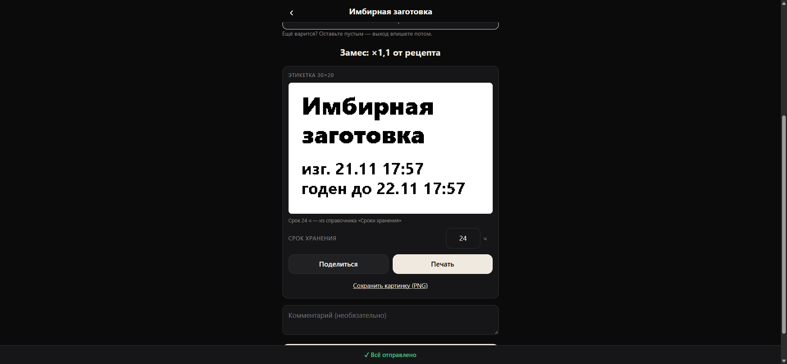

# Этикетка 30×20 мм из акта переработки — что сделано и как проверено

Дата: 21 ноября 2026. Ветка `dsh-threads/9-f26907`, база — `main` (`ec153fc`).
Бэкенд обновлён **тем же** развёртыванием `/exec` — версия **18**
(`AKfycbzRXm4P2dC_xEmSrw4RjAXWk6J-Hav54iHrXK8xddGH9o5NcsdchIKkaZArwGqvAJN7-w`),
URL не менялся, новых развёртываний не создавалось.

Ключевое из исследования (`docs/labels/ИССЛЕДОВАНИЕ.md`, ветка `dsh-threads/8-15a7ac`):
принтер AiYin B21, 203 dpi, печатает **импортированную картинку**, шаблоны не принимает.
Поэтому приложение рисует PNG **ровно 240 × 160** (30 × 20 мм), а печать выполняет
Label Expert / AiYin на iPhone и Android одинаково.

---

## 1. Данные: лист «Сроки хранения»

Новый лист в таблице:

| Колонка | Что это |
|---|---|
| `заготовка` | ровно то название, которое попадает на этикетку (для акта — название результата) |
| `срок_часов` | срок в часах, можно дробный (0,5 = 30 минут) |
| `примечание` | свободный текст владельца |
| `активен` | галочка: снятая убирает строку из приложения, но не удаляет её |

* Лист создаётся **сам** при первом чтении справочника (`ensureShelfLifeSheet_`),
  как это уже сделано для «Дуэлей» и «Рейтинга». Повторный запуск ничего не дублирует.
* Первое заполнение — 65 строк: названия результатов всех актов переработки +
  названия из ТТК (без повторов), у всех срок **24 ч** и примечание
  `значение по умолчанию, проверьте`. Цифры владелец правит руками — настоящие
  сроки знает только он.
* Справочник уходит в `config` (`shelfLife`), поэтому телефон не делает отдельный
  запрос перед печатью; строки лежат и в офлайн-копии справочника.
* Пустой или нулевой `срок_часов` бэкенд отдаёт как 24 ч, чтобы приложение не
  напечатало «годен до» без срока.

Проверено запросом `?action=config` после деплоя: в ответе появилось поле
`shelfLife` (65 записей, у всех `hours: 24`, `note: "значение по умолчанию, проверьте"`).

## 2. Как считается срок хранения

1. Название (из акта или введённое руками) сравнивается со справочником
   без учёта регистра, «ё/е» и лишних пробелов — точное совпадение.
2. Нашли — берём срок оттуда, под превью пишем:
   `Срок 24 ч — из справочника «Сроки хранения»`.
3. Не нашли — подставляем **24 ч** и честно пишем мелким текстом:
   `Срок 24 ч: позиции нет в справочнике «Сроки хранения», проверьте`.
4. Срок можно поправить прямо на экране; тогда подпись меняется на
   `Срок 48 ч (в справочнике 24 ч) — поправлено вручную`.
5. «Годен до» = дата производства + срок. **На самой этикетке только срок**,
   никаких пометок о справочнике нет.

Дата производства: `дд.мм чч:мм`. Для акта, который только что создали, — текущее
время. Для акта, который закрывают позже, — **время начала акта**: в данных,
которые приложение получает из таблицы, времени закрытия нет (есть только дата
создания и «закрыт»), а заготовка сделана тогда, когда акт начали. Это написано
и на экране после закрытия.

## 3. Картинка этикетки (`js/label.js`)

* `canvas` ровно **240 × 160**, без масштабирования; белый фон, чёрный текст.
* Безопасная зона 2 мм = 16 точек; проверено по факту: чёрные пиксели лежат
  в диапазоне x 16…221, y 16…137 (границы 16…223 и 16…143).
* **Чистый чёрно-белый**: после рисования все пиксели прогоняются через порог
  по яркости, поэтому полутонов нет вообще (в проверке `gray = 0` для всех
  образцов). PNG при этом 8-битный RGBA, но значения только 0 и 255 — дизеринг
  приложению включать не нужно.
* Три поля: название (1–2 строки), `изг. дд.мм чч:мм`, `годен до дд.мм чч:мм`.
  Ни QR, ни сотрудника, ни логотипа.
* Подбор кегля названия: сначала одна строка 40 → 28; если не влезает —
  две строки 30 → 22 (перенос по словам, самое ровное место); ниже 22 не
  уменьшаем; если и в 22 не влезает — вторая строка обрезается с «…»,
  а на экране появляется предупреждение «название не помещается целиком —
  сократите его». Слова не рвём, кроме одного сверхдлинного (> 13 символов).
* Даты — кегль 22 (минимум 18), начертание 600: «годен до 22.11 17:45»
  влезает в 208 точек.
* Шрифт — системный sans-serif (`system-ui, -apple-system, "Segoe UI", Roboto…`),
  кириллица рисуется в Chrome на Windows (проверено) и в WebKit по стеку.

Замеры на 10 названиях (кегль названия / кегль дат / обрезка):

| Название | Название | Даты | Обрезка |
|---|---|---|---|
| Малиновая заготовка | 30, 2 строки | 22 | нет |
| Заготовка Морса | 30, 2 строки | 22 | нет |
| Облепиховое пюре | 28, 2 строки | 22 | нет |
| Имбирная заготовка | 30, 2 строки | 22 | нет |
| Кордиал Лимонграсс–Бузина–Лаванда | 22, 2 строки | 22 | **да** (39 символов) |
| Лимонный сок ПФ | 30, 2 строки | 22 | нет |
| Мята (листья) | 28, 1 строка | 22 | нет |
| Облипиховая заготовка | 28, 2 строки | 22 | нет |
| Сироп из имбиря с мёдом | 24, 2 строки | 22 | нет |
| Имбирь | 40, 1 строка | 22 | нет |

## 4. Где кнопки

Блок «ЭТИКЕТКА 30×20»: превью картинки в 2× (480 × 320), подпись про срок,
поле срока, кнопки **«Печать»** и **«Поделиться»**, ниже — «Сохранить картинку (PNG)».

* **Экран акта** (`screenAct`): блок появляется, как только вписано «получилось»
  (выход > 0), то есть акт готов. Пока выхода нет — блока нет вовсе.
* **Закрытие акта** (`screenCloseAct`, акты «в работе»): блок появляется, как
  только вписано количество, — дата производства берётся из времени начала акта.
* **После сохранения** открывается экран «Акт сохранён» / «Акт закрыт» с тем же
  блоком: этикетку можно напечатать сразу, а не искать акт потом.
* **Пустая заготовка** — кнопка «🏷 Этикетка пустой заготовки» в списке
  «Переработка»: акта нет, название вводится руками в обычном поле
  (не модалка поверх), срок по умолчанию 24 ч и его можно поменять.
* Если у акта пустое название результата, блок сразу показывает поле ввода названия.

## 5. Что делают кнопки

* **«Поделиться»** — `navigator.share({files:[File]})` с PNG. Кнопка
  **не создаётся вовсе**, если `navigator.canShare({files})` не умеет файлы
  (проверка при отрисовке, а не на клик). В Chrome на Windows `canShare` вернул
  `true`, кнопка есть; само системное меню в автотесте не открывалось.
* **«Печать»** — `window.print()` страницы ровно 30 × 20 мм:
  `@page { size: 30mm 20mm; margin: 0 }`, всё лишнее скрыто, картинка 30 × 20 мм.
  Не Bluetooth: протокол B21 физически не проверен, поэтому прямой печати нет.
  Место под вторую кнопку «Печать по Bluetooth» помечено комментарием `BLE_HOOK`
  в `js/label.js` — общий макет картинки менять не придётся.
* **«Сохранить картинку (PNG)»** — скачивание `etiketka-30x20-ДД.ММ.png`
  (работает даже если share-меню не даёт выбрать приложение).

## 6. Что проверено

* Локальный сервер, Chrome на десктопе (обе темы).
* 10 названий, включая длинные: текст в безопасной зоне, ничего не обрезано
  краем; единственная обрезка — заведомо сверхдлинный «Кордиал Лимонграсс–Бузина–Лаванда»
  (39 символов), и приложение об этом предупреждает.
* Размер: canvas и PNG — 240 × 160 (проверено чтением заголовка PNG),
  превью 480 × 320, полутонов нет (`gray = 0`).
* Превью и кнопки на локальном сервере; «Сохранить картинку» реально скачала PNG
  (4,2 КБ, 240 × 160).
* «Печать»: обработчик вызывает `window.print()`, в DOM добавляется только
  страница печати; правила `@media print` и `@page 30mm 20mm` на месте.
* Акт без рецепта: ввод названия руками, срок 24 → 48 ч, «годен до» пересчитался.
* Обе темы: чёрная ESSE и зимняя (бордо + золото) — блок читается, этикетка
  всегда чёрно-белая.
* Бэкенд после деплоя: `?action=ping` → `ok:true`; `?action=config` → поле
  `shelfLife` с 65 строками; `?action=questions` → 60 вопросов;
  `duelCreate` → комната создана, `duelCancel` → отмена; `openActs` → `ok:true`.
* `?action=config` в браузере грузится (страница сама подтянула свежий справочник),
  экраны «Викторина» (10 вопросов) и «Дуэль» открываются без ошибок.

## 7. Что НЕ проверено (честно)

* **Реальная печать на B21 не проверялась** — принтера в этом окружении нет,
  это ожидаемо. Не проверено и то, как Label Expert масштабирует PNG при импорте:
  по исследованию нужно выбрать **30 × 20 мм**, эффект **Original**, Smart crop выключить.
* **Системное «Поделиться»** не открывалось (в автотесте это системное окно ОС);
  проверено только, что кнопка создаётся при поддержке `canShare({files})`.
* **Точный размер страницы печати**: PDF-экспорт через Chrome DevTools
  (chrome_pdf) не учитывает CSS `@page` без отдельного флага, поэтому PDF вышел
  на листе Letter — проверен вид печатной страницы при тех же правилах
  (30 × 20 мм, поля 0, только картинка), а не физический лист.
  Сам `window.print()` в Chrome открывает предпросмотр и блокирует страницу —
  это подтверждено, но снять сам диалог предпросмотра в автотесте нельзя.
* **Web Bluetooth / BLE-печать** не делались сознательно.
* Дата производства для поздно закрытого акта — время начала (см. §2).
* Справочник заполнен значениями по умолчанию (24 ч), цифры нужно поправить
  владельцу.

## 8. Скриншоты

| Файл | Что на нём |
|---|---|
| `02-act-screen.png` | экран акта по рецепту, вписан выход — блок этикетки с превью и кнопками |
| `03-label-box.png` | блок этикетки крупно (превью 2×, подпись про справочник, срок, кнопки) |
| `04-act-saved.png` | экран «Акт сохранён» сразу с этикеткой |
| `05-blank-label.png` | пустая заготовка: название руками, срок 48 ч, «годен до» пересчитан |
| `06-close-act.png` | закрытие акта «в работе»: блок появился после ввода выхода |
| `07-act-closed.png` | экран «Акт закрыт» с пояснением про дату производства |
| `08-print-page.png` | печатная страница 30 × 20 мм (эмуляция правил печати, показано в 8×) |
| `09-winter-theme.png` | зимняя тема: блок этикетки |
| `10-samples.png` | 10 этикеток в 2× для проверки переносов |
| `01-etiketka-240x160.png` | сама картинка, 240 × 160, скачанная кнопкой «Сохранить картинку» |

## 9. Что изменено в коде

| Файл | Что |
|---|---|
| `js/label.js` | новый модуль: canvas 240×160, подбор кегля, 1-битный порог, share/print/save |
| `js/app.js` | блок этикетки, `screenActDone`, `screenLabel`, справочник сроков, привязка к актам |
| `styles.css` | превью 2×, поля, кнопки блока, `@media print` с `@page 30x20mm` |
| `sw.js` | `VERSION` → `v20`, `js/label.js` в списке файлов кэша |
| `apps-script/Код.gs` | лист «Сроки хранения», `ensureShelfLifeSheet_`/`seedShelfLife_`/`shelfLife_`, поле `shelfLife` в `config`, `setup()` |
| `docs/labels/*` | отчёт и скриншоты |

Порядок деплоя (как делалось): `clasp push --force` из `apps-script/`, затем
`clasp deploy -i AKfycbz…N7-w -d "…"` — обновляется существующее развёртывание,
адрес в `config.js` не меняется.

## 10. Как печатать (короткая памятка)

1. Акт → вписать выход → «Печать» (обычный принтер) **или** «Поделиться» →
   Label Expert / AiYin.
2. В приложении: размер этикетки **30 × 20 мм**, эффект **Original**
   (не Dither), Smart crop **выключить**, масштаб 1:1.
3. Бледно — поднять density на 1 шаг.

Если share-меню не даёт выбрать приложение: «Сохранить картинку (PNG)» →
в Label Expert «Image print» → выбрать из галереи.
