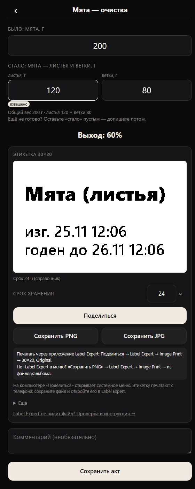
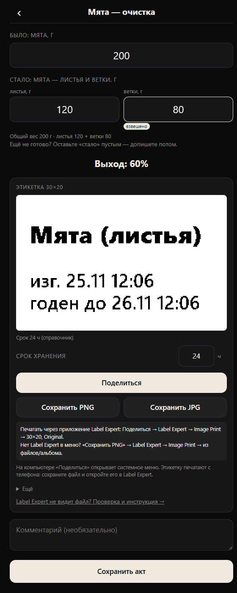
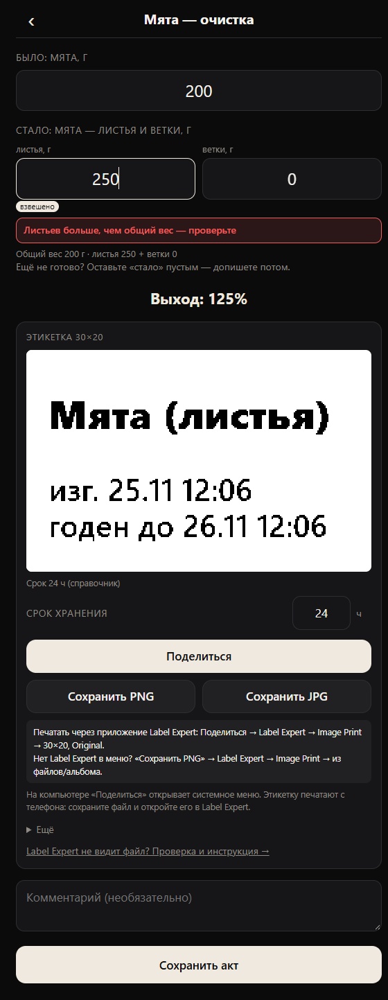
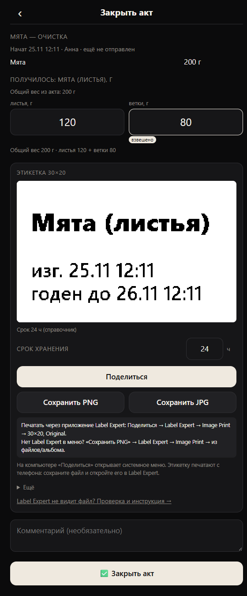

# Мята: вычитание из общего веса — отчёт

**Дата:** 25.11.2026. **Ветка:** `dsh-threads/21-09abc1` (от `main` `fecad9a`).
В `main` не пушилось. **Бэкенд развёрнут:** развёртывание **@51**, URL `/exec` не менялся.

| Коммит | Что |
|---|---|
| `2e9cc4e` | `feat(мята)` — вычитание из общего веса, миграция листа и колонок, тесты, `sw.js` v32 |
| этот коммит | `docs(мята)` — отчёт и скриншоты |

---

## Коротко

1. **Долей больше нет.** Лист «Пары позиций» теперь только говорит, какие две позиции
   образуют пару (мята-листья ↔ мята-ветки). `0.6 / 0.4` не используются.
2. **Общий вес — опора.** В акте «Мята — очистка» поле «Было: мята, г» — это общий вес.
   Под ним два поля: листья и ветки. Ввод в любое сразу считает второе:
   `вторая = общий вес − введённая`.
3. **Последнее введённое — источник.** Правка пересчитанного поля делает источником его.
   Отдельного «главного» поля нет; бейдж «взвешено» показывает, что ввели вручную.
4. **Сумма сходится.** В акт уходят точные значения (не округлённые), поэтому
   `листья + ветки = общий вес`. В таблице это видно по `F + R = V` и `W + X = V`.
5. **Старые данные сохранены.** Колонки `доля_A/доля_B` в листе и в актах помечены
   «(не используется)», значения `0.6/0.4` не стёрты; в комментарий листа дописана
   пометка о переходе на вычитание.

---

## Как это выглядит

### Ввели листья — ветки посчитались

200 г общего веса, листья 120 → ветки 80, выход 60 %.



### Ввели ветки — листья посчитались

200 г общего веса, ветки 80 → листья 120. Бейдж «взвешено» переехал на ветки.



### Листьев больше общего веса

200 г, листья 250 → ветки 0, заметное предупреждение; значение 250 не обрезано.
Сохранение акта в таком виде блокируется.



### Закрытие акта, где выход вписывали позже

Общий вес берётся из уже сохранённого акта (200 г), поля листьев/веток работают так же.



---

## Что стало с листом «Пары позиций»

### Схема

| A | B | C | D | E | F |
|---|---|---|---|---|---|
| `позиция_A` | `позиция_B` | `доля_A (не используется)` | `доля_B (не используется)` | `активен` | `комментарий` |
| `Мята (листья)` | `Мята (ветки)` | `0.6` | `0.4` | ☑ | `стартовое значение 0.6 / 0.4 — поправьте … \| 25.11.2026: доли не используются …` |

* Заголовки C/D при первом чтении переименованы в `доля_A (не используется)` /
  `доля_B (не используется)`. **Значения 0.6/0.4 остались на месте** — не стирались.
* В комментарий **дописана** пометка: «доли не используются — пересчёт вычитанием
  из общего веса; старые значения сохранены». Прежний текст владельца сохранён.
* `config.pairs` теперь отдаёт `[{a, b, comment}]`, без `shareA/shareB`.
* Новые пары добавляются строкой, как раньше; доли заполнять не нужно.
* Снятая галочка «активен» по-прежнему выключает пару: форма снова с одним полем.

### Проверено на живой таблице

`GET /exec?action=config` после @51:

```json
"pairs": [{
  "a": "Мята (листья)",
  "b": "Мята (ветки)",
  "comment": "стартовое значение 0.6 / 0.4 — поправьте по факту взвешивания | 25.11.2026: доли не используются — пересчёт вычитанием из общего веса; старые значения сохранены"
}]
```

Чтение листа через gviz подтвердило: заголовки C/D — «(не используется)»,
в строках по-прежнему `0,6` и `0,4`.

---

## Схема сохранения акта

Колонки A–P не менялись. Справа — **Q–X** (создаются/мигрируют при первом акте с парой):

| Q | R | S | T | U | V | W | X |
|---|---|---|---|---|---|---|---|
| `пара_позиция` | `пара_кол-во` | `доля_A (не используется)` | `доля_B (не используется)` | `взвешено` | `всего, г` | `часть_A, г` | `часть_B, г` |
| `Мята (ветки)` | `80` | *(старое 0.6, не трогаем)* | *(старое 0.4, не трогаем)* | `Мята (листья)` | `200` | `120` | `80` |

* `F «Кол-во»` — количество своей позиции строки (листья, 120).
* `R` — вторая часть (ветки, 80); `V` — общий вес; `U` — что взвесили.
* `W/X` — обе части в порядке пары A/B. Для мяты A = листья, B = ветки.
* `S/T` — старые доли. Новые акты их **не заполняют и не перезаписывают**:
  в исторических строках могли остаться `0.6/0.4`, их нельзя стирать.
* Для старой записи из очереди, где клиент ещё не присылал `pair.total`,
  общий вес берётся из ключевого сырья («Было»). Это позволяет принять
  записи, созданные до перехода.
* Если сумма не сходится или часть больше общего веса — сервер **не пишет акт**
  и возвращает ошибку. Молча сохранить противоречивые данные нельзя.
* Выход акта считается как раньше: `Результат` — листья, ветки в выход не входят.
  Для 200 → 120 выход 60 %.

Проверка суммы в тестах:

* `F + R = V`: 120 + 80 = 200;
* `W + X = V`: 120 + 80 = 200;
* источник «ветки»: `qty=80`, `total=200` → сервер сам получает листья 120,
  присланное клиентом «своё» число не используется.

---

## Пограничные случаи

| Случай | Поведение |
|---|---|
| Общий вес пуст или 0 | Оба поля пустые, подсказка «Сначала укажите общий вес». Пересчёта нет. |
| Листья больше общего веса | Ветки = 0; предупреждение «Листьев больше, чем общий вес — проверьте»; листья не обрезаются. Сохранение блокируется. |
| Ветки больше общего веса | Листья = 0; предупреждение «Веток больше…»; сохранение блокируется. |
| Отрицательное или мусор | Поле не пересчитывается, второе не подставляется; предупреждение «Введите число без минуса и букв — пересчёт не делаем». |
| Правка пересчитанного поля | Оно становится источником; второе пересчитывается от него. |
| Смена общего веса после ввода части | Второе поле пересчитывается от последнего введённого. 200→250 при листьях 120 даёт ветки 130. |
| Общий вес очистили | Оба поля очищаются, подсказка возвращается. |
| Дробные граммы | В полях и итоговой строке — целые; в акт уходят точные значения. `200,5 / 120,3 / 80,2`: сумма 200,5 сходится. |
| Закрытие акта с парой | Общий вес берётся из сохранённого акта, а не из клиента; листья и ветки считаются так же. |
| Пара выключена | Форма как раньше, одно поле; колонки пары не пишутся. |
| Вторая позиция пары неизвестна | Строка сохраняется как обычная, в «Лог» — предупреждение. |

### Дробные граммы: как решено

Правило: **считаем и сохраняем точное значение, показываем целое.**
В `meta()` уходят `total`, `own`, `qty` без округления; сервер пишет их как есть.
Поэтому `F + R = V` и `W + X = V` сходятся точно. В итоговой строке каждое число
округляется до целого: для `200,5 / 120,3 / 80,2` получится
`мята: 120 г листьев / 80 г веток (общий вес 201 г, взвешены листья)` —
сумма отображаемых чисел может отличаться от отображаемого общего веса на 1 г.
Это допускается условием; в сохранённой записи расхождения нет.

---

## Тесты

### Node, без Google

```text
node tools/test-features-pairs.mjs   → 22 из 22
node tools/test-mint-subtract.mjs    → 9 из 9
node tools/test-integration-16-17.mjs → 5 из 5
node tools/test-photo-check.mjs      → 46 из 46
node tools/test-stop-list.mjs        → 53 из 53
```

`test-features-pairs.mjs` проверяет миграцию листа (заголовки, сохранение 0.6/0.4,
комментарий), пары без долей, запись акта (общий вес, части, «взвешено», сумма),
источник «ветки», отказ при превышении, старую запись без `total`, закрытие акта
и сохранение старых долей в S/T.

`test-mint-subtract.mjs` — чистое вычитание без DOM: 200→120→80, 200→80→120,
200→250→0 + warning, пустой/нулевой общий вес, мусор, отрицательные, дроби,
допуск суммы.

### Браузер, мок-сервер

`node tools/demo-server.mjs`, приложение на `http://127.0.0.1:8799`:

* 200 → листья 120 → ветки 80, бейдж «взвешено», выход 60 %, этикетка;
* 200 → ветки 80 → листья 120, бейдж на ветках;
* 200 → листья 250 → ветки 0, предупреждение, сохранение блокируется;
* смена общего веса 200→250 при листьях 120 → ветки 130;
* очистка общего веса → оба поля пустые, подсказка;
* мусор «abc» → предупреждение, без пересчёта;
* сохранение: в `POST submit` уходит
  `{qty:120, pair:{item:'Мята (ветки)', qty:80, total:200, own:120, source:'own', weighed:'Мята (листья)'}}`;
  экран итога: `мята: 120 г листьев / 80 г веток (общий вес 200 г, взвешены листья)`;
* источник «ветки» → `source:'other'`, итог «взвешены ветки»;
* дробные 200,5 / 120,3 → в запросе `200.5 / 120.3 / 80.2`, сумма сходится;
* лимонный фреш 1000 → 300 = 30 %, одно поле, не сломался;
* экран закрытия акта: общий вес 200 из акта, ветки 80 → листья 120;
* списание открывается, этикетка строится, флаги разделов на месте.

Скриншоты — выше (`01`–`04`).

---

## Деплой

* `clasp push --force` + `clasp deploy -i AKfycbzRX…N7-w` → **@51**.
  URL `https://script.google.com/macros/s/AKfycbzRX…/exec` не менялся.
* Живой `config` проверен: `pairs` без долей, комментарий с пометкой.
* Живой лист «Пары позиций» проверен через gviz: заголовки C/D «(не используется)»,
  значения `0,6/0,4` на месте.
* **Колонки актов Q–X** мигрируют при первом акте с парой после деплоя:
  S/T помечаются «(не используется)», добавляются W/X. До первого такого акта
  в шапке актов остаются старые `доля_A/доля_B`; исторические значения не трогаются.
  `clasp run setupPairs` в этом окружении вернул `NOT_FOUND` (нет запуска через API),
  поэтому миграция произойдёт при первом сохранении мяты, а не вручную.
* Фронтенд в `main` не пушился. После публикации ветки телефоны получат `sw.js` v32;
  иногда нужно открыть приложение дважды.

---

## Что осталось / на что посмотреть

* **Публикация фронтенда.** Ветка `dsh-threads/21-09abc1` не пушилась; решение о мерже
  и публикации — за владельцем. До этого на телефонах старый клиент с долями,
  а сервер уже новый: старый клиент пришлёт `pair` без `total`, сервер возьмёт
  общий вес из «Было» и посчитает вычитанием. Для мяты 200/120/80 результат совпадёт,
  но для других соотношений старый клиент может показать не то — обновить PWA нужно.
* **«Свод переработки».** Формулы читают A–P; новые W/X стоят справа. Один взгляд
  после первого реального акта не помешает.
* **Комментарий в листе.** Он дописан, а не заменён: старый текст про 0.6/0.4
  остался как история. Если владелец хочет — можно удалить вручную.
* **Живой акт не создавался**, чтобы не засорять боевую таблицу. Проверка записи —
  на моке и таблице-заглушке; живая миграция колонок произойдёт на первом акте.

---

## Изменённые файлы

* `js/app.js` — блок пары: общий вес, вычитание, источник, предупреждения;
  экраны акта и закрытия; точные значения в `meta()`.
* `js/pair-calc.js` — чистые функции `splitPair`, `displayGrams`, `pairSumOk`.
* `styles.css` — `.pair-total-row`, `.pair-total`, `.pair-warn`.
* `apps-script/Код.gs` — лист «Пары позиций» без долей, миграция заголовков и
  комментария, Q–X, проверка суммы, запись/закрытие акта, fallback для старых записей.
* `apps-script/README.md` — новая схема.
* `sw.js` — `VERSION` v31 → v32, `js/pair-calc.js` в кэш.
* `tools/test-features-pairs.mjs`, `tools/test-integration-16-17.mjs` — обновлены.
* `tools/test-mint-subtract.mjs` — новый тест чистого расчёта.
* `tools/demo-server.mjs` — пары без долей.
* `docs/flags-pairs/ОТЧЁТ.md`, `docs/integration-16-17/ОТЧЁТ.md` — пометки,
  что описан прежний вариант с долями.
* `docs/mint-subtract/` — этот отчёт и скриншоты.
