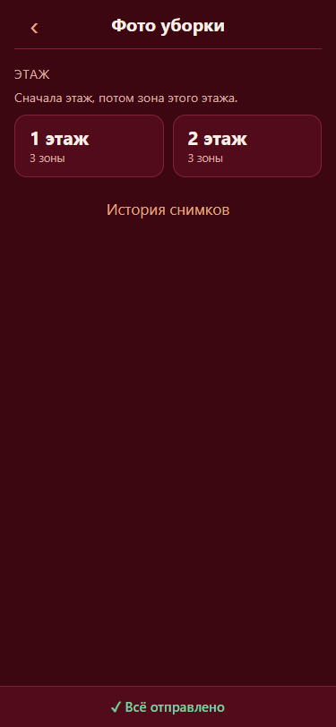
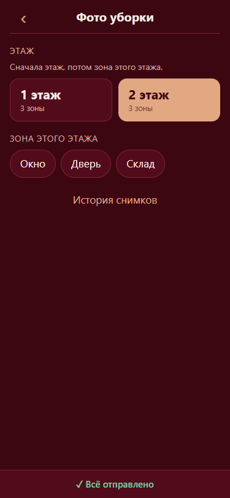

# Фото уборки: 6 утверждённых зон — отчёт

**Дата:** 24.11.2026. **Ветка:** `dsh-threads/16-06fda8` (от `main` `45cc815`).
В `main` не пушилось. Бэкенд развёрнут **версией 37** существующего
развёртывания, `/exec` не менялся.

---

## Коротко

* Владелец утвердил **6 зон**: 2 этаж — Окно, Дверь, Склад; 1 этаж — Бар,
  Холодильники, За баром. Старые 11 зон убраны из работы.
* Лист **«Эталоны уборки»** переписан под схему `этаж | зона | критерии |
  эталонное_фото`. Код теперь читает колонки **по названию шапки**, поэтому
  понимает и новую, и старую схему.
* Старые 11 строк **не удалены молча**: они перенесены в лист
  **«Архив эталонов»** с пометкой `до 24.11.2026`. Там же сохранена старая ссылка
  на эталон «Бар 2 этаж» и уточнение владельца по «Бар 1 этаж».
* «Списки»!B обновлён на те же 6 зон — приложение показывает ровно
  «1 этаж» (3 зоны) и «2 этаж» (3 зоны), группы «Без этажа» нет.
* Живая проверка: все **6 зон** проверены по критериям, плюс «Бар» — **с
  эталоном** (3 части запроса: текст + эталон + фото, ответ `crit` за 1,9 с).
* Лимит прежний: до **3 активных эталонов** + фото = не больше 4 изображений.

---

## Итоговая схема листов

### «Эталоны уборки» — новая схема

| Колонка | Заголовок | Что внутри |
|---|---|---|
| A | `этаж` | `1` или `2` |
| B | `зона` | Окно, Дверь, Склад, Бар, Холодильники, За баром |
| C | `критерии` | 4–5 строк, по одному проверяемому пункту на строку |
| D | `эталонное_фото` | необязательная одиночная ссылка (старый механизм) |

Порядок строк: 2 этаж (Окно, Дверь, Склад), затем 1 этаж (Бар, Холодильники,
За баром). Приложение всё равно сортирует этажи по возрастанию, поэтому на
экране сначала «1 этаж», потом «2 этаж».

**Совместимость.** `refsColumnMap_` ищет колонки по шапке: `этаж`/`floor`,
`зона`, `критерии`/`что проверять`, `эталонное_фото`/`эталонное фото`/
`ссылка_на_фото`. Поэтому старые тесты и старая схема
`Зона | Что проверять | Эталонное фото | этаж` тоже читаются. Если шапки нет
совсем — используется прежнее расположение A/B/C.

### «Эталоны — фото» — без изменений

`зона | порядок | ссылка_на_фото | ракурс | активен`.

* до 3 активных эталонов на зону; лишние не отправляются;
* порядок — по `порядок`, пустой уходит в конец;
* пустой `активен` = активен; `FALSE`/`нет`/`0` — выключен;
* битая ссылка: если все битые — `unclear` с причиной, если часть — работают
  оставшиеся.

### «Фото уборки» — без изменений, колонка S

A–R прежние, S `этаж` заполняется сервером. R при нескольких эталонах —
кликабельные «эталон 1 · эталон 2 · эталон 3».

### «Архив эталонов» — новый лист

Шапка: `пометка | <старые колонки «Эталонов уборки»> | архивировано`.

Перенесено **11 строк** (все старые зоны) с пометкой `до 24.11.2026` и датой
архивации. В архиве сохранены:

* все старые критерии, включая уточнение владельца по «Бар 1 этаж»:
  «на передней стойке слева стоит посуда и чистый инвентарь, справа
  допускается наличие чашек»;
* старая ссылка на эталон «Бар 2 этаж»:
  `https://drive.google.com/file/d/1-r49ANxZpLsWhnRImyoW65G2q1hMgoSi/view`;
* старые этажи (`1`/`2`).

Лист «Эталоны — фото» на момент миграции был пуст (только шапка), поэтому
архивировать из него было нечего. Старый список зон из «Списки»!B заменён на
6 новых; старые названия остались в «Архиве эталонов».

---

## Шесть зон и критерии

Критерии — стартовые, владелец может править их прямо в колонке C.

### 2 этаж

**Окно**
1. Подоконник сухой и протёртый, без пыли, посуды и посторонних предметов.
2. Стекло чистое, без разводов, пятен и следов рук.
3. Шторы или жалюзи висят ровно, без заломов.
4. На подоконнике нет бутылок, стаканов, коробок и личных вещей.
5. Рама и уголки окна без пыли и паутины.

**Дверь**
1. Полотно двери и ручка чистые, без пятен, следов рук и грязи.
2. Стекло двери чистое, без разводов и отпечатков.
3. На двери нет объявлений, наклеек и бумажек.
4. Коврик перед дверью лежит на месте и чистый.
5. Петли и доводчик без пыли и следов смазки.

**Склад**
1. Пол свободен, без коробок, мусора и пустой тары.
2. Коробки стоят на полках или в отведённых местах, не на полу.
3. Проход между стеллажами свободен.
4. Мусор вынесен, мешки и упаковка не лежат на полу.
5. Полки не перегружены, ничего не свисает в проход.

### 1 этаж

**Бар**
1. Стойка пустая и сухая, без грязной посуды и стаканов с остатками.
2. Поверхность стойки протёрта, без пятен, крошек и луж.
3. Инструмент вымыт и лежит на своих местах.
4. У края стойки нет пустых бутылок и банок.
5. На передней стойке слева допускается чистый инвентарь, справа — чашки;
   грязной посуды и стаканов с остатками быть не должно.

**Холодильники**
1. Дверцы закрыты, уплотнители чистые.
2. Полки чистые, без подтёков, крошек и грязи.
3. Продукты закрыты и промаркированы.
4. Посторонних предметов и открытых ёмкостей нет.
5. Внутри нет луж и сильного конденсата.

**За баром**
1. Пол чистый, без мусора, бутылок и посуды.
2. Мусор вынесен, мешок не переполнен.
3. Инвентарь (швабры, тряпки, вёдра) на своих местах.
4. Нет пустой тары и коробок на полу.
5. Проход за стойкой свободен.

---

## Экран выбора

* «1 этаж» — Бар, Холодильники, За баром (3 зоны).
* «2 этаж» — Окно, Дверь, Склад (3 зоны).
* Группы «Без этажа» нет: все шесть зон размечены, а если в данных всё же
  окажется пустой этаж, приложение относит зону к 1 этажу, а не прячет.
* После выбора зоны — камера/галерея, как раньше.

---

## Живая проверка 24.11.2026

Временное действие `?action=zonesTest17` (в версии 37 удалено) скачало тестовые
фото, положило эталон для «Бар» в «Эталоны — фото», прогнало проверку и удалило
тестовые строки/файлы. Фото — публичные с Wikimedia Commons, не из бара
владельца; это проверка кода, а не калибровка.

Тестовое фото смены: `Dirty dishes.jpg` (грязная посуда). Эталон для «Бар»:
`Bar at a restaurant in Tallin.jpg`.

| Зона | Режим | Изображений | Время Gemini | Вердикт |
|---|---|---|---|---|
| Окно | по критериям | 1 | 1,85 с (после 503 0,9 с) | `unclear` |
| Дверь | по критериям | 1 | 11,8 с (после 503 5,6 с) | `unclear` |
| Склад | по критериям | 1 | 10,4 с | `unclear` |
| Холодильники | по критериям | 1 | 1,3 с | `unclear` |
| За баром | по критериям | 1 | 1,6 с | `crit` |
| Бар | **с эталоном** | **2** (эталон + фото) | 1,9 с (после 503 1,5 с) | `crit` |

Все ответы — `gemini-flash-lite-latest`. Для «Бар» в запросе было **3 части**
(текст + эталон + фото), промпт содержал «На изображении 1 — эталон… на
изображении 2 — фото после уборки». Это доказывает, что эталон реально уходит
в Gemini вместе с фото.

**Про 503.** В первом прогоне «Бар» с эталоном попал в серию 503 от всех трёх
моделей; `savePhoto_` записал «не проверено», тестовая строка затем удалена.
Повторный прогон через `checkPhoto_` дал 503 один раз и успешный ответ со второй
попытки. Это перегрузка бесплатного Gemini, а не ошибка кода: тот же запрос с
эталоном отработал. Ветка 512 px при 503/сетевой ошибке сохранена.

Полный путь `savePhoto_` с записью вердикта, эталона в R и этажа в S проверен в
предыдущей итерации (строка `test16-…`); в этой итерации после прогона
тестовые строки `test17-…` удалены, чтобы не засорять «Фото уборки».

---

## Как владельцу загрузить эталоны — пошагово

1. **Проверить зоны и этажи.** Открыть «Эталоны уборки»: A `этаж`,
   B `зона`, C `критерии`. Сейчас 6 строк: 2 этаж — Окно, Дверь, Склад;
   1 этаж — Бар, Холодильники, За баром. Критерии можно править текстом.
2. **Открыть «Эталоны — фото».** Колонки: `зона | порядок | ссылка_на_фото |
   ракурс | активен`.
3. **Снять/загрузить фото на Google Диск.** Лучше в отдельную папку
   «Эталоны уборки». **Снимайте с того же ракурса, с которого бармены снимают
   зону после смены** — тогда модель видит те же предметы и не путается.
   Для каждой зоны — до 3 снимков: общий вид, рабочая поверхность, проблемное
   место.
4. **Скопировать ссылку.** Правой кнопкой по файлу → «Поделиться» → «Все, у кого
   есть ссылка» → «Читатель» → «Копировать ссылку».
5. **Вписать строку в «Эталоны — фото»:**
   * `зона` — точно как в «Эталоны уборки» B (`Окно`, `Дверь`, `Склад`, `Бар`,
     `Холодильники`, `За баром`);
   * `порядок` — `1`, `2`, `3`;
   * `ссылка_на_фото` — вставить ссылку;
   * `ракурс` — коротко: `со стороны входа`, `стойка крупно`, `вечерний свет`;
   * `активен` — галочка (пусто тоже считается «активен»).
6. **Проверить.** Открыть приложение → «Фото уборки» → этаж → зона → снять фото.
   В «Фото уборки» R будет `эталон 1 · эталон 2`, в «Лог» — строка
   `Gemini gemini-flash-lite-latest: … мс, изображений N`.
7. **Выключить эталон** — снять галочку `активен`, не удалять строку.
8. **Если эталонов нет** — проверка идёт по критериям из колонки C.
9. **Больше 3 активных** — уйдут первые 3 по `порядок`, остальные не
   отправляются.

---

## Что проверено

* `node tools/test-photo-check.mjs` — **46 из 46**:
  * новая схема читается по шапке (`этаж | зона | критерии | эталонное_фото`);
  * миграция не добавляет вторую колонку «этаж»;
  * критерии списком режутся по строкам, «1.», «2)», «—», «•», «;»;
  * прежние проверки эталонов, лимита 3, битых ссылок, 512 px и колонок M–S.
* Живой прогон: 6 зон по критериям + «Бар» с эталоном (см. таблицу).
* `?action=config` после деплоя: 9 сотрудников, 6 зон, 6 `photoZones` с этажами,
  `photoRefs` — 6 зон (сейчас 0 активных), 3 чек-листа, 63 ТТК, 65 сроков,
  факт дня.
* Не сломаны: `?action=questions` — 60, `?action=duelRating` — `ok:true`,
  `?action=openActs` — `ok:true`, `?action=photos` и `?action=photoVerdict` —
  работают (старые строки истории сохраняют старые названия зон).
* Временные действия `zonesMigrate17` и `zonesTest17` в версии 37 отсутствуют
  (проверено: «Неизвестное действие»).

---

## Развёртывание, ветка, коммиты

* Обновлено **существующее** развёртывание `AKfycbz…N7-w`; `/exec` не менялся.
* Версии: 31–32 — инспекция и миграция листов; 33–36 — прогон и проверка
  архива; **37 — финальная**, без временных действий.
* `sw.js` `VERSION` поднят `v26` → **`v27`**.
* Ветка `dsh-threads/16-06fda8`, от `main` `45cc815`. Коммиты — бэкенд,
  приложение, тесты, отчёт и скриншоты; в `main` не пушилось.
* `GEMINI_API_KEY` в код не писался, маска `AIza…****`.

---

## Что не проверено и риски

* Это по-прежнему **не калибровка** на реальных фото бара: тестовые снимки
  публичные. Владельцу стоит прогнать 2–3 реальные смены и поправить критерии.
* Бесплатный Gemini периодически отдаёт 503; код перебирает модели и повторяет
  с 512 px, но при длительной перегрузке вердикт будет `не проверено` с причиной.
  Смена из-за этого не блокируется.
* Старые строки в «Фото уборки» (зоны «Бар 1 этаж», «Бар 2 этаж» и т. п.)
  остались как история; на экран выбора они не влияют — он берёт только
  `config.photoZones`.
* «Архив эталонов» — обычный лист; если владелец захочет, старые строки можно
  удалить, но лучше оставить как историю до 24.11.2026.
* Ключ и региональный риск Gemini — без изменений, решение владельца.
