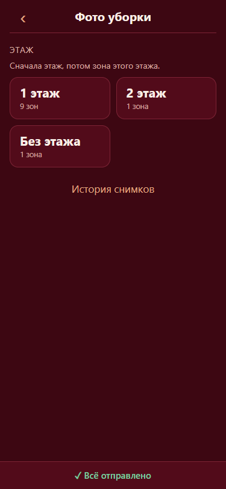
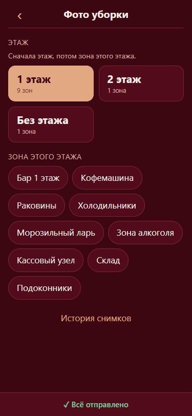

# Фото уборки: этажи и несколько эталонов — отчёт

**Дата:** 24.11.2026. **Ветка:** `dsh-threads/16-06fda8` (от `main` `45cc815`).
В `main` не пушилось, ветка не мержилась. Бэкенд развёрнут **версией 30**
существующего развёртывания, адрес `/exec` не менялся.

---

## Коротко

1. **Этажи.** В «Эталоны уборки» добавлена колонка `этаж` (D). В `config` появились
   `photoZones: [{zone, floor}]` и `photoRefs: [{zone, floor, active, total}]`;
   старое поле `zones` осталось прежним массивом строк. В приложении фото уборки
   теперь начинается с выбора этажа (крупные кнопки), затем — зоны этого этажа,
   затем камера/галерея. Зона без этажа не пропадает: она в группе «Без этажа».
2. **Несколько эталонов.** Новый лист «Эталоны — фото»: `зона | порядок |
   ссылка_на_фото | ракурс | активен`. В запрос уходят до **3 активных** эталонов
   (первые по `порядок`) + фото смены, всего **не больше 4 изображений**. Если
   эталонов нет — проверка идёт по тексту критериев, как раньше. Битая ссылка не
   роняет проверку: вердикт `unclear` с причиной.
3. **Промпт** переписан под несколько эталонов: сравнение по составу и порядку,
   ракурс может отличаться, оцениваются признаки (чистота поверхностей, мусор,
   посуда, контейнеры, инвентарь), а не совпадение кадра.
4. **Лимит и время.** 4 изображения на `gemini-flash-lite-latest` — **1,9 с**;
   полный путь сохранения фото с 2 эталонами — **12,2 с** (из них Gemini 4,5 с).
   При 503 тот же запрос повторяется с превью **~512 px** — на живом прогоне
   повтор занял **1,2 с**.
5. **Развёртывание:** версия **30**, `/exec` прежний. Ключ `GEMINI_API_KEY`
   хранится только в Script Properties (маска `AIza…****`), в код и отчёт не попал.

---

## Схема листов

### «Эталоны уборки» — добавлена колонка D

| Колонка | Содержимое |
|---|---|
| A | `Зона (как в «Списки», столбец B)` — не менялась |
| B | `Что проверять (ИИ читает это описание)` — не менялась |
| C | `Эталонное фото (ссылка на Google Диск)` — старая одиночная ссылка, поддержана |
| D | **`этаж`** — новое: `1`, `2`, … |

Формат: пишем просто **`1` / `2`** (числом или текстом — неважно). Код принимает
и `1 этаж`, `2 этаж`: из значения берётся первое число. Пустая ячейка = «Без этажа».
Колонка добавляется миграцией при первом чтении `config`; существующие A–C не тронуты.
Если в колонке C осталась старая ссылка, а в «Эталоны — фото» для зоны ничего нет,
она используется как один эталон (обратная совместимость).

### «Эталоны — фото» — новый лист

Создаётся автоматически при первом чтении `config` (и в `setupPhotoCheck()`),
шапка не дублируется.

| Колонка | Содержимое |
|---|---|
| A | `зона` — точно как в «Эталоны уборки» A / «Списки» B |
| B | `порядок` — 1, 2, 3… (первые по порядку уходят в запрос) |
| C | `ссылка_на_фото` — ссылка Google Диска на файл |
| D | `ракурс` — коротко, зачем снимок: «со стороны входа», «вечерний свет» |
| E | `активен` — галочка; пусто тоже считается «активен» |

Правила чтения:

* одна строка = один эталон;
* активные сортируются по `порядок` (пустой — в конец, при равенстве — как в таблице);
* в запрос берутся **первые 3 активных**; если активных больше, лишние **не
  отправляются**, в «Лог» пишется строка об этом;
* `активен` = `FALSE` / `нет` / `0` — эталон выключен и не отправляется;
* строка без ссылки игнорируется;
* все ссылки битые → `unclear` + причина «эталон не открылся: …», падения нет;
* часть ссылок битая → проверка идёт по оставшимся, в «Лог» — сколько не открылось.

### «Фото уборки» — добавлена колонка S

A–R не тронуты, в конец добавлена **S `этаж`**. Заполняется сервером при записи
вердикта (значение из «Эталоны уборки» D по зоне). Если зоны нет в «Эталонах
уборки» — S пустая, это и есть «Без этажа» на экране.

При нескольких эталонах колонка R «эталон» содержит ссылки «эталон 1 · эталон 2 ·
эталон 3» (каждая — кликабельная), при одном — прежнюю ссылку «эталон», при
отсутствии — `нет`.

---

## Этажи: что заполнено и что уточнить владельцу

При миграции 24.11.2026 этажи заполнены так:

| Зона | Этаж | Откуда |
|---|---|---|
| Бар 1 этаж | `1` | из названия |
| Бар 2 этаж | `2` | из названия |
| Кофемашина | `1` | по умолчанию — **уточнить** |
| Раковины | `1` | по умолчанию — **уточнить** |
| Холодильники | `1` | по умолчанию — **уточнить** |
| Морозильный ларь | `1` | по умолчанию — **уточнить** |
| Зона алкоголя | `1` | по умолчанию — **уточнить** |
| Кассовый узел | `1` | по умолчанию — **уточнить** |
| Склад | `1` | по умолчанию — **уточнить** |
| Подоконники | `1` | по умолчанию — **уточнить** |
| Другое | `1` | по умолчанию — **уточнить** |

**Владельцу нужно подтвердить 9 зон** (всё, кроме двух баров): если какая-то из
них на 2 этаже — поменять `1` на `2` в колонке D «Эталонов уборки». Больше
ничего делать не нужно: приложение само разложит зоны по этажам после обновления
справочника.

---

## Лимит эталонов и время ответа

* Максимум **3 активных эталона** + 1 фото смены = **4 изображения** за запрос.
  Больше в Gemini не отправляется (это же ограничение задачи).
* Порядок: по `порядок`; при 5 активных отправятся первые 3, ещё 2 — нет.
* Промпт при 3 эталонах: «На изображениях 1–3 — эталоны… На изображении 4 — фото
  после уборки. Оценивай ТОЛЬКО изображение 4», плюс требование сравнивать состав
  и порядок, а не кадр.

### Живые замеры 24.11.2026 (версия 29, `gemini-flash-lite-latest`)

| Сценарий | Изображений | Время Gemini | Время целиком | Вердикт |
|---|---|---|---|---|
| Без эталонов, по критериям (1 фото) | 1 | 1,14 с | 3,7 с | `unclear` (не тот кадр) |
| 2 эталона + фото, полный путь `savePhoto_` | 3 | **4,54 с** | **12,2 с** | `crit` |
| 5 активных, отправлены первые 3 + фото | 4 | **1,90 с** | 5,5 с | `crit` |
| Все ссылки битые (запроса не было) | 0 | — | 3,2 с | `unclear` + причина |
| Одна битая, одна живая → 503 → повтор 512 px | 3 → 3 | 2,77 с (503) + **1,17 с** | 13,1 с | `unclear` |
| Только неактивный эталон (запроса с эталоном нет) | 1 | 6,71 с | 8,5 с | `unclear` |

Выводы:

* 4 изображения на `gemini-flash-lite-latest` укладываются в **~1,9 с**; полный
  путь с загрузкой файла и записью в лист — **~12 с** (в худшем живом прогоне).
* На живом 503 сработал повтор **с превью ~512 px**: тот же запрос ушёл повторно,
  ответ — **1,2 с**. Это не «теоретическая» ветка: она реально выполнилась.
* Отдельно в первом прогоне (версия 28) `gemini-3.8-flash` на 3 изображениях
  ответил за **178 с**. Поэтому порядок моделей изменён: `gemini-3.8-flash`
  теперь последний, а модель, ответившая дольше 30 с, **не запоминается** как
  основная (`GEMINI_MODEL`). Следующий запрос снова начнётся с flash-lite.
* Ограничение «не больше 4 изображений» соблюдается жёстко: `PHOTO_MAX_IMAGES = 4`,
  `PHOTO_MAX_REFS = 3`.

---

## Как владельцу загрузить эталоны — пошагово

1. **Проверить этажи.** Открыть таблицу → лист **«Эталоны уборки»** → колонка
   **D `этаж`**. Она уже заполнена (`1`/`2`). Если зона на другом этаже — вписать
   `1` или `2`. Пусто = «Без этажа».
2. **Открыть лист «Эталоны — фото».** Он создан автоматически; если его не видно,
   откройте приложение один раз (оно читает `config`) или попросите добавить.
   В нём 5 колонок: `зона | порядок | ссылка_на_фото | ракурс | активен`.
3. **Загрузить фото на Google Диск.** Можно в любую папку. В коде уже есть папка
   «Бар — фото уборки» (`PHOTO_FOLDER_ID`) — брать ссылки можно и оттуда, но лучше
   завести **отдельную папку «Эталоны уборки»**, чтобы не смешивать эталоны с
   фото смен. Для каждого файла: правой кнопкой → «Поделиться» →
   «Все, у кого есть ссылка» → «Читатель» → «Копировать ссылку». Доступ по ссылке
   не обязателен для самого скрипта (он работает от владельца), но так ссылка
   точно откроется и с телефона.
4. **Вписать строку на каждый снимок в «Эталоны — фото»:**
   * `зона` — скопировать название из «Эталоны уборки» A (или «Списки» B),
     например `Бар 1 этаж`. Регистр не важен, пробелы важны;
   * `порядок` — `1`, `2`, `3` (в этом порядке фото пойдут в модель; больше 3
     не отправляется);
   * `ссылка_на_фото` — вставить ссылку из Диска;
   * `ракурс` — коротко: `со стороны входа`, `вечерний свет`, `стойка крупно`;
   * `активен` — галочка. Пустая клетка тоже считается «активен».
5. **Проверить, что получилось.** Открыть приложение → «Фото уборки» → этаж →
   зона → снять фото. Если эталоны есть, в листе «Фото уборки» в колонке R будет
   `эталон 1 · эталон 2`, а в «Лог» — строка вида
   `Gemini gemini-flash-lite-latest: 1900 мс, изображений 4`.
6. **Выключить эталон** — снять галочку `активен` (не удалять строку). Строка
   останется, но в запрос не попадёт.
7. **Если эталонов у зоны нет** — ничего не делать: проверка идёт по тексту
   критериев из колонки B, как раньше.
8. **Если зона новая** — добавить её в «Списки» B и в «Эталоны уборки» A
   (с критериями и этажом). Она появится на экране под нужным этажом.

---

## Что проверено

### Локальные тесты

`node tools/test-photo-check.mjs` — **43 из 43**. Добавлены проверки:

* этажи: `1`, `2 этаж`, пусто, значение по умолчанию, миграция колонки D;
* лист «Эталоны — фото»: создание, неактивный не берётся, порядок, лимит 3,
  пустой `активен` = активен;
* `photoZones`/`photoRefs` в `config`: этажи из «Эталонов уборки», зоны без
  этажа и зоны только из эталонов;
* запрос с 3 эталонами: ровно 5 частей (текст + 3 эталона + фото), эталоны
  первыми, фото последним, промпт «изображения 1–3… изображение 4»;
* все ссылки битые → `refsUnavailable` → `unclear` с причиной, запроса нет;
* часть ссылок битая → отправляются оставшиеся;
* 503 → та же модель повторяется с 512 px; медленный ответ (>30 с) не
  запоминается в `GEMINI_MODEL`;
* колонки M–S, запись этажа в S, несколько ссылок в R («эталон 1 · эталон 2»).

### Живой прогон на Gemini (версии 28–29, временное действие, в v30 удалено)

Тестовые изображения — публичные фото Wikimedia Commons (не фото владельца),
файлы лежат в `docs/photo-check/test/`:

| Файл | Что на нём | Источник |
|---|---|---|
| `ref1-bar-tallin.jpg` | барный зал/стойка | [Bar at a restaurant in Tallin.jpg](https://commons.wikimedia.org/wiki/File:Bar_at_a_restaurant_in_Tallin.jpg) |
| `ref2-bar-royaloak.jpg` | барная стойка | [Bar counter, Royal Oak, Wetherby](https://commons.wikimedia.org/wiki/File:Bar_counter,_Royal_Oak,_Wetherby_(31st_May_2024).jpg) |
| `ref3-bar-deutsches.jpg` | интерьер бара | [Deutsches Haus NOLA interior bar 1](https://commons.wikimedia.org/wiki/File:Deutsches_Haus_NOLA_interior_bar_1.JPG) |
| `shift-dirty-dishes.jpg` | грязная посуда (фото смены) | [Dirty dishes.jpg](https://commons.wikimedia.org/wiki/File:Dirty_dishes.jpg) |

Это **не калибровка качества**: снимки не из бара владельца. Цель прогона —
доказать, что код реально отправляет 1–3 эталона, модель отвечает, лимит и
битые ссылки работают.

Сценарии и результат:

1. **Зона без эталонов** (`Кофемашина`): 1 изображение, ответ 1,14 с, `unclear`
   («кофемашина не в кадре»). Текст критериев ушёл, падения нет.
2. **Зона с 2 эталонами** (`Бар 1 этаж`), полный путь `savePhoto_`: 3 изображения,
   Gemini 4,54 с, вердикт `crit`; в листе строка с `R = эталон 1 · эталон 2`,
   `S = 1`; фото сохранено на Диск.
3. **5 активных, лимит 3** (`Раковины`): в запросе ровно 3 эталона + фото
   (5 частей), `skipped = 2`; ответ 1,90 с, `crit`.
4. **Битая ссылка** (`Склад`): запроса к Gemini нет, `unclear` с причиной
   «эталон не открылся: полки: Недопустимый идентификатор файла или папки…».
5. **Одна битая, одна живая** (`Холодильники`): первый запрос 503, повтор с
   превью 512 px той же модели — 1,17 с; в запросе 1 эталон + фото.
6. **Только неактивный эталон** (`Подоконники`): эталон не отправлен (1 изображение),
   проверка по критериям, ответ 6,71 с.

### `config` после деплоя

`?action=config` → `ok:true`, 9 сотрудников, 11 зон, `photoZones` — 11 зон с
этажами, `photoRefs` — 11 зон (сейчас `active:0`, тестовые строки удалены),
`photoRefLimit:3`, 3 чек-листа, 63 ТТК, 65 сроков хранения, факт дня.
Остальное не сломано: `?action=questions` → 60, `?action=duelRating` → `ok:true`,
`?action=openActs` → `ok:true`, `?action=photos` и `?action=photoVerdict` работают,
у вердикта появилось поле `floor`.

---

## Скриншоты (375 px, обе темы)

---

## Развёртывание, ветка, коммиты

* Развёрнуто **существующее** развёртывание `AKfycbz…N7-w`; `/exec` не менялся.
* Версии: **28** — тестовый блок + основная функциональность; **29** — 512 px-
  повтор, порядок моделей, очистка; **30** — финальная, без временного действия.
* Временное действие `?action=photoTest16` и файл `Тест16.gs` в финальную версию
  **не входят** (проверено: действие отвечает «Неизвестное действие»).
* `sw.js` `VERSION` поднят `v25` → **`v26`**.
* Ветка `dsh-threads/16-06fda8`, от `main` `45cc815`; коммиты — отдельными
  сообщениями (бэкенд, приложение, тесты, отчёт и скриншоты). В `main` не пушилось.

---

## Что не проверено и риски

* **Реальные фото владельца и камера телефона.** Прогон на публичных фотографиях;
  калибровка «чисто/грязно» для конкретного бара ещё нужна.
* **Реальный сетевой таймаут.** Ветка 512 px сработала на живом 503, но именно
  таймаут `UrlFetchApp` не воспроизводился.
* **Превью Диска.** Если у файла нет превью (`getThumbnail()` вернул null),
  повтор с 512 px невозможен — вернётся ошибка/`unclear` с причиной.
* **Медленная запасная модель.** `gemini-3.8-flash` на 3 изображениях отвечала
  178 с; она оставлена последней и не запоминается. Если flash-lite и 3.1
  одновременно отдадут 503, пользователь может ждать долго — это ограничение
  бесплатного Gemini, а не логики.
* **Старые данные на телефоне.** Пока телефон не обновил `config`, экран фото
  может показывать старые зоны списком «Без этажа». После обновления (sw v26)
  этажи появятся.
* **Тестовая строка в «Фото уборки».** Осталась одна строка `ТЕСТ (удалить)` с
  вердиктом `crit`, `S=1`, `R=эталон 1 · эталон 2` (ID `test16-…`). Её можно
  удалить; фото на Диске при необходимости удалить отдельно. Строки эталонов
  после прогона удалены, лист «Эталоны — фото» пуст.
* **Ключ.** `GEMINI_API_KEY` не читался и не печатался; маска `AIza…****`.
  В коде ключа нет.
* **Региональный риск Gemini** (РФ нет в списке регионов) остаётся решением
  владельца, как и в предыдущем отчёте.
