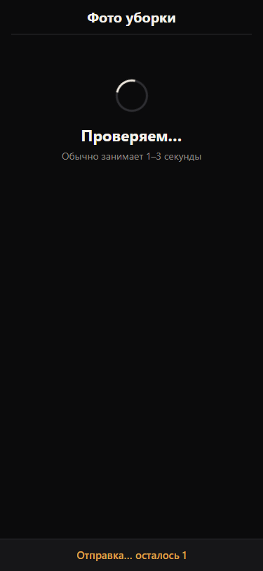
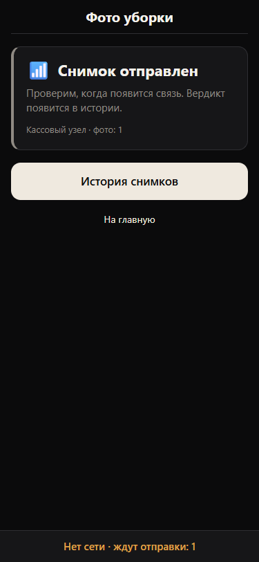
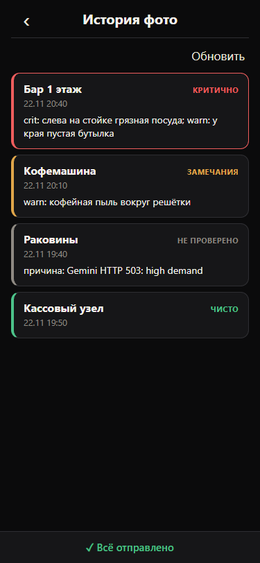
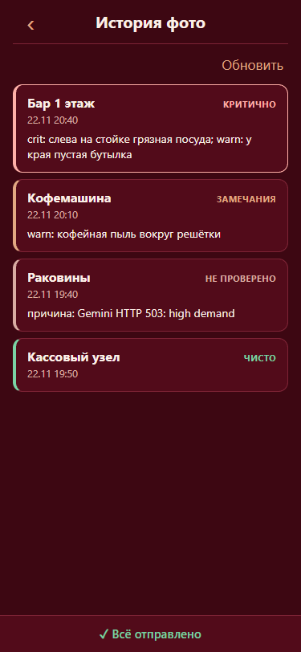
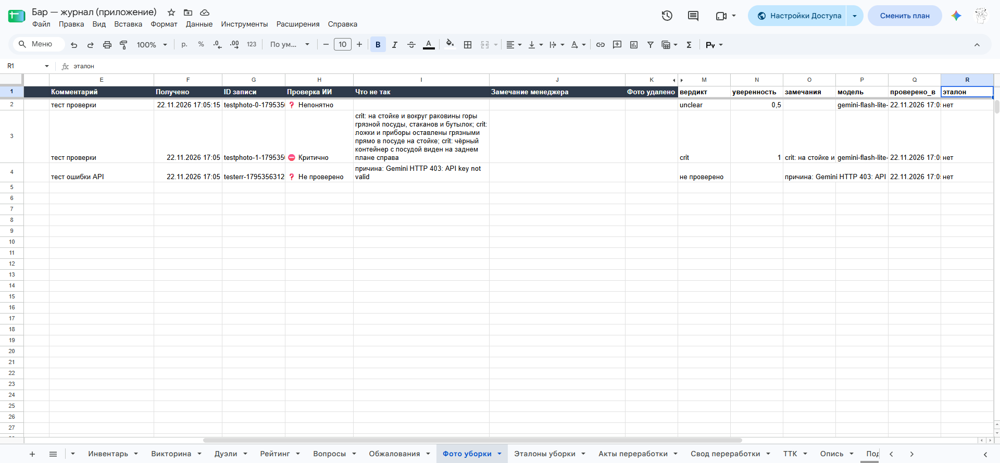

# Проверка фото уборки через Gemini — отчёт

**Дата:** 22.11.2026. **Ветка:** `dsh-threads/15-3370e2` (от `main` `4d482c9`).
В `main` не пушилось. Бэкенд развёрнут версией 27 существующего развёртывания,
адрес `/exec` не менялся.

---

## Коротко

Проверка фото оживлена и переписана: вместо мёртвых `setupPhotoCheck()` /
`checkPhotos()` / `cleanupPhotos()` (триггеров не было) стоит **синхронная**
проверка при загрузке. Сначала файл на Диске и строка в листе, потом запрос в
Gemini и запись вердикта. Ошибка Gemini не отменяет запись: в лист идёт
`не проверено` + причина. Триггеров и автоудаления фото нет.

В лист «Фото уборки» дописаны колонки **M–R**: `вердикт | уверенность |
замечания | модель | проверено_в | эталон`. Существующие A–L не тронуты;
H/I заполняются человеческим статусом и коротким текстом для совместимости.

В приложении после отправки — экран «Проверяем…», затем карточка `ok/warn/crit/
unclear`; офлайн — «Снимок отправлен, проверим когда появится связь»; есть
история последних снимков. Обе темы, 375 px.

**Реальные фото проверены** (публичные фотографии, не фото владельца):
чистая барная стойка → `warn`/`unclear` в зависимости от модели и кадра,
грязная посуда → `crit` (1.0), неверный ключ → `не проверено`. Подробности в
§«Чем проверено».

---

## Что сделано в бэкенде

### 1. Один механизм вместо трёх мёртвых функций

| Было | Стало |
|---|---|
| `setupPhotoCheck()` ставил триггеры `checkPhotos` каждые 10 минут и `cleanupPhotos` ночью | `setupPhotoCheck()` только создаёт/находит колонки M–R, ставит формат времени и проверяет ключ. **Триггеры не ставит.** |
| `checkPhotos()` раз в 10 минут искал непроверенные фото | проверка идёт **сразу** в `savePhoto_`, пока клиент ждёт ответ. 5 фото/день — секунды. |
| `cleanupPhotos()` удалял «чистые» фото старше 30 дней | **не оживлён**: фото — доказательство для разбора, срок хранения решает владелец. Кода автоудаления в проекте больше нет. |
| `geminiCheck_()` со схемой `{photo_ok, clean, issues}` | `geminiPhotoCheck_()` со схемой `{verdict, confidence, items[]}`; итог считает сервер |

Старый код удалён, второй параллельный механизм не оставлен.

### 2. Путь одного фото

1. `submit_` → `saveOne_` → `savePhoto_`.
2. Файл создаётся в «Бар — фото уборки» / `ГГГГ-ММ`.
3. `addRow_` пишет строку A–L; D — ссылка на файл.
4. `photoRefs_` читает «Эталоны уборки» по зоне.
5. `checkPhoto_` → `geminiPhotoCheck_` → Gemini.
6. `writePhotoVerdict_` пишет H/I и M–R. Ошибка записи логируется, но не
   отменяет сохранение фото.
7. В ответе `submit` для фото есть `verdict` — приложение может показать
   карточку сразу, не делая отдельный запрос.

Если Gemini ответил ошибкой, `photoUnchecked_` возвращает `level: unchecked`,
в лист пишется `вердикт: не проверено`, `замечания: причина: …`.

### 3. Промпт (кратко)

```
Ты проверяешь фото уборки бара в джаз-клубе. Зона: «{зона}».
[Если эталон: изображение 1 — эталон, изображение 2 — фото; оценивай только 2.
Эталон — образец, а не шаблон для попиксельного сравнения: сравнивай состав
и захламлённость, а не совпадение пикселей.]
Что проверять (критерии зоны):
1) … 2) … (предложения из колонки B «Эталонов уборки»)

Правила:
1. Видно только то, что видно; если пункта не видно — не додумывай,
   ставь level "unclear".
2. Тёмное/размытое/не тот кадр — тоже "unclear", а не "crit".
3. Не описывай и не оценивай людей на фото; если человек в кадре — не делай
   выводов о нём, оценивай только зону и предметы.
4. Нарушение — грязь, мусор, еда, грязная посуда, открытые продукты, лишние
   вещи, неубранный инструмент.
5. Для нарушения укажи, где оно: «слева на стойке», «под решёткой» и т. п.
6. crit — грязь/еда/мусор рядом с продуктами, грязная посуда, лужи на рабочей
   поверхности; warn — порядок и эстетика; ok — чисто; unclear — не видно.
7. Верни ТОЛЬКО JSON, без markdown, по схеме.
8. confidence — 0…1.
9. verdict — общий итог; сервер всё равно пересчитает его по пунктам.
```

Схема ответа:

```json
{
  "verdict": "ok|warn|crit|unclear",
  "confidence": 0.0,
  "items": [
    { "criterion": "пункт", "level": "ok|warn|crit|unclear", "comment": "что видно и где" }
  ]
}
```

Схема задана и в `responseSchema` Gemini (`responseMimeType: application/json`,
`temperature: 0`), и проверяется на сервере.

### 4. Как считается вердикт

Только на сервере, не в модели:

1. `confidence < 0.5` → **unclear**.
2. Есть хотя бы один `crit` → **crit**.
3. Иначе есть `warn` → **warn**.
4. Иначе есть `ok` → **ok**.
5. Если все пункты `unclear`/`na` → **unclear** (иначе «ничего не видно»
   превращалось бы в «чисто»).

Невалидный JSON, пустой `items`, `confidence` вне 0…1 → **unclear**, без
исключения и без потери строки. Модель может вернуть `unclear`/`na` для
пункта — это разрешено, потому что промпт прямо требует «не видно → unclear».

### 5. Эталон

Код поддерживает два изображения: если в «Эталонах уборки» заполнена колонка C,
`geminiPhotoCheck_` отправляет эталон первым, фото вторым и просит сравнивать
состав и захламлённость, а не пиксели. Сейчас C пустая у всех 11 зон, поэтому
на практике проверка идёт по тексту критериев. Когда владелец загрузит эталоны,
код менять не нужно.

### 6. Модели и таймаут

```js
const GEMINI_MODELS = ['gemini-flash-lite-latest', 'gemini-3.8-flash', 'gemini-3.1-flash-lite'];
```

* `gemini-flash-lite-latest` — рабочая, проверена 22.11.2026 (200, ~0,8 с).
* `gemini-3.8-flash`, `gemini-3.1-flash-lite` — запас: 22.11.2026 иногда отдавали
  503 «высокая нагрузка», но в тестах `gemini-3.1-flash-lite` ответил 200.
* `gemini-2.5-flash` (404) и `gemini-flash-latest` (503) из списка убраны.
* При 404/500/503 перебирается следующая модель; при 429 — ошибка квоты.
* Рабочая модель запоминается в свойстве `GEMINI_MODEL`; следующий запрос
  начинается с неё.
* `UrlFetchApp` не даёт задать таймаут. Если запрос не уложился (исключение
  сети/таймаута), код один раз повторяет с превью Диска (~512 px по длинной
  стороне). На живом запросе этого не потребовалось: ответы 11–13 с на больших
  фото и 0,8 с на маленьком.

---

## Что видит бармен

| Вердикт | Экран | Кнопки |
|---|---|---|
| `ok` | Спокойная карточка «✓ Всё чисто», без замечаний | «Понятно», «История снимков» |
| `warn` | «⚠ Есть замечания», список `warn`-пунктов цветом темы | «Понятно» (основная), «История снимков» |
| `crit` | Заметный красный блок «⛔ Критично», список `crit`/`warn` | «Переснять» (основная), «Всё равно закрыть» (текстовая), «История снимков» |
| `unclear` | «? Не удалось проверить» + причина (ошибка API, невалидный JSON или «не видно») | «Переснять», «Позже», «История снимков» |

* После «Сохранить» — экран «Проверяем…» (спиннер, «обычно 1–3 секунды»),
  затем карточка. Ожидание вердикта ограничено 18 секундами; если не успели —
  «Проверка идёт дольше обычного», снимок уже сохранён, вердикт будет в истории.
* Офлайн (`navigator.onLine === false`): «Снимок отправлен. Проверим, когда
  появится связь. Вердикт появится в истории». Запись остаётся в очереди.
* История: дата/время, зона, бейдж вердикта, замечания. Критичные — сверху
  (потом `warn`, `unclear`, `ok`), внутри — новые первыми. Локальные
  неотправленные снимки помечены «ждёт отправки». Экран доступен с экрана
  «Фото уборки» и из карточки вердикта.
* Ничего не блокируется: любой вердикт можно закрыть, смена не зависит от ИИ.

### Серверные действия для фронта

* `GET ?action=photoVerdict&id=<ID записи>` — вердикт по одной записи.
* `GET ?action=photos&limit=20` — последние снимки без имён сотрудников
  (дата, зона, уровень, замечания, модель, уверенность, эталон).
* В ответе `submit` у сохранённого фото есть `verdict`; `sync.js` кладёт его
  в `sent.server`, поэтому карточка появляется без отдельного запроса.

---

## Что в листе «Фото уборки»

Колонки в конце, порядок как в задаче:

| Колонка | Поле | Пример |
|---|---|---|
| M | `вердикт` | `ok` / `warn` / `crit` / `unclear` / `не проверено` |
| N | `уверенность` | `0.86` (число) |
| O | `замечания` | `crit: грязная посуда слева на стойке; warn: пустая бутылка у края` |
| P | `модель` | `gemini-flash-lite-latest` |
| Q | `проверено_в` | `22.11.2026 17:05` |
| R | `эталон` | ссылка «эталон» или `нет` |

Старые H «Проверка ИИ» и I «Что не так» заполняются тем же вердиктом
человеческим текстом — для совместимости с прежним видом листа.

`setupPhotoCheck()` создаёт/находит эти колонки, ставит формат времени и
проверяет ключ; повторный запуск не дублирует. В «Эталонах уборки» структура
не менялась.

---

## Чем проверено

### Локальные тесты (без сети)

`node tools/test-photo-check.mjs` — **31 из 31**. Загружает `Код.gs` в песочницу
Node с заглушками Apps Script и проверяет:

* разбиение критериев зоны и промпт (зона, критерии, «только JSON», запрет
  описывать людей, «не видно → unclear»);
* валидный JSON, markdown-обёртку, не-JSON, `confidence` вне 0…1, пустой
  `items`, нормализацию уровней;
* правила вердикта: `crit` > `warn` > `ok`, `confidence < 0.5` → `unclear`,
  все пункты не видны → `unclear`;
* запрос к Gemini: одна картинка, две картинки с эталоном (эталон первым),
  перебор моделей при 503, 429, 404, повтор с превью при сетевой ошибке;
* запись A–L + M–R, отказ от дублей колонок, `не проверено` + причина;
* чтение истории и вердикта по ID, «эталон» по зоне.

### Реальный Gemini на фотографиях

Проверка шла **из Apps Script** (локальные запросы во внешнюю сеть не проходят).
Фотографии — публичные с Wikimedia Commons (не фото владельца):

| Фото | Что вернул Gemini | Модель | Уверенность |
|---|---|---|---|
| Барный зал/стойка (`Bar at a restaurant in Tallin.jpg`, 1,2 МБ) | `warn`: «на стойке слева стоят бокалы — противоречит пустой стойке»; остальное `unclear`/`ok` | `gemini-3.1-flash-lite` | 0.9 |
| Та же стойка, повторный прогон | `unclear`: все 4 критерия «не видно» (ракурс/детали) | `gemini-flash-lite-latest` | 0.5 |
| Грязная посуда (`Dirty dishes.jpg`, 284 КБ) | `crit`: горы грязной посуды, стаканов, бутылок; ложки/приборы; чёрный контейнер справа | `gemini-flash-lite-latest` | 1.0 |
| Барная стойка (`Comptoir.jpg`, 135 КБ) | `warn`: «на дальней правой части стойки чашка с блюдцем»; поверхности чистые, пятен/луж нет, лишних вещей нет | `gemini-flash-lite-latest` | 0.9 |

Вывод: **вердикт различается** — грязная посуда даёт `crit`, чистая стойка —
`warn`/`unclear`, а не `crit`. Разница между `warn` и `unclear` на одном и том же
кадре показывает, что модель может быть неуверенной; сервер честно отдаёт
`unclear` при `confidence < 0.5` и при всех «не видно». Это ожидаемое поведение,
а не «грязно».

### Ошибки и границы

* **Неверный ключ** (эмуляция ошибки API): `checkPhoto_` вернул `не проверено`,
  в лист записана строка с `причина: Gemini HTTP 403: API key not valid`.
* **Невалидный JSON**: проверен локальным тестом — `validatePhotoAnswer_`
  возвращает `ok:false`, `photoFromGeminiResult_` даёт `unclear` с причиной,
  исключения нет. Живой моделью невалидный JSON не провоцировали.
* **Лимит 5 фото/день**: не упёрлись. За сессию — 5 проверок (2 + 2 + 1) и
  одна ошибка без вызова Gemini. `generateContent` не вернул 429; попытка
  генерировать тестовые картинки моделью `gemini-2.5-flash-image` дала 429
  (квота генерации картинок), поэтому тестовые фото взяты публичные.
* **Ошибка эталона**: эталонов нет; путь с двумя картинками проверен юнит-тестом
  (в запросе ровно 3 части: текст + эталон + фото).
* **Таймаут/уменьшение до 512 px**: юнит-тест эмулирует сетевую ошибку и
  проверяет, что второй запрос уходит с превью; на живом запросе не потребовалось.

### Лист

В «Фото уборки» записаны три тестовые строки (сотрудник `ТЕСТ (удалить)`):

1. «Бар 1 этаж» — `unclear`, 0.5, `gemini-flash-lite-latest`;
2. «Бар 1 этаж» — `crit`, 1.0, замечания про грязную посуду и чёрный контейнер;
3. «Раковины» — `не проверено`, причина `Gemini HTTP 403: API key not valid`.

Их можно удалить: выделить строки 2–4 и удалить. Структура листа не менялась,
добавлены только колонки M–R.

### Развёртывание

* Обновлено **существующее** развёртывание `AKfycbz…N7-w`; `/exec` не менялся.
* **Версия 27** от 22.11.2026 (до неё были 26 и 25 в тот же день).
* После деплоя проверены: `?action=ping` → `ok:true`; `?action=config` → `ok:true`,
  9 сотрудников, 11 зон, 3 чек-листа, 63 ТТК, 65 сроков хранения, факт дня;
  `?action=photos` → 3 строки; `?action=photoVerdict&id=…` → вердикт;
  `?action=questions` → 60 вопросов (`v60-…`); `?action=duelRating&employee=…` →
  `ok:true`, рейтинг и матчи.
* `sw.js` `VERSION` поднят с `v24` до `v25`.
* Фронтенд в этой ветке; на GitHub Pages не публиковался — публикация после
  merge, как решит пользователь.

---

## Скриншоты












---

## Расхождения с исследованием и решения

1. **Провайдер.** `docs/photo-check/ИССЛЕДОВАНИЕ.md` рекомендовал GigaChat 2 Pro,
   а Gemini — только офлайн-бенчмарк из-за доступности в РФ. Задача явно требует
   Gemini и сообщает, что ключ уже проверен. Сделано на Gemini; региональный и
   юридический риск из §2 исследования остаётся, это решение владельца.
2. **Порог уверенности.** В исследовании стартово 0,6; в задаче — 0,5.
   Поставлено 0,5.
3. **Уровень пункта.** В схеме задачи `level` только `ok|warn|crit`, но промпт
   требует «не видно → unclear». Реализовано `ok|warn|crit|unclear` (+ `na`
   нормализуется), иначе модель не могла бы выполнить правило. Итог всё равно
   считается по правилам сервера.
4. **Все пункты не видны.** Добавлено правило «все `unclear`/`na` → общий
   `unclear`», которого нет в буквальных правилах задачи; без него фото, где
   ничего не видно, получало бы `ok`.
5. **Колонки.** В исследовании предлагалась миграция A–Q и отдельный лист
   «Разборы фото». В задаче — дописать M–R, не ломая существующие. Сделано
   M–R; H/I сохранены как человеческий статус. Отдельного листа с полным JSON
   нет: хранится короткий текст замечаний. Полный JSON при необходимости можно
   добавить позже, не меняя этот код.
6. **Триггеры и автоудаление.** В исследовании — проверка раз в 30 минут и
   удаление «чистых» фото через 30 дней. В задаче — синхронно, без триггера,
   ничего не блокировать. Автоудаление не включалось: фото — доказательство.
7. **Эталоны.** В исследовании — 11 зон × 2–3 ракурса, отдельная папка.
   У владельца их пока нет; код готов принимать ссылку в колонке C, но реальный
   тест с эталоном не проводился.

---

## Что не проверено

* **Реальные фото владельца и камера телефона.** Проверка шла на публичных
  фотографиях из Wikimedia Commons; владелец ещё не снимал 2–3 зоны. Для
  калибровки это нужно сделать: ракурс, свет и обстановка бара сильно отличаются.
* **Реальная отправка из приложения с PIN и очередью.** Бэкенд проверен прямым
  вызовом `savePhoto_` (файл, строка, Gemini, вердикт); фронтенд — с подменой
  `fetch` в браузере. Настоящий телефон/камера/авиарежим не проверялись.
* **Эталонное фото.** Колонка C пустая; путь с двумя изображениями проверен
  только юнит-тестом (состав запроса), не реальным сравнением.
* **Точный лимит 5 фото/день.** Не упёрлись; сколько именно осталось в free tier
  на аккаунте, из РФ не видно (консоль AI Studio недоступна). `generateContent`
  не отдавал 429; генерация картинок отдала 429.
* **Таймаут и уменьшение до 512 px.** Механизм есть и покрыт тестом, но живой
  таймаут `UrlFetchApp` не воспроизводился.
* **Автоудаление фото.** Не включено; срок хранения (30/90 дней) — решение
  владельца, как и в исследовании.
* **Региональная доступность Gemini.** Ключ работает из Apps Script, но РФ нет
  в списке регионов Gemini; риск блокировки/смены модели остаётся. Это не
  проверка кода, а решение о провайдере.
* **Остальные экраны.** Чек-листы, викторина, дуэль, этикетка и факт дня не
  менялись; данные проверены (`?action=config` — 3 чек-листа, 63 ТТК, 65 сроков,
  факт дня; `?action=questions` — 60; `?action=duelRating` — `ok:true`).
  Сами экраны после деплоя вживую не прокликивали.

---

## Ветка и коммиты

* Ветка: `dsh-threads/15-3370e2`, от `main` `4d482c9`.
* Коммиты: бэкенд, приложение, тесты, отчёт и скриншоты — отдельными коммитами
  в этой ветке. В `main` не пушилось, ветка не мержилась.

## Как удалить тестовые строки

В листе «Фото уборки» выделить строки 2–4 (сотрудник `ТЕСТ (удалить)`) и
удалить. Это не влияет на приложение и на колонки M–R.
