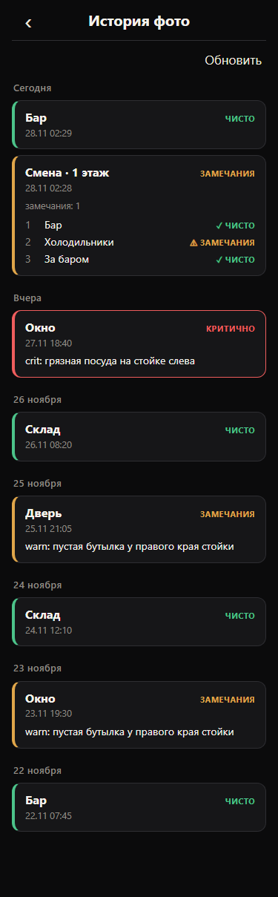
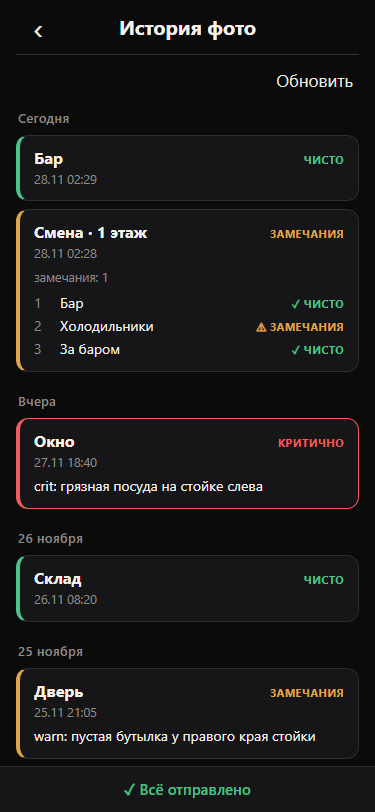
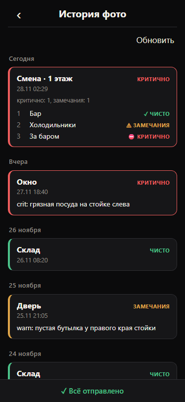
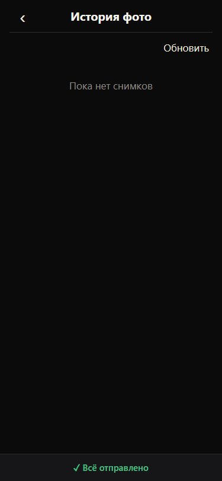

# История фото: по датам, а не по качеству уборки — отчёт

**Дата:** 28.11.2026. **Ветка:** `dsh-threads/23-0d8382` (от `main` `ae95bba`).
В `main` не пушилось. **Бэкенд не менялся:** `apps-script/Код.gs` и URL
`/exec` те же, сортировка и группировка — только на телефоне. `sw.js` —
`v35` (`v34` → `v35`).

| Коммит | Что |
|---|---|
| `d8bddf0` | `feat(фото)` — сортировка истории по дате, группировка по дням, тестовые данные демо-сервера, скрипт проверки и скриншоты, `sw.js` v35 |
| коммит с этим отчётом | `docs(фото)` — отчёт и README к скриншотам |

---

## Коротко

1. **Порядок в истории — только по времени снимка, новые сверху.** Вердикт
   (критично / замечания / чисто) больше не двигает строку: критичный
   вчерашний снимок стоит **ниже** сегодняшнего чистого.
2. **Группировка по дням:** «Сегодня», «Вчера», дальше дата — «26 ноября»
   (если год не текущий, добавляется год). Внутри дня — от новых к старым.
3. **Внутри прохода кадры идут в порядке съёмки** (1, 2, 3), а не по вердикту.
4. **Лимит — после сортировки по дате.** Показываются 30 последних проходов;
   обрезаются самые старые, а не «самые плохие». Сервер по-прежнему отдаёт
   до 50 строк (`?action=photos&limit=50`), но порядок на экране задаёт
   клиент — поэтому старые офлайн-снимки, отправленные позже, встают на своё
   место по времени съёмки.
5. Вердикты, цвета, бейджи, кнопки, пересъёмка и пустое состояние не
   менялись.

---

## Где была сортировка и что стало

Всё в `js/app.js`, экран `screenPhotoHistory`.

**Было** (`photoRuns`, до правки):

```js
groups.sort((a, b) => ((rank[b.level] || 0) - (rank[a.level] || 0))
  || String(b.at || '').localeCompare(String(a.at || '')));
```

Сначала ранг вердикта (`crit` 3 → `warn` 2 → `unclear` 1 → `ok` 0), и только
при равном ранге — дата. Поэтому критичные всегда были сверху.

**Стало:**

```js
// Проходы — от новых к старым; вердикт на место в списке не влияет.
groups.sort((a, b) => comparePhotoAt(b.at, a.at));
```

* `at` — время снимка (оно же `createdAt` записи в очереди; сервер пишет его
  в колонку A листа «Фото уборки»). Время **записи строки** не используется.
* `comparePhotoAt` / `photoAtMs` — сравнение по `Date.parse`, пустая или
  битая дата уходит вниз. Строковое сравнение ISO оставлено только как
  тай-брейк.
* Внутри прохода: `g.photos.sort((a, b) => comparePhotoAt(a.at, b.at))` —
  по времени кадра, то есть в порядке съёмки.
* Обрезка: `groups.slice(0, PHOTO_HIST_RUNS)` (30) выполняется уже после
  сортировки по дате, затем `photoHistoryDays(...)` добавляет заголовки.

**Группировка:**

* день считается по местному времени телефона: `dayKey(new Date(at))`;
* «Сегодня» / «Вчера» — по календарным дням, а не «24 часа назад»;
* остальные дни — `toLocaleDateString('ru-RU', {day:'numeric', month:'long'})`
  → «26 ноября»; для другого года добавляется год;
* снимки без даты — в конце, под заголовком «Без даты»;
* заголовки — `photoHistoryDays`, стиль `.photo-hist-day` в `styles.css`.

Код: `js/app.js:1488` (`PHOTO_HIST_RUNS`), `js/app.js:1739` (обрезка после
сортировки), `js/app.js:1760` (`photoRuns`), `js/app.js:1810`
(`photoHistDayLabel`), `js/app.js:1824` (`photoHistoryDays`),
`styles.css:618`.

---

## Скриншоты

Сняты с локального демо-сервера (`tools/demo-server.mjs`), окно 375×812.
**Вердикты и даты — демо-данные**, боевая таблица не использовалась.

### История сгруппирована по дням, внутри дня — новые сверху



### Критичное вчера — ниже чистого сегодня (главная проверка владельца)

Первая строка — сегодняшний «Бар · чисто» (28.11 02:26), ниже — сегодняшняя
смена из трёх кадров, и только под «Вчера» — критичное «Окно» (27.11 18:40).



### Новый проход из трёх кадров встал на своё место по дате

После реальной отправки трёх кадров (демо-вердикты) новый проход — первая
строка под «Сегодня», кадры 1–2–3 в порядке съёмки, вчерашний критичный
снимок остался ниже.



### Пустое состояние не изменилось



---

## Что проверено

**Автопроверка на экране истории** — `node tools/screenshot-photo-history.mjs`
(демо-сервер, headless Chrome; падает, если expectation не сходится):

* 7 заголовков дней, первый — «Сегодня», второй — «Вчера»;
* первая строка — сегодняшний одиночный снимок «чисто»;
* группа из трёх кадров — под «Сегодня», кадры `Бар | Холодильники |
  За баром` и номера `1 2 3`;
* критичный вчерашний снимок «Окно» — под «Вчера», ниже сегодняшних строк,
  бейдж «критично» виден;
* внутри каждого дня время не растёт;
* пустое состояние — ровно «Пока нет снимков»;
* лимит: набор из 35 снимков (самые старые 5 — критичные) → показано ровно
  30, ни одного критичного (старые не всплыли и не попали в показ);
* новый проход из трёх кадров: 7 строк, проход первый, под «Сегодня», кадры
  по порядку.

**Скриншоты** — 01–04 в этой папке (сняты тем же прогоном).

**Регрессия существующего:**

* `node tools/screenshot-photo-run.mjs` — поток «этаж → три кадра →
  отправка», блок стоп-листа в проходе, сводка, «зона не определена» → смена
  зоны вручную: **все шаги прошли**. Старые скриншоты `docs/photo-run/` не
  менялись (после проверки возвращены как были).
* `node tools/test-photo-check.mjs` — **67 из 67**.
* `node tools/test-features-pairs.mjs` — **22 из 22**;
  `node tools/test-integration-16-17.mjs` — **5 из 5**;
  `node tools/test-mint-subtract.mjs` — **9 из 9**.
* Ручная проверка в headless Chrome (временный скрипт, в репозиторий не
  попал): чек-лист «Открытие бара» открывается, пункт отмечается («1 из 2»),
  «Отправить» → экран «Готово: 1 из 2»; экран «Стоп-лист» открывается и
  показывает **7 строк** из демо-данных.
* `node tools/test-stop-list.mjs` — **47 из 53**; 6 падений **не связаны с
  правкой**: тест читает только `apps-script/Код.gs`, а он не менялся
  (`git diff --stat -- apps-script` пуст). Падения были до этой ветки и
  остались как есть — чинить бэкенд в этой задаче не требовалось.

## Что НЕ проверено (честно)

* Боевая таблица и живой `/exec`: сортировка чисто клиентская, бэкенд не
  трогали, поэтому на реальных данных истории отдельного прогона не было.
  На реальном устройстве проверить стоит: старые снимки без `runId` тоже
  попадут в дни по своей дате.
* Лимит сервера остался прежним (50 строк, обрезка по строкам листа, а не по
  дате). Если офлайн-снимки отправлены сильно позже и вытеснили более новые
  строки из этих 50, клиент покажет то, что пришло; менять бэкенд в задаче
  было нельзя.
* Скриншоты `docs/photo-run/` (прошлый отчёт) не перегенерированы — там
  история без заголовков дней; актуальный вид — в этой папке.

## Ветка и коммиты

* Ветка `dsh-threads/23-0d8382` от `main` `ae95bba`.
* `d8bddf0` — код, тестовые данные демо-сервера, скрипт проверки, скриншоты,
  `sw.js` v35.
* Коммит с этим отчётом — `docs(фото)`.
* В `main` не пушилось, ветка не мержилась.
