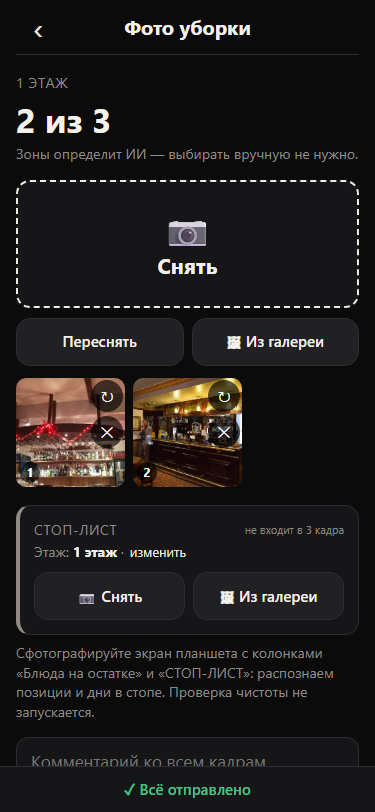
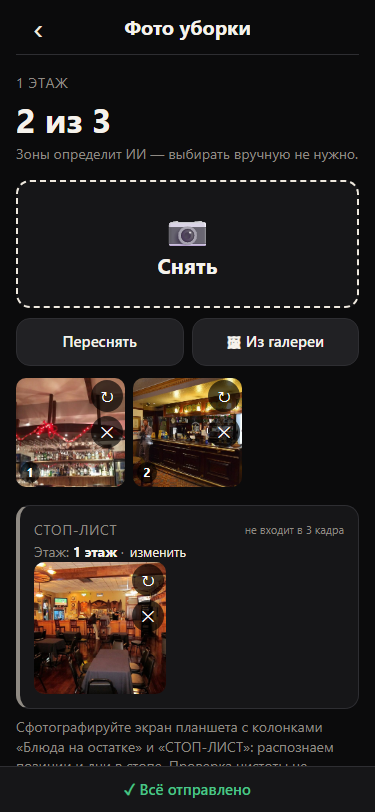
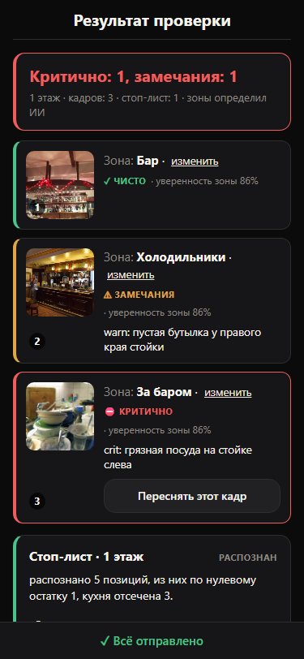
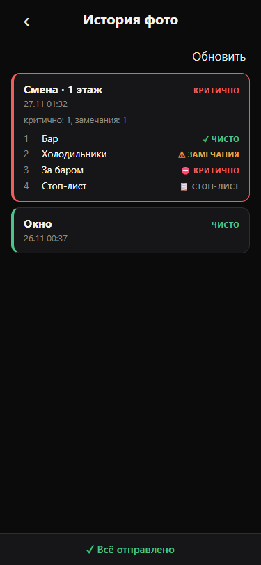
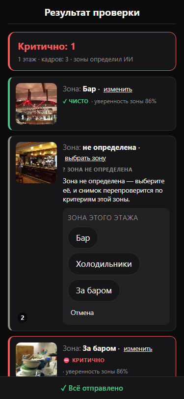
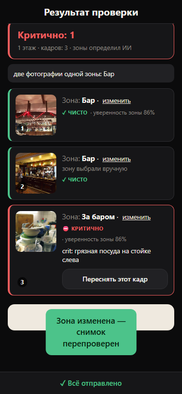

# Фото уборки: этаж → три кадра → одна отправка — отчёт

**Дата:** 27.11.2026. **Ветка:** `dsh-threads/22-6384b3` (от `main` `4e588b2`).
В `main` не пушилось. **Бэкенд развёрнут:** версия **60** существующего
развёртывания `/exec` (адрес не менялся). `sw.js` — `v34`.

| Коммит | Что |
|---|---|
| `7c3d492` | `feat(фото)` — три кадра за проход, определение зоны ИИ, ручная смена зоны, колонки T–V, тесты, `sw.js` v33 |
| `13fe4de` | `docs(фото)` — отчёт первой части и скриншоты 01–05 |
| коммит с уточнениями | `feat(фото)` — эталоны в определении зоны и проверке, стоп-лист в проходе, `sw.js` v34; отчёт и скриншот 06 |

Ключ Gemini в код не писался и в отчёте не приводится: он лежит в свойствах
скрипта (`GEMINI_API_KEY = ****…`).

---

## Коротко

1. В основном пути больше нет выбора зоны: **этаж → до трёх кадров → одна
   отправка**. Счётчик «N из 3», любой кадр можно переснять или убрать.
2. Все кадры прохода уходят в очередь **пачкой с общим `runId`** и в истории
   выглядят одной сменой, а не тремя записями. Отправлять можно и один кадр.
3. Зону каждого кадра сервер определяет **сам, из списка зон этого этажа**
   (отдельный запрос к Gemini). Если `zone_confidence < 0.6` — зона «не
   определена», проверка чистоты **не запускается**, бармен выбирает зону
   одним нажатием, и снимок перепроверяется по её критериям.
4. Сводка после отправки: три строки «миниатюра · зона · вердикт» и общий
   итог («Замечаний нет» / «Критично: 1, замечания: 2»). Критичный кадр можно
   переснять отдельно, не переснимая все три.
5. В лист «Фото уборки» добавлены колонки **T `проход_id`**,
   **U `зона_определена_автоматически`**, **V `уверенность_зоны`**.
   Существующие A–S не тронуты, в старые строки ничего не записано.
6. **Стоп-лист можно снять там же**, на экране трёх кадров: отдельный снимок,
   свой этаж, старый путь распознавания и дней в стопе, тот же `runId`.
7. **Эталоны владельца** (5 зон из 6, имена файлов в «Эталонах уборки»)
   работают в проверке зоны; в классификацию они не идут — замер показал, что
   так безопаснее (см. §«Уточнение 1»).

---

## Новый поток по шагам

1. Главная → плитка **«Фото уборки»** («этаж и три кадра»).
2. Экран раздела: режим **«Фото зоны»** (по умолчанию) или **«Стоп-лист»**
   (отдельный, как раньше). В режиме фото — только этаж.
3. Выбор этажа открывает съёмку: крупная кнопка **«Снять»**, счётчик
   **«0 из 3»**, миниатюры, кнопки **«Переснять»** (последний кадр) и
   **«Отправить»** (активна с первого кадра). У каждой миниатюры есть `↻`
   (переснять именно этот кадр) и `✕`. Ниже — отдельный блок **«Стоп-лист»**
   (свой снимок и этаж, в три кадра не входит; см. §«Уточнение 2»).
4. «Отправить» кладёт все кадры в очередь с одним `runId`, этажом и
   `autoZone: true`; снимок стоп-листа — с тем же `runId`, `stopList: true` и
   своим этажом. Комментарий (необязательный) — один на проход.
5. Экран «Проверяем…» с прогрессом «Проверено N из 3…» (или «из 4», если был
   стоп-лист); кадры уходят на сервер по одному (так каждый запрос к Apps
   Script короткий).
6. Сводка: по каждому кадру зона и вердикт, общий итог, карточка стоп-листа,
   при необходимости — «Переснять этот кадр» и «История снимков».

Офлайн: кадры остаются в очереди, при появлении сети уходят все три с тем же
`runId` (проверено отдельным прогоном, см. §«Что проверено»).

---

## Как определяется зона и порог

* **Список зон — только этажа.** Перед проверкой сервер собирает зоны этого
  этажа из «Списков» и «Эталонов уборки» (этаж + критерии) и передаёт их в
  промпт. Модель обязана назвать зону **дословно из списка**; зона, которой
  в списке нет, не принимается ни при какой уверенности. Допускается только
  уточнение этажа в названии («Окно 2 этажа» → «Окно»), это то же название.
* **Два шага, а не один.** Шаг 1 — «какая это зона» (`{"zone",
  "zone_confidence"}`, в промпте только зоны и их критерии, без задачи
  проверки). Шаг 2 — обычная проверка чистоты по критериям найденной зоны
  (тот же `checkPhoto_`, что и раньше). Почему два, а не один — см. замер:
  один запрос вдвое быстрее, но путает зоны и выдумывает вердикт там, где
  зоны нет.
* **Порог `zone_confidence < 0.6`** (`PHOTO_ZONE_MIN_CONF`). Ниже порога:
  * `zone` = «зона не определена», проверка чистоты **не вызывается**;
  * в лист: зона «зона не определена», H «❓ Зона не определена»,
    M `unclear`, T–V: проход, «нет», уверенность;
  * телефону: `level: unclear`, `zone: "зона не определена"`,
    `zoneAuto: false`, `zoneConfidence` — фактическая;
  * бармену: строка «Зона: не определена · выбрать зону» и мягкий текст, без
    модалки. Выбор — чипы зон этого этажа прямо в строке.
* **Смена зоны вручную** (`POST action=photoRecheck`): сервер проверяет
  PIN и что снимок свой (или роль админ), берёт файл с Диска, проверяет по
  критериям **новой** зоны и обновляет строку: C «зона», H/I, M–S, U «нет»,
  V очищается. Проход (`runId`) сохраняется.
* Если два кадра попали в одну зону — оба сохраняются, в сводке появляется
  «две фотографии одной зоны: Бар» (подтверждено скриншотом 05).

## Что видит бармен

Скриншоты сняты с локального демо-сервера (`tools/demo-server.mjs`): он
подменяет ответы Gemini, чтобы показать экраны. **Вердикты на скриншотах —
демо-данные**, качество и время модели измерены отдельно на реальных фото
(§«Замер»).

### Съёмка: счётчик «2 из 3», переснять можно любой кадр



### Блок «Стоп-лист» на том же экране: свой снимок и этаж



### Сводка: три строки, общий итог и карточка стоп-листа



### История: одна смена = одна запись с кадрами прохода



### «Зона не определена» — выбор зоны одним нажатием



### После смены зоны: перепроверка и «две фотографии одной зоны»



---

## Лист «Фото уборки»

Проверено на боевой таблице (временным read-only действием, удалено после
проверки):

```
M вердикт | N уверенность | O замечания | P модель | Q проверено_в | R эталон |
S этаж | T проход_id | U зона_определена_автоматически | V уверенность_зоны
```

* Последняя строка на момент проверки — 25-я; T–V в ней пустые, то есть в
  существующие строки ничего не записано.
* Колонки создаются и при обычном `?action=config` (`photoMigrate_` →
  `ensurePhotoColumns_`), и `setupPhotoCheck()`; повторный запуск их не дублирует.
* Для старых снимков `runId` пустой — приложение показывает их отдельными
  строками, как раньше.

---

## Замер: два шага против одного

Метод: временное развёртывание того же кода с диагностическим действием
(после замера удалено), реальные фото с Диска, реальный ключ из свойств
скрипта. Каждое фото — отдельные запросы; время `Date.now()` вокруг запросов.
«Два шага» — зона + проверка; «один шаг» — один запрос «зона+вердикт».

### Два шага — основной вариант

| Фото (реальное) | Ожидание | Зона | conf | зона, мс | проверка, мс | всего, мс | Вердикт |
|---|---|---|---|---|---|---|---|
| Смена 25.11, «Бар» | Бар | **Бар** | 0.95 | 5 031 | 4 900 | **9 931** | warn 0.9 |
| Смена 26.11, «За баром» | За баром | **За баром** | 0.95 | 5 683 | 4 927 | **10 610** | ok 0.95 |
| Эталон «Бар» | Бар | **Бар** | 0.95 | 7 274 | 13 368 | **20 642** | warn 0.9 |
| Эталон «Холодильники» | Холодильники | **Холодильники** | 0.99 | 5 194 | 4 159 | **9 353** | ok 0.95 |
| Эталон «За баром» | За баром | **За баром** | 0.95 | 9 417 | 12 735 | **22 152** | ok 0.95 |
| Эталон «Дверь» | Дверь | **Дверь** | 0.80 | 4 392 | 3 814 | **8 206** | ok 0.9 |
| Эталон «Склад» | Склад | **Склад** | 0.99 | 6 120 | 6 650 | **12 770** | warn 0.9 |
| Эталон «Окно» | Окно | не определено | 0.10 | 6 301 | — | **6 301** | проверки нет |
| Не зона: крупный план грязной посуды | не определено | не определено (модель сказала «Бар» 0.35) | 0.35 | 5 690 | — | **5 690** | проверки нет |

**Итог по качеству:** 7 из 8 фото зон названы верно. Единственный промах —
эталон «Окно»: это общий вид бара, окно в глубине кадра, модель честно
ответила «не определено» (0.10). То есть это слабый эталон, а не ошибка
кода: зона останется неопределённой, бармен выберет её вручную (мягкий путь).
Снимок «не зоны» (крупный план посуды) зону **не получил** — модель назвала
«Бар» с уверенностью 0.35, порог 0.6 отсёк, вердикт не выдуман.

**Время на три кадра (по очереди):** шаг зоны 4.4–9.4 с (в среднем ≈ 6.1 с),
проверка 3.8–13.4 с (в среднем ≈ 7.2 с), итого **8.2–22.2 с на кадр**,
то есть **≈ 25–67 с на проход из трёх кадров**. Клиент ждёт до 120 с и
показывает «Проверено N из 3…».

**Лимит Apps Script (6 минут):** каждый кадр — отдельный запрос к `/exec`,
самый долгий замер — **22,2 с**, втрое-впятеро меньше лимита. Даже если все
три кадра проверять в одном запросе, это ~67 с. Никакого упора в лимит нет.

### Один запрос «зона + вердикт» — почему не выбран

| Фото | Зона (один запрос) | Вердикт | Время, мс |
|---|---|---|---|
| Смена 25.11, «Бар» | **Бар** 0.95 | warn | 2 868 |
| Смена 26.11, «За баром» | **Бар** 0.90 — **ошибка** (надо «За баром») | ok | 2 389 |
| Не зона: посуда крупно | **Бар** 0.70 — **ошибка** | **crit 0.9** — выдуман | 2 534 |

Один запрос быстрее (~2,5 с против ~10 с), но на трёх реальных фото ошибся в
зоне **дважды** и придумал критичный вердикт там, где зоны нет. Для «нейронка
сама разделит по категориям» это недопустимо, поэтому в бой пошёл вариант
**из двух шагов**: сначала зона строго из списка этажа, потом проверка только
по её критериям.

---

## Что проверено

**Автотесты (без сети и Google):** `node tools/test-photo-check.mjs` —
**67 из 67**. Добавлены проверки: промпт зоны (только зоны этажа, запрет
придумывать, «не проверяй чистоту», JSON-схема), приём зоны только из списка
(+ «Окно 2 этажа» как уточнение), порог 0.6 (0.59 → не определена, 0.6 →
определена), зона чужого этажа при 0.99 → не определена, сбой API → не
определена с причиной, полный `savePhoto_` (определена зона / не определена /
ручной старый путь / нет этажа), колонки M–V и их заполнение, история с
`runId`/`zoneAuto`/`zoneConfidence`, `photoRecheck` (своё фото, новая зона,
U «нет», V пусто, проход сохранён) и отказы (чужая зона, чужое фото, неверный
PIN). Для уточнений: эталон по имени файла (с расширением, без, в кавычках),
эталон-папка (до 3 фото), эталон из «Эталонов уборки» попадает в проверку,
промпт варианта A (по одному эталону на зону), `writePhotoRun_` (T–V, пустая
уверенность не пишется нулём).

**Живой бэкенд (версия 60):** `?action=ping` — ok; `?action=config` отдаёт
6 зон по этажам; `?action=photos` отдаёт записи с новыми полями (`runId`,
`zoneAuto`, `zoneConfidence`); старые строки без новых значений;
`?action=photoVerdict` ищет по ID; диагностические действия после
развёртывания недоступны («Неизвестное действие»).

**Смешанная пачка (headless Chrome + демо):** 3 кадра зон + снимок стоп-листа
→ 4 записи с **одним** `runId`: три `autoZone: true` (этаж 1) и одна
`stopList: true`, `zone: "Стоп-лист"`; на сводке три строки зон и карточка
стоп-листа.

**Офлайн (headless Chrome + демо):** при выключенной сети все 4 снимка легли
в очередь с **одним** `runId`; после включения сети ушли все четыре, `runId`
тот же (ранее тем же способом проверены и три кадра без стоп-листа).

**Ручная смена зоны (headless Chrome + демо):** нажатие «выбрать зону» →
чипы зон этажа → «Бар» → `photoRecheck` → строка обновилась
(«зону выбрали вручную», вердикт пересчитан), появилась пометка «две
фотографии одной зоны: Бар».

**Остальные разделы (headless Chrome + демо):** перенос, списание,
фото, стоп-лист, чек-листы, ТТК, инвентаризация, викторина, дуэль,
переработка — все открываются без JS-ошибок; экран снимка стоп-листа
(«Этаж стоп-листа» → «Фото стоп-листа» → «Сохранить») работает по-прежнему.

**Лист:** шапка M–V на боевой таблице; существующие строки не изменены.

## Что НЕ проверено (честно)

* **Полный путь с телефона живым барменом** — нет PIN сотрудника, поэтому
  клиент проверен в браузере на демо-сервере, а сервер — прямыми запросами к
  боевому `/exec` с реальными фото.
* **`photoRecheck` на боевом Gemini** — проверен автотестом (мок Gemini) и
  демо-сервером; сама проверка внутри — тот же `checkPhoto_`, что и при
  сохранении. Отдельного запроса к живой модели с реальным снимком не делали,
  чтобы не писать в боевую таблицу.
* **Инструкция бармена** (`docs/manual/инструкция-бармена.html`/`.pdf`) не
  перегенерирована — в ней ещё описан старый путь «этаж → зона».
* Эталон «Окно» в таблице — общий вид бара; для автоопределения он слабый.
  Это данные владельца, код не менялся.
* В «Эталонах — фото» по-прежнему **0 строк**; эталоны берутся из «Эталонов
  уборки» по именам файлов (см. §«Эталоны: что нашлось»). У зоны «Дверь»
  эталона нет — её и проверить, и определить по эталону нельзя.
* Стоп-лист с боевым Gemini в этом проходе не отправлялся (нет PIN): его путь
  проверен автотестами, демо-сервером и прежними боевыми снимками стоп-листа
  (8,4–9,5 с на распознавание, `docs/stop-list/ОТЧЁТ.md`).

---

## Уточнение 1: эталоны в определении зоны

### Что нашлось

* Лист **«Эталоны — фото» пуст** — 0 строк, фото там нет.
* Но в листе **«Эталоны уборки»** (колонка «эталонное_фото») владелец
  записал **6 имён файлов**: `2_этаж_окно.jpg`, `2_этаж_дверь.jpg`,
  `2_этаж_склад.jpg`, `1_этаж_Бар.jpg`, `1_этаж_холодильники`,
  `1_этаж_за_баром.jpg` — это **не ссылки, а имена**. У зоны **«Дверь»
  ячейка пустая**.
* Все 5 файлов находятся на Диске и открываются (`1_этаж_холодильники` — без
  расширения, тоже нашёлся).
* Код раньше понимал только ссылку/ID. Добавлено: эталон ищется **по ссылке,
  по ID, по имени файла (с расширением и без) или по имени папки** (из папки
  берутся первые до 3 фото). Работает и для проверки, и для классификации.
  Итог: **5 зон из 6 с эталоном**.

Промпт проверки теперь действительно получает эталон зоны (одно изображение)
и просит сравнивать состав и порядок, а не пиксели — это вариант **B**.

### Замер A (с эталонами в классификации) против B (текст + эталон в проверке)

9 реальных снимков: 2 сменных фото (не эталоны), 6 эталонов владельца,
1 снимок «не зоны» (крупный план грязной посуды). В запросе A — по одному
эталону на зону **этажа** (3 эталона + фото = 4 изображения), эталоны
отправлялись превью 512 px.

| Снимок | Ожидание | B: текст | A: эталоны |
|---|---|---|---|
| смена 25.11 «Бар» | Бар | **Бар** 0.95, 3.1 с | **Бар** 0.95, 8.9 с |
| смена 26.11 «За баром» | За баром | **За баром** 0.95, 3.4 с | **За баром** 0.95, 7.4 с |
| эталон «Бар» | Бар | **Бар** 0.95, 3.3 с | **Бар** 1.0, 5.1 с |
| эталон «Холодильники» | Холодильники | **Холодильники** 0.98, 3.0 с | **Холодильники** 0.99, 5.7 с |
| эталон «За баром» | За баром | **За баром** 0.90, 2.7 с | **За баром** 0.95, 5.2 с |
| эталон «Окно» | Окно | не определено 0.1, 5.9 с | **Окно** 1.0, 6.5 с |
| эталон «Дверь» | Дверь | **Дверь** 0.80, 3.4 с | **Окно** 0.95, 6.5 с — ошибка |
| эталон «Склад» | Склад | **Склад** 0.99, 3.6 с | **Склад** 1.0, 6.3 с |
| не зона: посуда крупно | не определено | **не определено** 0.1, 3.9 с | **не определено** 0.1, 6.6 с |

Отдельно проверен дорогой запрос **со всеми 6 эталонами (7 изображений)**:
9,1–9,8 с, без таймаута `UrlFetchApp` (эталоны — превью 512 px). То есть
7 картинок технически проходят, но это втрое дороже по времени без выигрыша.

**Что показал замер:**

* A выиграл ровно там, где фото **само является эталоном** (Окно): модель
  сравнивала картинку саму с собой — тривиальный случай, в жизни такого не будет.
* Там, где эталона зоны нет («Дверь»), A **уверенно назвал чужую зону**
  (Окно 0.95). Это худший вид ошибки: бармен видит «определено» и не проверяет.
* B ошибся только на «Окно» — и то **безопасно**: «не определено» + выбор
  вручную, а не ложная зона.
* B в 2–3 раза быстрее (2,7–5,9 с против 5,1–9,8 с) и дешевле по картинкам.

**Выбран B.** A оставлен в коде как альтернатива: `PHOTO_ZONE_MODE = 'refs'`
в `Код.gs` (промпт и запрос с эталонами готовы, переключается одной строкой).
Причина выбора — безопасность ошибки и цена; к тому же у «Двери» эталона нет,
и A в таком виде ей только вредит.

---

## Уточнение 2: стоп-лист в том же проходе

На экране съёмки (там же, где три кадра) появился отдельный блок **«Стоп-лист»**:

* кнопки **«📷 Снять»** и **«🖼 Из галереи»** (на iPhone галерея удобнее);
* **этаж** берётся из выбранного и подписан на карточке: «Этаж: 1 этаж ·
  изменить»; чипы этажей переключают, к какому этажу отнесётся снимок;
* снимок **не входит в три кадра** и не проверяется на чистоту;
* уходит **существующим путём стоп-листа** (`stopList: true`, зона
  «Стоп-лист»): распознавание двух колонок, объединение, отсечение кухни по
  листу «Кухня», дни в стопе — логика не дублировалась;
* после отправки на сводке карточка: «распознано 5 позиций, из них по
  нулевому остатку 1, кухня отсечена 3» и ссылка **«Открыть стоп-лист»**;
* если не распозналось — «Не удалось распознать: причина» и кнопка
  **«Ввести позицию вручную»** (существующий экран ручного ввода), без второй
  такой же механики;
* в истории снимок стоп-листа стоит в той же смене («Стоп-лист · 📋 стоп-лист»).

Проверено на смешанной пачке: **3 кадра зон + стоп-лист** → 4 записи с **одним
`runId`**, 3 ушли как `autoZone`, одна — как `stopList` с зоной «Стоп-лист»,
этаж 1. Офлайн: все 4 лежат в очереди, после появления сети уходят все 4 с тем
же `runId`. Скриншоты — `06-stop-block-375.png` и `02-summary-three-375.png`
(карточка стоп-листа внизу сводки).

**Время прохода на 4 снимка:** 3 кадра зон 25–67 с (зона + проверка, по
очереди) + распознавание стоп-листа 8,4–9,5 с (замер прежнего боевого
снимка, `docs/stop-list/ОТЧЁТ.md`) ≈ **35–77 с**. Клиент ждёт до 120 с и
показывает «Проверено N из 4…». Каждый снимок — отдельный короткий запрос,
до 6-минутного лимита Apps Script далеко.

---

## Деплой

* `clasp push --force` (3 файла) и `clasp deploy -i AKfycbzRX…N7-w` —
  **версия 60**, описание «фото: эталоны в определении зоны и проверке,
  стоп-лист в проходе». URL `/exec` не менялся; `?action=ping` отвечает.
* Версии 52–59 — временные (диагностический замер, проверка шапки, замер
  эталонов); их развёртывания удалены (`clasp delete-deployment`), в истории
  версий они остаются как есть. Диагностические действия (`tmpDiag`,
  `tmpSchema`, `tmpRefs`, `tmpZoneAB`) из боевого кода удалены — проверено:
  «Неизвестное действие».
* `sw.js` `VERSION` поднят до `v34` (v32 → v33 в первой части, v33 → v34 здесь).
* Демо-сервер (`tools/demo-server.mjs`) обновлён под новый поток и стоп-лист:
  он нужен только для локальных скриншотов и тестов.

## Ветка и коммиты

* Ветка `dsh-threads/22-6384b3` от `main` `4e588b2`.
* `7c3d492` — первая часть: три кадра, определение зоны, ручная смена, T–V.
* `13fe4de` — отчёт первой части и скриншоты 01–05.
* Коммит с уточнениями (эталоны + стоп-лист) — код, тесты, отчёт, скриншот 06.
* В `main` не пушилось, ветка не мержилась.
