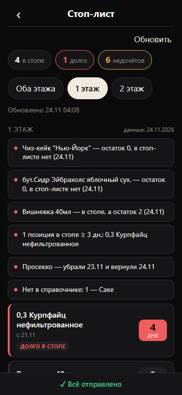
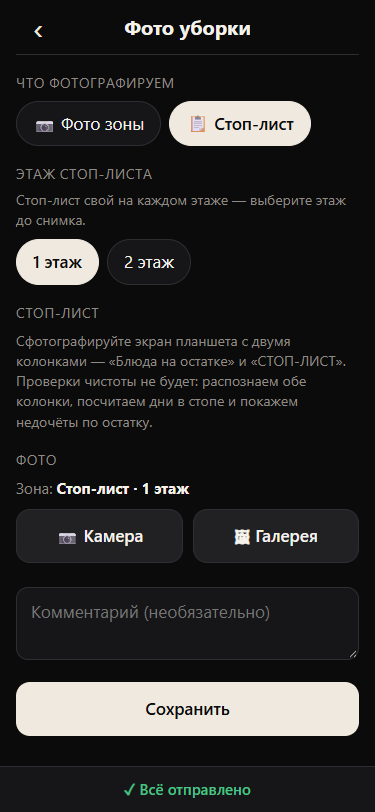
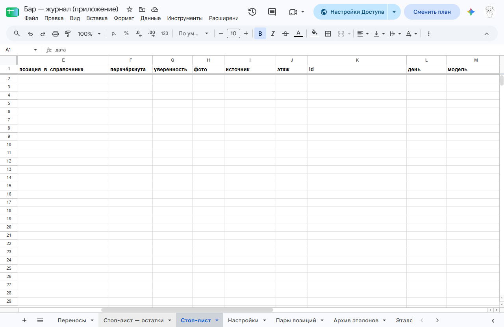
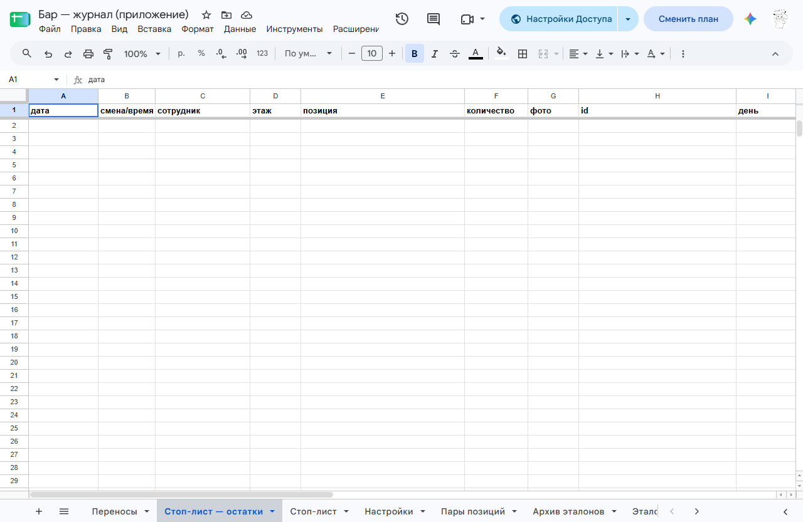

# Стоп-лист по фото — отчёт

**Дата:** 24.11.2026. **Ветка:** `dsh-threads/19-2712c5` (от `main` `5c9acb6`).
В `main` не пушилось. Бэкенд выложен и развёрнут **версией 46** существующего
развёртывания `AKfycbz…N7-w` — адрес `/exec` не менялся, `config.js` не правился.
Ключ Gemini в коде и в отчёте отсутствует: он лежит только в свойствах скрипта
(`GEMINI_API_KEY`).

> **Ревизия 2.** Владелец прислал реальное фото: снимок экрана планшета с **двумя
> колонками** — «Блюда на остатке» (позиция + количество) и «СТОП-ЛИСТ» (позиции),
> плюс указание, что стоп-лист свой **на каждом этаже**. Распознавание, схема
> ответа, хранение, подсчёт дней, недочёты и экраны переработаны под это;
> распознавание проверено **на самом фото** (§7). Ревизия 1 (один список,
> рукописный образец) осталась в истории ветки коммитом `853e015`.

---

## Коротко

* Модель читает **обе колонки**: `{"stock":[{"name","qty"}],"stop":[{"name"}],
  "unreadable":""}`. Количества — числа (`3.00 → 3`, `0.00 → 0`); не читается —
  `qty` нет вовсе (не ноль), чтобы не выдумать «закончилось».
* **Главный недочёт** — «нет в стопе при нулевом остатке»: остаток `0.00`, а в
  стоп-листе позиции нет. Обратный — «в стопе, а остаток есть». Оба только
  помечаются, ничего не блокируют.
* **Стоп-лист по этажам**: на экране фото выбирается этаж (1 или 2), в листе
  «Стоп-лист» появилась колонка `этаж`, дни считаются **этаж + позиция**.
  Экран стоп-листа показывает этаж или оба сразу.
* Названия с объёмом **не нормализуются**: `0,3 Курпфайц` и `0,5 Курпфайц` —
  разные позиции. Приведение — регистр, «ё», кавычки, дефисы, пробелы и маркер
  списка. Справочник — только подсказка; при сомнении сохраняется как написано
  и помечается «нет в справочнике».
* **Проверка на реальном фото:** 13 позиций стоп-листа из 13 и 8 остатков из 8,
  все количества верные, `unreadable` пустой; то же на полном скриншоте телефона.
  Один спорный символ в названии («Бридог»/«БрюДог») — в §7.
* 41 локальный тест нового набора + 70 существующих — зелёные.

---

## 1. Как снимок помечается стоп-листом

Переключатель **«📷 Фото зоны / 📋 Стоп-лист»** на экране «Фото уборки». В режиме
стоп-листа появляется выбор этажа (1 / 2), зона и проверка чистоты не нужны.

Что происходит на сервере (`savePhoto_`):

1. фото пишется на Диск и строкой в «Фото уборки» — **до** распознавания;
2. при `rec.stopList === true` (или зоне «Стоп-лист») проверка чистоты
   **не запускается**;
3. снимок уходит в Gemini с промптом на две колонки;
4. позиции пишутся в «Стоп-лист», количества — в «Стоп-лист — остатки»,
   в «Фото уборки» — статус `📋 Стоп-лист` и сводка;
5. любая ошибка (нет ключа, квота 429, таймаут, мусор) → строка
   **«не распознано»** с причиной; фото и запись остаются, смена не блокируется.

Этаж обязателен на экране (по умолчанию 1). Если запись пришла без этажа
(старый клиент, обрыв), сервер пишет `1` и не падает.

---

## 2. Распознавание: промпт и схема ответа

Модели уходит **только снимок и текст промпта** — справочник в промпт не
передаётся, чтобы модель не «исправляла» названия под него.

Промпт (`buildStopListPrompt_`), ключевые правила:

```text
Ты распознаёшь экран планшета (или распечатку) со стоп-листом бара. На снимке две колонки:
  • слева — «Блюда на остатке»: название и количество («0,150 Домен Брюне Шинон   3.00»);
  • справа — «СТОП-ЛИСТ»: только названия, без количеств.

2. Левая колонка целиком идёт в "stock": name — название без числа-количества,
   qty — число из конца строки (3.00 → 3, 0.00 → 0). Если количество не читается,
   не выдумывай: не указывай qty совсем (пустое значение лучше нуля).
3. Пиши названия ТАК, КАК НАПИСАНО: сохраняй регистр, «бут.», объёмы («0,3», «0,33»,
   «40мл»), кавычки, дефисы, сокращения и опечатки. Не исправляй, не переводи,
   не раскрывай сокращения и не отрезай объём от названия: объём различает позиции
   («0,3 Курпфайц» и «0,5 Курпфайц» — разные позиции).
4. Не придумывай позиции и не переноси строки между колонками...
6. Служебную строку внутри списка оставляй как написано (например «Комментарий на бар»)
   — решает человек.
8. Верни ТОЛЬКО JSON, без markdown и текста вокруг, строго по схеме:
{"stock":[{"name":"строка как написана","qty":3.0}],"stop":[{"name":"строка как написана"}],"unreadable":""}
```

Схема ответа (`stopGenerationConfig_`): `responseMimeType: application/json`,
`temperature: 0`:

```json
{
  "type": "OBJECT",
  "properties": {
    "stock": {
      "type": "ARRAY",
      "items": {
        "type": "OBJECT",
        "properties": { "name": { "type": "STRING" }, "qty": { "type": "NUMBER" } },
        "required": ["name"]
      }
    },
    "stop": {
      "type": "ARRAY",
      "items": {
        "type": "OBJECT",
        "properties": { "name": { "type": "STRING" } },
        "required": ["name"]
      }
    },
    "unreadable": { "type": "STRING" }
  },
  "required": ["stock", "stop", "unreadable"]
}
```

Разбор (`validateStopListAnswer_`) терпим к markdown-обёртке, режет пустые имена
и дубликаты (по нормализованному ключу), `qty` приводит числом (`1,500 → 1.5`,
отрицательное/текст/огромное → `null`), `0` сохраняет как `0`.
Пустые обе колонки + непустой `unreadable` — нормальный ответ «не читается»,
запись «не распознано» с причиной от модели.

Модели и квоты — как у проверки фото: запомненная модель, затем
`gemini-flash-lite-latest`, `gemini-3.1-flash-lite`, `gemini-3.8-flash`;
500/503/таймаут → повтор с превью ~512 px; **429 → сразу «не распознано»**.

---

## 3. Названия и нормализация

| Шаг | Что делает | Пример |
|---|---|---|
| маркер списка | снимает `1.`, `2)`, `—`, `•` | `1. Вишневка 40мл` → `Вишневка 40мл` |
| ключ | нижний регистр, `ё→е`, знаки → пробел, пробелы схлопываются | `бут. Лондон Прайд` → `бут лондон прайд` |
| числа | собираются из названия и сравниваются как множество | `0,3 Курпфайц` → `[0.3]` |
| точное | совпадение ключа | `лайм` → `Лайм` |
| падежи | усечение окончаний — **только при тех же числах** | `лимоны` → `Лимон` |
| опечатки | Левенштейн с порогом по длине (≤4 → 0, ≤8 → 1, ≤14 → 2, иначе 3) — **только при тех же числах** | `Курпфайц нефильтрованое` → `Курпфайц нефильтрованное` |

Что **не** делается (по требованию владельца): объём не отрезается, поэтому
`0,3 Курпфайц нефильтрованное` и `0,5 Курпфайц нефильтрованное` — две разные
позиции; «Курпфайц нефильтрованное» из справочника к ним **не** применяется
(числа разные) — позиция останется как написана и будет помечена
«нет в справочнике». Обратное «короткое → длинное» тоже не делается: `Джин`
не станет `Джин Монки 47`.

Если позицию добавили в справочник позже, при чтении истории срабатывает
дешёвое пересопоставление (точное совпадение и падежи, без Левенштейна).

---

## 4. Сколько дней позиция в стопе

### Формула словами

1. **День с данными** — календарная дата по Москве, на которую есть хотя бы
   одна запись стоп-листа **этого этажа** (фото или ручной ввод).
2. Одна позиция = одна запись в день: повторный снимок в тот же день счётчик
   не увеличивает, но обновляет данные (новая строка дня перекрывает старую).
3. Для каждой позиции по дням с данными: `present` — есть запись, где она **не**
   перечёркнута; `crossed` — есть перечёркнутая (ставится руками).
4. Идём по дням с данными **по возрастанию**: `present` → отрезок продолжается
   (+1 день); день с данными, где позиции нет → отрезок закрывается.
5. **Сейчас в стопе** = последний отрезок, если он заканчивается на последнем
   дне с данными этажа. Иначе 0.
6. `дней в стопе` = длина этого отрезка (число **смен с подтверждением**);
   `span` — календарная длина, `gaps = span − дней` — сколько дней внутри
   отрезка остались без данных.

### Пограничные случаи (как решено)

| Случай | Поведение |
|---|---|
| Тот же этаж, два снимка в один день | счётчик не удваивается (проверено тестом) |
| Снимок 1 этажа, а позиция на 2 этаже | на счёт 1 этажа не влияет: дни считаются по этажу |
| День без снимка внутри отрезка | по умолчанию не считается и **не обрывает** счёт, виден в `gaps`; ключ `стоплист_пропуск_обрывает = вкл` включает строгий режим |
| Снимок был, но «не распознан» | день не считается данными и не обрывает счёт; недочёт «нет данных за смену» |
| Позиция перечёркнута руками | день не засчитывается как «в стопе», отрезок закрывается |
| Позиция пропала из снятого списка | отрезок закрывается, счётчик 0; прошлое остаётся: `totalDays`, отрезки, «была N дней до этого» |
| Убрали и вернули в течение 1–2 дней | флаг **«убрано преждевременно»** (считается от дня, когда убрали) |
| Остатки | в текущий стоп-лист и в дни **не** попадают: это отдельный лист |
| Окно анализа | последние **180** дней; история на экране — `стоплист_история_дней` (30) |

### Что отдаётся приложению

`?action=stopList` (с историей) и `config.stopList` (без истории):

```json
{
  "ok": true, "today": "2026-11-24", "updatedAt": "…",
  "settings": { "longDays": 3, "prematureDays": 2, "historyDays": 30, "gapBreaks": false,
                "checks": { "zero": true, "stock": true, "long": true,
                            "premature": true, "catalog": true, "data": true } },
  "floors": [
    { "floor": "1", "label": "1 этаж",
      "current": [{ "floor": "1", "name": "0,3 Курпфайц нефильтрованное", "canonical": "",
                    "inCatalog": false, "days": 4, "since": "2026-11-21", "long": true,
                    "streaks": [{ "from": "2026-11-21", "to": "2026-11-24", "days": 4, "gaps": 0 }],
                    "totalDays": 4, "lastSeen": "2026-11-24", "records": 4 }],
      "long": [], "premature": [], "missingCatalog": [], "returned": [],
      "noData": [], "stockIssues": [{ "kind": "zero", "day": "2026-11-24", "floor": "1",
                                      "name": "Чиз-кейк \"Нью-Йорк\"", "qty": 0 }],
      "issuesCount": 6, "totals": { "inStop": 4, "daysWithData": 4, "stockRows": 8, "unreadable": 0 } },
    { "floor": "2", "label": "2 этаж", "…": "…" }
  ],
  "summary": [{ "floor": "1", "label": "1 этаж", "inStop": 4, "long": 1, "issues": 6 }],
  "totals": { "floors": 2, "positions": 6, "inStop": 6, "photos": 12, "manual": 1, "stockRows": 8 },
  "history": { "1": { "0,3 Курпфайц нефильтрованное": [{ "day": "2026-11-24", "crossed": false, "source": "фото" }] } }
}
```

---

## 5. Недочёты: что включено и как настроить

Всё — в листе **«Настройки»**; строки дописываются сами, правки владельца не
затираются. Ничего не блокируется.

| Ключ | По умолчанию | Что делает |
|---|---|---|
| `стоплист_проверять_нулевой_остаток` | `вкл` | **«нет в стопе при нулевом остатке»** — остаток 0.00, а позиции в стоп-листе нет (главный недочёт) |
| `стоплист_проверять_остаток_в_стопе` | `вкл` | **«в стопе, а остаток есть»** — возможно, забыли убрать |
| `стоплист_долго_дней` | `3` | с какого числа дней позиция «долго в стопе» |
| `стоплист_проверять_долго` | `вкл` | недочёт **«долго в стопе»** |
| `стоплист_преждевременно_дней` | `2` | окно «убрали и вернули» |
| `стоплист_проверять_преждевременно` | `вкл` | недочёт **«убрано преждевременно»** |
| `стоплист_проверять_справочник` | `вкл` | недочёт **«нет в справочнике»** |
| `стоплист_проверять_данные` | `вкл` | недочёт **«нет данных за смену»** |
| `стоплист_пропуск_обрывает` | `выкл` | `вкл` — пропуск дня обрывает счёт дней |
| `стоплист_история_дней` | `30` | сколько дней истории показывать |
| `раздел_стоплист` | `вкл` | флаг раздела: выключить плитку и экран |

* Сравнение остатков и стопа — по нормализованному имени и падежам **при
  совпадении чисел**: `0,5 Курпфайц` с нулевым остатком не «закроется»
  позицией `0,3 Курпфайц` в стопе.
* Недочёты по остаткам смотрятся за последние **14 дней** по каждому этажу.
* «Долго в стопе» и «нет в справочнике» в сводке показываются строкой с
  количеством и первыми названиями (иначе на большом списке это стена строк);
  те же сведения есть тегом у каждой позиции.
* «Нет данных за смену» — только по нечитаемым снимкам: о том, что смены не
  было, сервер не знает.
* Предупреждение по данным владельца: в его «Справочнике» 39 позиций (в
  основном ингредиенты), а в реальном стоп-листе — блюда и бутылки. Поэтому все
  13 позиций с фото получат «нет в справочнике». Это не ошибка распознавания,
  а состояние справочника: чтобы тег исчез, позиции надо добавить в «Справочник».

---

## 6. Листы

### «Стоп-лист» (создаётся сам, «этаж» добавлен миграцией)

| Колонка | Заголовок | Что внутри |
|---|---|---|
| A | `дата` | дата и время записи |
| B | `смена/время` | `23:40` |
| C | `сотрудник` | имя из «Сотрудников» |
| D | `позиция` | как написано/распознано |
| E | `позиция_в_справочнике` | каноническое название или пусто |
| F | `перечёркнута` | `TRUE`/`FALSE` (ставится руками, из фото не берётся) |
| G | `уверенность` | пусто: в новой схеме модель уверенность не отдаёт |
| H | `фото` | ссылка на снимок |
| I | `источник` | `фото` / `ручной ввод` / `не распознано` |
| J | `этаж` | `1` или `2` |
| K | `id` | ID записи с телефона |
| L | `день` | `2026-11-24` — по ней считаются дни |
| M | `модель` | например `gemini-flash-lite-latest` |
| N | `заметка` | причина «не распознано» или «нет в справочнике» |

Первые девять колонок — как в задании. Для пустого листа шапка переписывается
в новом порядке (данных нет); если бы данные были — недостающие колонки
дописались бы справа, порядок не меняется.

### «Стоп-лист — остатки» (новый лист)

`дата | смена/время | сотрудник | этаж | позиция | количество | фото | id | день | модель`

Строка = позиция из «Блюда на остатке». `0.00` пишется как `0`. Строки этого
листа не попадают в текущий стоп и не считают дни — только проверки остатка.

---

## 7. Что показало распознавание на реальном фото

Фото владельца (снимок экрана планшета, снятый на телефон) лежит в
`docs/stop-list/test/real-screenshot.jpg`; из него сделан вариант «как отправляет
приложение» — `real-photo.jpg` (JPEG 1600 px, качество 72, ~110 КБ). Сырые
ответы модели — `docs/stop-list/test/распознавание-реальное.json`. Прогон шёл
через развёрнутый бэкенд временным действием (в финальной версии 46 его нет).

### Результат

| Файл | Модель | Стоп-лист | Остатки | `unreadable` | Время модели |
|---|---|---|---|---|---|
| `real-photo.jpg` (как из приложения) | `gemini-flash-lite-latest` | **13 из 13** | **8 из 8** | пусто | 9,5 с |
| `real-screenshot.jpg` (весь экран телефона) | `gemini-3.1-flash-lite` | **13 из 13** | **8 из 8** | пусто | 8,4 с |

Полное совпадение объёма: 13 позиций стоп-листа, 8 строк остатков. Ошибок
«позиция не из той колонки» нет, потерь строк нет.

### Что именно вернула модель (снимок «как из приложения»)

Колонка «СТОП-ЛИСТ» — 13 позиций, порядок как на фото:

```text
0,3 Курпфайц нефильтрованное
0,5 Курпфайц нефильтрованное
бут. БрюДог ИПА 0,33          ← на фото «Бридог»/«БрюДог», см. ниже
бут. Лондон Прайд
бут. Флорис Крик
Вишневка 40мл
Комментарий на бар            ← служебная строка POS, прочитана как позиция
Равиоли с лососем
Салат с утиным филе
Торт Три Шоколада
Утиное филе на гриле
Хреновуха 40мл
Черноплодная рябина 40мл
```

Колонка «Блюда на остатке» — 8 строк с количествами, все совпали:

```text
0,150 Домен Брюне Шинон          3
бут. Фрисленд Шираз/Гренаш       1
бут.Сидр КЛУБНИКА/ЛАЙМ           1
бут.Сидр Эйбрахолс яблочный сух. 0     ← остаток 0.00, в стоп-листе нет → недочёт
Настойка черная смородина 40мл   7
Тапас с лососем                  2
Чиз-кейк "Нью-Йорк"              0     ← остаток 0.00, в стоп-листе нет → недочёт
Штрудель Яблочный                4
```

Недочёты по остатку на этом фото — ровно два, оба верные: `Чиз-кейк "Нью-Йорк"`
и `бут.Сидр Эйбрахолс яблочный сух.`. Обратной ошибки («в стопе, а остаток есть»)
на этом фото нет: ни одна позиция стоп-листа не встречается в остатках — это
ожидаемо, колонки пересекаются редко.

### Честные замечания по точности

* **Один символ в названии.** Строка 3 в стоп-листе читается как «бут. Бридог
  ИПА 0,33» (так и в описании владельца), модель вернула «бут. БрюДог ИПА 0,33».
  На фото это место смазано (бутылка в глубине кадра), «и/ю» и «д/л» различимы
  плохо. Для учёта это некритично (название сохраняется, помечается «нет в
  справочнике»), но если такая позиция важна — её стоит добавить в справочник
  и поправить строку руками.
* **Служебная строка POS.** «Комментарий на бар» — это, судя по всему, подпись
  интерфейса планшета, а не блюдо. Модель прочитала её как позицию стоп-листа,
  и система честно запишет её так же. Если это не позиция — её надо убрать в
  самом POS или удалить строку в листе «Стоп-лист».
* **Модель на полном скриншоте.** На большом скриншоте телефона (с рамками
  Telegram и системы) первая модель не уложилась, сработал запасной
  `gemini-3.1-flash-lite`; результат тот же. Приложение отправляет сжатый кадр,
  поэтому в бою ожидается первый вариант.
* **Рукописный случай больше не актуален**, но в репозитории остались прежние
  образцы `printed.png` и `handwritten.png` с прошлого прогона (ревизия 1):
  печатный — 10/10, рукописный — 10/10. Они больше не используются.

---

## 8. Проверки (что реально прогнано)

### Локальные тесты (Node, без сети и без Google)

* `node tools/test-stop-list.mjs` — **41 из 41**: промпт (две колонки, «не
  отрезай объём», запрет придумывать) и схема; разбор ответа (qty `null` вместо
  выдуманного нуля, `1,500 → 1.5`, отрицательное/текст → `null`, дубликаты,
  markdown, «не читается», мусор); нормализация (маркер, регистр, «ё»; объём
  остаётся; `0,3` и `0,5` не сливаются; падежи и опечатки — только при тех же
  числах); дни по этажам (независимость этажей, повтор в день, пропуск и строгий
  режим, выпадение с сохранением истории, «убрано преждевременно» от дня
  удаления); пороги и флаги; недочёты остатков (нулевой без стопа, стоп с
  остатком, разделение этажей, выключение флагом, **реальные списки с фото:
  8 остатков и 13 стоп → ровно два недочёта по нулю**); снимок через `submit`
  (обе колонки и этаж пишутся, чистоты не проверяет, промпт про две колонки);
  повторный ID → `duplicate` без второго распознавания; **429 → «не
  распознано», фото и запись на месте**; «не читается» → причина в листе; без
  этажа → этаж 1; ручной ввод (этаж, дубль на том же этаже, но не на другом,
  «уже убрали», отказ без позиции, админу недоступно); `config.stopList` по
  этажам без истории и `?action=stopList` с историей по этажам; битая шапка не
  ломает `config`; миграция шапки пустого листа под колонку «этаж»; регрессия —
  обычное фото уборки по-прежнему проверяется на чистоту.
* `node tools/test-photo-check.mjs` — **46 из 46** (не сломано).
* `node tools/test-features-pairs.mjs` — **19 из 19**.
* `node tools/test-integration-16-17.mjs` — **5 из 5**.

### Живая проверка на развёрнутом бэкенде (версия 46)

* `?action=ping` → `ok`.
* `?action=config` → `ok`, `stopList` с двумя этажами, 10 флагов разделов.
* `?action=stopList` → `ok`, этажи «1 этаж» и «2 этаж», проверки
  `zero/stock/long/premature/catalog/data` включены.
* Лист «Стоп-лист» получил колонку `этаж` (скриншот 09), создан лист
  «Стоп-лист — остатки» (11), в «Настройках» 21 строка с новыми ключами (10).
* Распознавание реального фото через развёрнутый код — §7.
* Временное действие проверки в финальной версии отсутствует:
  `action=stopListProbe` → «Неизвестное действие».

### Не проверено (честно)

* **Снимок с телефона бармена на боевом бэкенде** — требует PIN сотрудника;
  распознавание проверено на живом коде другим способом (§7), запись — тестами
  и демо-интерфейсом.
* **Ручной ввод реальным барменом** — по той же причине (нужен PIN).
* Фронтенд на GitHub Pages не обновлялся: в `main` не пушим, экраны проверены
  в локальном демо-стенде.

---

## 9. Скриншоты

| Файл | Что видно |
|---|---|
| `01-home.png` | главная с плиткой «Стоп-лист» |
| `02-stoplist.png` | «Оба этажа»: сводка, недочёты по остатку, текущий список с днями |
| `03-stoplist-floor1.png` | фильтр «1 этаж»: только позиции первого этажа и его недочёты |
| `04-stoplist-bottom.png` | блок «2 этаж» и кнопки «Снять стоп-лист» / «Ввести позицию» |
| `05-history.png` | история позиции: этаж, отрезки, «убрали/вернули», записи по дням |
| `06-photo-stoplist.png` | режим «📋 Стоп-лист» с выбором этажа |
| `07-photo-zones.png` | обычный режим «Фото зоны» не сломан |
| `08-recognized.png` | результат снимка: «2 этаж: распознано», недочёты по остатку, обе колонки |
| `09-sheet-stoplist.png` | лист «Стоп-лист»: колонка `этаж` на своём месте |
| `10-sheet-settings.png` | «Настройки»: `стоплист_*`, включая новые проверки остатков |
| `11-sheet-stock.png` | лист «Стоп-лист — остатки» |
| `12-manual.png` | ручной ввод с выбором этажа |









Стенд для скриншотов — `docs/stop-list/test/frame.html` (приложение в рамке
375×812 с демо-сервера `tools/demo-server.mjs`); в работу приложения не входит.

---

## 10. Что изменено в коде

### Бэкенд `apps-script/Код.gs`

* `SHEETS.stopStock`, `ID_COLUMN.stoplist` (11 — после `этаж`), флаг `stoplist`.
* Раздел «СТОП-ЛИСТ ПО ФОТО» переписан под две колонки и этажи: промпт и схема
  `stock/stop/unreadable`, `validateStopListAnswer_`, `stopQty_`,
  `stopListRecognize_`, запись обеих колонок (`stopListSavePhotoRows_`,
  `stopLinkPhoto_`), ручной ввод с этажом (`saveStopListItem_`), нормализация без
  отрезания объёма (`stopNameKey_`, `stopNumbers_`, `stopSameNumbers_`,
  `stopMatchName_`), расчёт по этажам (`stopFloorState_`, `stopGroupState_`,
  `stopListState_`), недочёты остатков (`stopPhotoIssues_`, `stopMakeIndex_`,
  `stopFindIn_`), `stopListPublic_`, `getStopList_`, `setupStopList`.
* `savePhoto_`: ветка стоп-листа с этажом и обеими колонками, `writeStopPhotoVerdict_`.
* `getConfig_`: `stopList` по этажам; `doGet`: `action=stopList`; `saveOne_`:
  тип `stoplist`; `ensureSettingsSheet_`: `settingsSeedRows_`;
  `setup()`: автосоздаваемые листы.

### Приложение

* `js/app.js`: выбор этажа в режиме стоп-листа и в ручном вводе, экран
  стоп-листа с переключателем «Оба этажа / 1 / 2», недочёты остатков,
  сводные строки «долго»/«нет в справочнике», экран результата с обеими
  колонками, история с этажом; `sw.js` → `v30`.
* `js/sync.js`: в историю отправки кладётся `server.stoplist` (обе колонки).
* `styles.css`: блок стилей стоп-листа (этажи, остатки, недочёты).

### Тесты и демо

* `tools/test-stop-list.mjs` — новый набор (41 тест) под две колонки и этажи.
* `tools/demo-server.mjs` — демо-данные по этажам и остаткам, ответ `submit`
  с обеими колонками и недочётами.
* `tools/test-features-pairs.mjs`, `tools/test-integration-16-17.mjs` — ожидания
  по числу флагов/строк берутся из кода.

---

## 11. Развёртывание, ветка, коммиты

* `clasp push --force` (3 файла: `Код.gs`, `Вопросы.gs`, `appsscript.json`) и
  `clasp deploy -i AKfycbz…N7-w` — обновлено **существующее** развёртывание,
  теперь **версия 46** от 24.11.2026. Новых развёртываний не создавалось,
  адрес `/exec` в `config.js` не менялся. Версии 44–45 — промежуточные шаги
  этой же работы (44 — с временной проверкой распознавания, 45/46 — без неё).
* Проверка после деплоя: `?action=ping`, `?action=config`, `?action=stopList` —
  `ok`; `action=stopListProbe` → «Неизвестное действие».
* Ветка `dsh-threads/19-2712c5`, в `main` не пушилось.

Коммиты:

| Коммит | Что внутри |
|---|---|
| `853e015` | ревизия 1: стоп-лист по фото (один список), бэкенд, экраны, тесты, отчёт |
| `3ac90b0`, `d5d438d` | правки отчёта ревизии 1 |
| `d88d0a7` | строгий режим пропуска дня |
| далее | ревизия 2: две колонки, остатки, этажи, проверка на реальном фото, отчёт |

Отправная точка — `main` `5c9acb6` (`Merge branch 'integration-16-17'`).
