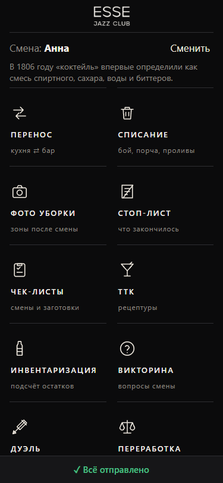
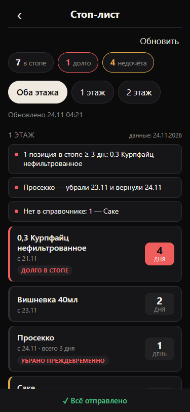
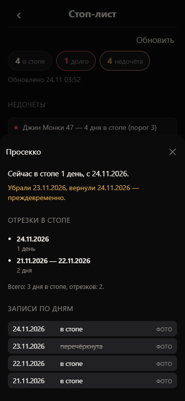
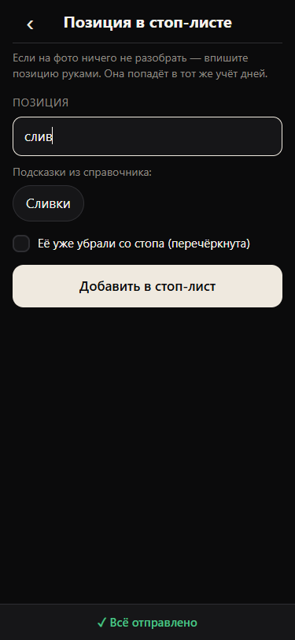

# Стоп-лист по фото — отчёт

**Дата:** 24.11.2026. **Ветка:** `dsh-threads/19-2712c5` (от `main` `5c9acb6`).
В `main` не пушилось. Бэкенд выложен и развёрнут **версией 42** существующего
развёртывания `AKfycbz…N7-w` — адрес `/exec` не менялся, `config.js` не правился.
Ключ Gemini в коде и в этом отчёте отсутствует: он лежит только в свойствах
скрипта (`GEMINI_API_KEY`).

---

## Коротко

* На экране «Фото уборки» появился переключатель **«📷 Фото зоны / 📋 Стоп-лист»**.
  Снимок в режиме стоп-листа сохраняется как обычное фото (файл на Диске +
  строка в «Фото уборки», зона «Стоп-лист»), **не проверяется на чистоту** и
  уходит на распознавание текста. Эталон и критерии для него не нужны — отдельная
  зона в «Эталонах уборки» не создавалась.
* Появился лист **«Стоп-лист»** (13 колонок, первые девять — как в задании),
  экран **«Стоп-лист»** с днями в стопе, отметкой «долго в стопе», историей по
  позиции и **ручным вводом**, если фото не читается.
* Дни считает сервер. «Дней в стопе» = число **смен с данными**, где позиция
  стоит в стопе подряд; дубли в один день не считаются; день, где данные есть,
  а позиции нет, обнуляет счётчик, но прошлый отрезок остаётся в истории.
* Четыре настраиваемые проверки-«недочёта»: долго в стопе, убрано
  преждевременно, нет в справочнике, нет данных за смену. Ничего не блокируют.
* **Распознавание проверено на двух образцах:** печатный — 10 из 10 позиций,
  оба зачёркивания; рукописный — 10 из 10, оба зачёркивания. Модель
  `gemini-flash-lite-latest`, 4–5 секунд на снимок.
* Нормализация названий: точное совпадение, «ё»/регистр/знаки, падежи
  (усечение окончаний), опечатки (Левенштейн с порогом), объём в конце
  («0,5», «1 л»), маркер списка («1. »), начало названия по границе слова
  («Клюква с/м» → «Клюква»). На живом «Справочнике» из 10 распознанных позиций
  сопоставились 5 — остальных в справочнике владельца просто нет, они честно
  помечены «нет в справочнике».

---

## 1. Как снимок помечается стоп-листом

Выбран **переключатель на экране фото**, а не отдельная зона в «Эталонах
уборки». Почему так:

* текущий поток «этаж → зона → камера» не ломается: стоп-лист — второй режим
  того же экрана, зона подставляется сама;
* у стоп-листа нет эталона и критериев чистоты, а зона в «Эталонах уборки»
  как раз означала бы «проверять по критериям» — пришлось бы добавлять
  признак «тип = стоп-лист» и объяснять его владельцу;
* «Списки»!B (зоны уборки) остаются ровно теми 6 зонами, что утвердил владелец.

Что происходит на сервере (`savePhoto_`):

1. фото пишется на Диск и строкой в «Фото уборки» — **до** распознавания;
2. если `rec.stopList === true` (или зона равна «Стоп-лист»), проверка чистоты
   **не запускается**;
3. снимок уходит в Gemini с промптом стоп-листа;
4. позиции пишутся в «Стоп-лист», в «Фото уборки» — статус `📋 Стоп-лист` и
   вердикт `стоп-лист` с короткой сводкой;
5. любая ошибка (нет ключа, квота 429, таймаут, мусор в ответе) превращается в
   строку **«не распознано»** с причиной — фото и запись остаются, смена не
   блокируется.

---

## 2. Распознавание: промпт и схема ответа

Модели уходит **только снимок и текст промпта** — справочник позиций в промпт
сознательно **не передаётся**, чтобы модель не «исправляла» названия под него.
Нормализация — на сервере, после ответа (§3).

Промпт (`buildStopListPrompt_`), ключевые правила дословно:

```text
Ты распознаёшь стоп-лист бара: снимок листа бумаги или доски, где перечислено,
чего нет в наличии.
Твоя задача — прочитать позиции ровно так, как они написаны, и отметить
перечёркнутые.

1. Пиши позиции ТАК, КАК ОНИ НАПИСАНЫ: сохраняй регистр, сокращения, опечатки
   автора, объёмы и единицы («0,5», «1 л», «бут.»). Не исправляй, не переводи,
   не раскрывай сокращения, не добавляй пояснений и категорий.
2. Не придумывай позиции. Если часть текста не читается (почерк, блик, смазано,
   обрезано краем кадра) — не угадывай: перечисли в "unreadable", что именно
   не прочитано, а в "items" оставь только то, что действительно видно.
3. Если не читается весь список — верни {"items":[],"unreadable":"причина"}.
   Пустой items при непустом unreadable — правильный ответ, а не ошибка.
4. Пропускай заголовки и служебные надписи: «стоп-лист», «стоп», дату, время,
   подпись, имя автора, номер смены.
5. crossed_out = true только если позиция перечёркнута линией, крестом или
   штриховкой — то есть её уже убрали со стопа. Если зачёркивания не видно —
   false. Не додумывай за автора, что «наверное, уже убрали».
6. Одна строка списка = одна позиция. Не дроби и не склеивай строки, не повторяй
   дубликаты, не сортируй по-своему — порядок как в списке.
7. confidence — число от 0 до 1 ... ниже 0.5 — скорее догадка, тогда позицию
   лучше не писать в items, а назвать в unreadable.
8. Верни ТОЛЬКО JSON, без markdown и текста вокруг, строго по схеме:
   {"items":[{"name":"строка как написана","crossed_out":false,"confidence":0.9}],
    "unreadable":""}
9. Если на фото вообще нет списка — items пустой, unreadable: "на фото нет списка".
```

Схема ответа (`stopGenerationConfig_`): `responseMimeType: application/json`,
`temperature: 0`, `responseSchema`:

```json
{
  "type": "OBJECT",
  "properties": {
    "items": {
      "type": "ARRAY",
      "items": {
        "type": "OBJECT",
        "properties": {
          "name": { "type": "STRING" },
          "crossed_out": { "type": "BOOLEAN" },
          "confidence": { "type": "NUMBER" }
        },
        "required": ["name", "crossed_out", "confidence"]
      }
    },
    "unreadable": { "type": "STRING" }
  },
  "required": ["items", "unreadable"]
}
```

Разбор ответа (`validateStopListAnswer_`) терпим к markdown-обёртке, режет
мусор: пустые имена, дубликаты (по нормализованному ключу), `confidence` вне
0…1 → `null`, `crossed_out` строкой («да», «true», «перечёркнута») → `true`.
`items: []` + непустой `unreadable` — это **не поломка**, а честный ответ
«не читается»: сохраняется как «не распознано» с причиной от модели.

Модели и квоты: та же логика, что у проверки фото — сначала запомненная модель,
затем `gemini-flash-lite-latest`, `gemini-3.1-flash-lite`, `gemini-3.8-flash`;
при 500/503/таймауте повтор с превью ~512 px; **429 → сразу «не распознано»**
с причиной `квота Gemini (429)`, без падения и без потери фото.

---

## 3. Нормализация названий по справочнику

Сопоставление идёт по нормализованному ключу (`stopNameKey_`) и его вариантам:

| Шаг | Что делает | Пример |
|---|---|---|
| маркер списка | снимает `1.`, `2)`, `—`, `•` | `1. Джин Монки 47 0,5` → `Джин Монки 47 0,5` |
| ключ | нижний регистр, `ё→е`, знаки → пробел | `Мята (листья)` → `мята листья` |
| объём в конце | снимает `0,5`, `0.5 л`, `1 л`, `бут.` | `джин монки 47 0,5` → `джин монки 47` |
| точное | совпадение ключа | `лайм` → `Лайм` |
| падежи | усечение окончаний слов | `лимоны`, `ЛИМОНОВ` → `Лимон` |
| начало по границе слова | распознанное длиннее справочного | `Клюква с/м` → `Клюква`, `Сливки 33%` → `Сливки` |
| опечатки | Левенштейн, порог по длине (≤4 → 0, ≤8 → 1, ≤14 → 2, иначе 3) | `Просеко` → `Просекко` |

Специально **не** делается обратное «короткое → длинное»: `Джин` не должен
стать `Джин Монки 47`, а `Мята` — `Мята (ветки)`. Не сопоставилось — позиция
пишется в лист как есть, в колонке `позиция_в_справочнике` пусто, в `заметка`
— `нет в справочнике`, и она попадает в недочёт «недочёт номенклатуры».

Справочник берётся из листа «Справочник» **целиком**, включая позиции со
снятой галочкой «Показывать»: скрытая позиция всё равно существует. Если
позицию добавили в справочник позже, при чтении истории срабатывает дешёвое
пересопоставление (точное совпадение и падежи, без Левенштейна) — старые
записи сразу считаются «своими».

---

## 4. Сколько дней позиция в стопе

### Формула словами

1. **День с данными** — календарная дата по Москве (`yyyy-MM-dd`), на которую
   есть хотя бы одна запись с позицией (фото или ручной ввод). Дата берётся из
   колонки `день`, а не из времени телефона.
2. Для каждой позиции по каждому дню с данными: `present` — есть хоть одна
   запись, где она **не** перечёркнута; `crossed` — есть перечёркнутая.
3. Идём по дням с данными **по возрастанию**:
   * позиция `present` → продолжаем текущий отрезок (+1 день);
   * данных за день нет, а позиции нет (её убрали или перечеркнули) → отрезок
     **закрывается**.
4. **Сейчас в стопе** = последний отрезок, если он заканчивается на последнем
   дне с данными. Иначе 0.
5. `дней в стопе` = длина этого отрезка (число **смен с подтверждением**;
   повторы в один день считаются один раз).
6. `span` = календарная длина отрезка, `gaps` = `span − дней`: сколько дней
   внутри отрезка остались без данных.

### Пограничные случаи (как решено)

| Случай | Поведение |
|---|---|
| Два снимка в один день | одна запись дня, счётчик **не** удваивается (проверено тестом) |
| День без снимка внутри отрезка | день **не считается** и **не обрывает** счёт; виден в `gaps` («без данных 1») |
| Снимок был, но «не распознан» | день **не считается** данными и не обрывает счёт; попадает в недочёт «нет данных за смену» |
| Позиция есть в списке, но перечёркнута | день **не** засчитывается как «в стопе», отрезок закрывается (`убрали 23.11`) |
| Позиция пропала из снятого списка | отрезок закрывается, счётчик 0; прошлое остаётся: `totalDays`, отрезки `from…to`, «была N дней до этого» |
| Перечеркнули и вернули через 1–2 дня | флаг **«убрано преждевременно»**: «убрали 23.11, вернули 24.11» |
| Позиция вернулась позже окна | просто новый отрезок, флага нет, в истории видно «всего N дней, отрезков 2» |
| Дубли названий («лимоны» и «ЛИМОНОВ») | одна группа по справочнику, отрезки общие |
| Окно анализа | последние **180** дней; история на экране — `стоплист_история_дней` (по умолчанию 30) |

Почему пропуск дня не обнуляет счётчик: «выпала» — это факт по позиции (её нет
в снятом списке), а не факт о нашей отчётности. Если бармен забыл сфотографировать,
наказывать счётчик позиции неправильно — этот день показан отдельно как
`gaps`, а снимок без распознавания — как недочёт. Это осознанное отклонение от
буквального «выпала хотя бы на день», и его легко переключить на строгий режим,
если владелец захочет.

### Что отдаётся приложению

`?action=stopList` (полный ответ, с историей):

```json
{
  "ok": true, "today": "2026-11-24", "updatedAt": "…",
  "settings": { "longDays": 3, "prematureDays": 2, "historyDays": 30,
                "checks": { "long": true, "premature": true, "catalog": true, "data": true } },
  "current": [{ "name": "Джин Монки 47", "canonical": "Джин Монки 47", "inCatalog": true,
                "days": 4, "since": "2026-11-21", "span": 4, "gaps": 0, "long": true,
                "wasCrossed": false, "premature": null, "returned": false,
                "streaks": [{ "from": "2026-11-21", "to": "2026-11-24", "days": 4, "gaps": 0 }],
                "totalDays": 4, "lastSeen": "2026-11-24", "records": 4 }],
  "long": [], "premature": [], "missingCatalog": [], "returned": [],
  "noData": [{ "day": "2026-11-23", "time": "23:40", "reason": "квота Gemini (429)" }],
  "totals": { "inStop": 4, "daysWithData": 5, "photos": 8, "manual": 1, "unreadable": 1 },
  "history": { "Джин Монки 47": [{ "day": "2026-11-24", "crossed": false, "source": "фото" }] }
}
```

В `config` поле `stopList` — та же структура **без** `history` (чтобы не
раздувать справочник): приложение рисует экран сразу, а свежие данные и история
приходят отдельным запросом. Ошибка в листе «Стоп-лист» не ломает `config`.

---

## 5. «Недочёты» и «неправильно убрано»: что включено и как настроить

Все проверки — в листе **«Настройки»** (столбцы `ключ | значение | комментарий`).
Строки дописываются сами при первом чтении `config`, правки владельца не
затираются. Ни одна проверка ничего не блокирует — только помечает и
показывает в сводке.

| Ключ | По умолчанию | Что делает |
|---|---|---|
| `стоплист_долго_дней` | `3` | с какого числа дней подряд позиция считается «долго в стопе» |
| `стоплист_преждевременно_дней` | `2` | окно «убрали и вернули» (1–3 дня) |
| `стоплист_проверять_долго` | `вкл` | недочёт **«долго в стопе»** (позиция ≥ N дней) |
| `стоплист_проверять_преждевременно` | `вкл` | недочёт **«убрано преждевременно»** (перечеркнули и вернули через 1–2 дня) |
| `стоплист_проверять_справочник` | `вкл` | недочёт **«нет в справочнике»** (недочёт номенклатуры) |
| `стоплист_проверять_данные` | `вкл` | недочёт **«нет данных за смену»** (снимок не распознан) |
| `стоплист_история_дней` | `30` | сколько дней истории позиции показывать |
| `раздел_стоплист` | `вкл` | флаг раздела: выключить плитку и экран целиком |

* Числа читаются терпимо: `0`, пусто или мусор → значение по умолчанию;
  слишком большое — обрезается (дни 1…60, преждевременно 1…14, история 1…365).
* Флаги понимают `вкл/выкл`, `on/off`, `да/нет`, `1/0`, `true/false`.
* «Нет данных за смену» ставится **только** по нечитаемым снимкам: о том, что
  смены не было, сервер не знает, поэтому «забыли сфотографировать» отдельным
  недочётом не выдумывается.
* Что владелец имел в виду под «где пишется, что неправильно убрано» — не
  сформулировано; поэтому «неправильно убрано» реализовано как настраиваемый
  недочёт «убрано преждевременно» (перечеркнули и вернули). Если нужны другие
  правила (например, «убрали без подтверждения закупки»), их можно добавить
  такой же строкой в «Настройки».

---

## 6. Лист «Стоп-лист»

Создаётся сам при первом чтении `config`, шапка не дублируется.

| Колонка | Заголовок | Что внутри |
|---|---|---|
| A | `дата` | дата и время записи (телефон → сервер) |
| B | `смена/время` | `23:40` — время закрытия смены |
| C | `сотрудник` | имя из «Сотрудников» |
| D | `позиция` | как написано/распознано (маркер списка снят) |
| E | `позиция_в_справочнике` | каноническое название или пусто |
| F | `перечёркнута` | `TRUE`/`FALSE` |
| G | `уверенность` | 0…1 от модели, у ручного ввода пусто |
| H | `фото` | ссылка на снимок («фото»), у ручного ввода пусто |
| I | `источник` | `фото` / `ручной ввод` / `не распознано` |
| J | `id` | ID записи с телефона (защита от дублей) |
| K | `день` | `2026-11-24` — по ней считаются дни |
| L | `модель` | например `gemini-flash-lite-latest` |
| M | `заметка` | причина «не распознано» или «нет в справочнике» |

Одна строка = одна позиция одного снимка. Строка без позиции и с источником
`не распознано` — отметка «снимок был, текст не прочитался». Структура
существующих листов не менялась; в «Фото уборки» добавились только **значения**
(статус `📋 Стоп-лист`, вердикт `стоп-лист`), новых колонок не появилось.

---

## 7. Что показало распознавание (ключевая проверка)

Образцы лежат в `docs/stop-list/test/`: `printed.png` (сгенерированная картинка
с печатным списком) и `handwritten.png` (рукописный вид: шрифт Segoe Script,
неровные строки, зачёркивания синей линией и красным крестом). Исходные HTML —
рядом (`printed.html`, `handwritten.html`); сырые ответы модели целиком —
`docs/stop-list/test/распознавание.json`.

Прогон шёл **через развёрнутый бэкенд** (временное действие, удалено перед
финальной версией `42`), модель `gemini-flash-lite-latest`.

### (а) Печатный список

`http 200`, 5,2 с, `unreadable: ""`, `confidence 0.99`, **10 позиций из 10**,
оба зачёркивания найдены.

Распознанный текст (как вернула модель):

```text
1. Джин Монки 47 0,5      crossed_out: false  conf 0.99
2. Просекко               crossed_out: false  conf 0.99
3. Лимоны                 crossed_out: false  conf 0.99
4. Мята (листья)          crossed_out: false  conf 0.99
5. Апероль                crossed_out: true   conf 0.99   ← на образце перечёркнут
6. Саке                   crossed_out: false  conf 0.99
7. Лайм                   crossed_out: false  conf 0.99
8. Клюква с/м             crossed_out: false  conf 0.99
9. Сливки 33%             crossed_out: true   conf 0.99   ← на образце перечёркнут
10. Тоник                 crossed_out: false  conf 0.99
```

Сопоставление с живым «Справочником» (39 позиций): `Лимоны → Лимон` (падежи),
`Мята (листья) → Мята` (начало названия), `Лайм → Лайм` (точное),
`Клюква с/м → Клюква`, `Сливки 33% → Сливки`. **5 из 10**; остальные пять
(Джин Монки 47, Просекко, Апероль, Саке, Тоник) в справочнике владельца
отсутствуют — они и должны быть помечены «нет в справочнике».

### (б) Рукописный список

`http 200`, 5,4 с, `unreadable: ""`, `confidence 0.95`, **10 позиций из 10**,
оба зачёркивания найдены (синяя линия и красный крест).

```text
джин монки 47 0.5     crossed_out: false  conf 0.95
просекко              crossed_out: false  conf 0.95
лимоны                crossed_out: false  conf 0.95
мята лист.            crossed_out: false  conf 0.95   ← сокращение прочитано верно
апероль               crossed_out: true   conf 0.95   ← зачёркнуто синей линией
саке                  crossed_out: true   conf 0.95   ← зачёркнуто красным крестом
лайм                  crossed_out: false  conf 0.95
клюква с/м            crossed_out: false  conf 0.95
сливки 33%            crossed_out: false  conf 0.95
тоник                 crossed_out: false  conf 0.95
```

Сопоставление — те же 5 из 10, включая `мята лист. → Мята` и
`клюква с/м → Клюква`.

### Вывод по рукописи — важный для владельца

**Рукопись читается, и читается хорошо.** Оба образца: 10 из 10 позиций, ни
одной выдуманной, ни одной потерянной, зачёркивания определены верно (модель не
путает зачёркнутое с обычным). Сокращения (`клюква с/м`, `мята лист.`) и объёмы
(`0.5`, `33%`) сохраняются как написаны — их нормализует уже наша сторона.

**Оговорка, которую надо сказать прямо:** рукописный образец — синтетический
(шрифт с наклоном, ровный свет, ровный лист, цифровая картинка), а не реальный
снимок доски в баре. Он показывает, что модель в принципе разбирает рукописный
русский текст и зачёркивания, но не отменяет проверки на настоящем стоп-листе
владельца: тёмный зал, блики, косой кадр, маркер по пластику. Первые реальные
снимки стоит посмотреть глазами в листе «Стоп-лист» — там видно и `уверенность`,
и исходное название рядом со справочным.

Что делать, если фото всё же не читается: приложение показывает «не удалось
распознать» и кнопку **«Добавить позицию»** — ручной ввод идёт в тот же учёт
дней, поэтому один плохой снимок не разваливает историю.

---

## 8. Проверки (что реально прогнано)

### Локальные тесты (Node, без сети и без Google)

* `node tools/test-stop-list.mjs` — **44 из 44**: промпт и схема ответа; разбор
  ответа (мусор, markdown, дубликаты, «не читается», `confidence` вне 0…1);
  нормализация (маркеры, объём, падежи, опечатки, начало слова, «не подтягивать
  короткое к длинному»); дни в стопе (три дня подряд; повторный снимок в тот же
  день не удваивает; пропуск дня → `gaps`; выпадение → счёт 0, история
  сохранилась; перечёркивание и возврат → «убрано преждевременно»); порог
  «долго» из настроек; флаги проверок; недочёт номенклатуры; подхват позиции,
  добавленной в справочник позже; недочёт «нет данных за смену»; история по
  дням и её окно; снимок через `submit` (фото сохранено, чистоты не проверяет,
  промпт именно стоп-листа); повторный тот же ID → `duplicate` без второго
  запроса к Gemini; **429 → «не распознано», фото и запись на месте**; ответ
  «не читается» → причина в листе; сеть упала → «не распознано»; нет ключа →
  «не распознано» без запроса; ручной ввод (нормализация, дубль в тот же день,
  «уже убрали» отдельной строкой, отказ без позиции, админу недоступно,
  закрытие позиции руками); `config.stopList` без истории и `?action=stopList`
  с историей; битая шапка «Стоп-листа» не ломает `config`); регрессия — обычное
  фото уборки по-прежнему проверяется на чистоту.
* `node tools/test-photo-check.mjs` — **46 из 46** (не сломано).
* `node tools/test-features-pairs.mjs` — **19 из 19** (обновлены ожидания:
  флагов теперь 10, строк в «Настройках» — 17).
* `node tools/test-integration-16-17.mjs` — **5 из 5**.

### Живая проверка на развёрнутом бэкенде

* `?action=ping` — `ok`.
* `?action=config` — `ok`, в ответе `stopList` и 10 флагов, включая `stoplist`.
* `?action=stopList` — `ok`, настройки `longDays 3 / prematureDays 2 /
  historyDays 30`, пустой текущий список (данных ещё нет).
* Лист «Стоп-лист» и семь ключей `стоплист_*` + `раздел_стоплист` созданы в
  боевой таблице (скриншоты 09 и 10).
* Распознавание обоих образцов через развёрнутый код — результаты в §7.

### Не проверено (честно)

* **Ручной ввод реальным барменом на боевом бэкенде** — требует PIN сотрудника.
  Проверен локальным тестом через `submit_` и в демо-интерфейсе (POST
  `type:'stoplist'` уходит и запись принимается).
* **Снимок стоп-листа с телефона на боевом бэкенде** — по той же причине (нужен
  PIN). Распознавание проверено на живом коде другим способом (§7).
* Реальная рукопись с доски, а не синтетический образец.
* Фронтенд на GitHub Pages не обновлялся (в `main` не пушим): новые экраны
  проверены в локальном демо-стенде, скриншоты приложены.

---

## 9. Скриншоты

| Файл | Что видно |
|---|---|
| `01-home.png` | главная с новой плиткой «Стоп-лист» |
| `02-stoplist.png` | экран стоп-листа: сводка, недочёты, текущий список с днями |
| `03-stoplist-bottom.png` | низ списка, «были в стопе раньше», кнопки «Снять стоп-лист» / «Ввести позицию» |
| `04-history.png` | история позиции: «убрали/вернули», отрезки, записи по дням |
| `05-manual.png` | ручной ввод позиции с подсказками из справочника |
| `06-photo-stoplist.png` | режим «📋 Стоп-лист» на экране фото |
| `07-photo-zones.png` | обычный режим «Фото зоны» не сломан (этажи и зоны) |
| `08-recognized.png` | результат распознавания снимка: позиции, «перечёркнута», «нет в справочнике» |
| `09-sheet-stoplist.png` | лист «Стоп-лист» в боевой таблице: шапка |
| `10-sheet-settings.png` | «Настройки»: строки `стоплист_*` и `раздел_стоплист` |







Стенд для скриншотов — `docs/stop-list/test/frame.html` (приложение в рамке
375×812 с демо-сервера `tools/demo-server.mjs`); в работу приложения не входит.

---

## 10. Что изменено в коде

### Бэкенд `apps-script/Код.gs`

* `SHEETS.stopList`, `ID_COLUMN.stoplist`, `FEATURE_KEYS` + `stoplist`.
* Новый раздел «СТОП-ЛИСТ ПО ФОТО» (~600 строк): лист и его колонки,
  нормализация (`stopStripMarker_`, `stopNameKey_`, `stopStemKey_`,
  `stopNameVariants_`, `stopLevenshtein_`, `stopMatchName_`,
  `stopPrefixMatch_`), промпт и схема, `validateStopListAnswer_`,
  `stopListRecognize_`, запись строк, ручной ввод, расчёт `stopListState_`
  (отрезки, «долго», «убрано преждевременно», недочёты), `getStopList_`,
  `setupStopList`.
* `savePhoto_`: ветка стоп-листа (без проверки чистоты, с распознаванием),
  `writeStopPhotoVerdict_`.
* `getConfig_`: поле `stopList` (компактно, без истории), `doGet` —
  `action=stopList`; `saveOne_` — тип `stoplist` (+ создание листа, если его
  ещё нет); `runGeminiModels_` — необязательная метка для логов;
  `ensureSettingsSheet_` — `settingsSeedRows_` вместо жёстких девяти ключей;
  `setup()` — «Стоп-лист» и «Настройки» в списке автосоздаваемых листов.

### Приложение

* `js/app.js`: переключатель режима на экране фото, экраны «Стоп-лист»,
  «Распознаём стоп-лист…», «Результат распознавания», «Позиция в стоп-листе»,
  история позиции (оверлей), плитка на главной, флаг `stoplist`,
  `photoHistRow` понимает вердикт `стоп-лист`, описание записи в очереди.
* `js/sync.js`: в историю отправки кладётся `server.stoplist` рядом с вердиктом
  (экран результата показывает, что распозналось).
* `js/icons.js`: иконка `stoplist`.
* `styles.css`: блок стилей стоп-листа (~135 строк).
* `sw.js`: `VERSION` → `v29`.

### Тесты и демо

* `tools/test-stop-list.mjs` — новый набор (44 теста).
* `tools/test-features-pairs.mjs`, `tools/test-integration-16-17.mjs` — ожидания
  по числу флагов/строк настроек берутся из кода.
* `tools/demo-server.mjs` — демо-данные стоп-листа, `action=stopList`, ответ
  `submit` для снимка стоп-листа, расширенный справочник.

---

## 11. Развёртывание, ветка, коммиты

* `clasp push --force` (3 файла: `Код.gs`, `Вопросы.gs`, `appsscript.json`) и
  `clasp deploy -i AKfycbz…N7-w` — обновлено **существующее** развёртывание,
  теперь **версия 42** от 24.11.2026. Новых развёртываний не создавалось,
  адрес `/exec` в `config.js` не менялся.
* Промежуточные версии 39/40 содержали временное действие проверки
  распознавания на тестовых фото; в финальной версии **42** его нет (проверено:
  `action=stopListProbe` в коде отсутствует).
* Проверка после деплоя: `?action=ping` → `ok`, `?action=config` → `ok` и
  `stopList`, `?action=stopList` → `ok`.
* Ветка `dsh-threads/19-2712c5`, в `main` не пушилось.

Коммиты:

| Коммит | Что внутри |
|---|---|
| `853e015` | `feat(стоп-лист): учёт по фото — распознавание, дни в стопе, недочёты` — бэкенд, приложение, тесты, демо-сервер, образцы, скриншоты и этот отчёт (28 файлов, +3751/−42) |
| `…` | `docs(стоп-лист): хеши коммитов и итог проверки в отчёте` |

Отправная точка — `main` `5c9acb6` (`Merge branch 'integration-16-17'`).
