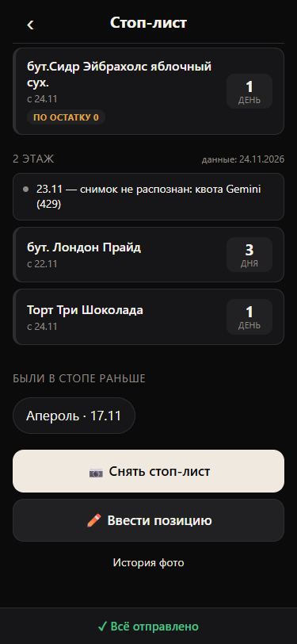
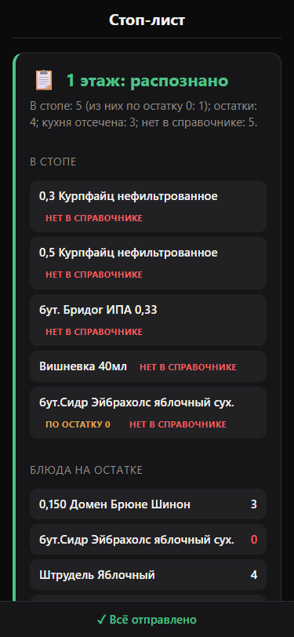
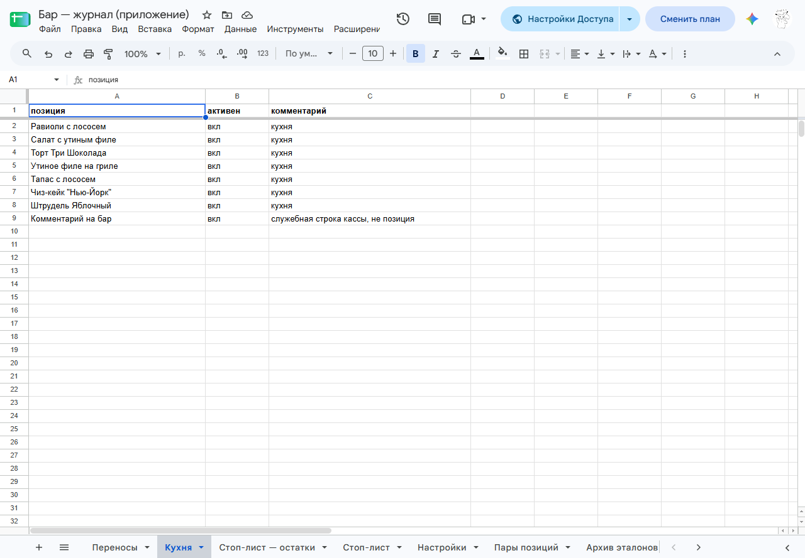
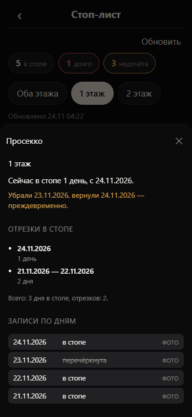

# Стоп-лист по фото — отчёт

**Дата:** 24.11.2026. **Ветка:** `dsh-threads/19-2712c5` (от `main` `5c9acb6`).
В `main` не пушилось. Бэкенд выложен и развёрнут **версией 47** существующего
развёртывания `AKfycbz…N7-w` — адрес `/exec` не менялся, `config.js` не правился.
Ключ Gemini в коде и в отчёте отсутствует: он лежит только в свойствах скрипта
(`GEMINI_API_KEY`).

> **Ревизия 3 (текущая).** Владелец уточнил: слева «Блюда на остатке» — это
> **ограничение**, ноль слева сам по себе значит «позиция в стопе». Активный
> стоп = **объединение** правой колонки и нулевых остатков. Проверка «ноль на
> остатке, а в стопе нет» **отменена** — сравнивать колонки и выводить из этого
> недочёты нельзя. Кухня в стоп-лист бара не входит и отсекается **данными**
> листа «Кухня». Задача одна: сколько дней позиция стоит в стопе. Всё остальное
> (этажи, объёмы в названиях, повторный снимок в тот же день, ручной ввод,
> `unreadable`) — в силе.
> Ревизия 2 (две колонки, сравнение и недочёты по остатку) осталась в истории
> ветки коммитом `e25d6a0`; ревизия 1 (один список) — `853e015`.

---

## Коротко

* Модель читает **обе колонки**: `{"stock":[{"name","qty"}],"stop":[{"name"}],
  "unreadable":""}`. Количества — числа (`3.00 → 3`, `0.00 → 0`); не читается —
  `qty` нет вовсе (не ноль), чтобы не выдумать «закончилось».
* **Активный стоп = правая колонка ∪ позиции с нулевым остатком слева.**
  Ноль слева без строки справа — нормальная ситуация, позиция просто в стопе.
* **Кухня отсекается данными**: лист **«Кухня»** (`позиция | активен |
  комментарий`) с блюдами и служебной строкой кассы. Сравнение по
  нормализованному названию (регистр, «ё», кавычки, дефисы, пробелы).
* **Дни в разрезе этаж + позиция** — единственный расчёт раздела. Повторный
  снимок в тот же день счётчик не увеличивает.
* Никаких «недочётов» из сравнения колонок. Остались только наблюдения по
  дням: долго в стопе, убрано преждевременно, нет в справочнике, нет данных
  за смену. Проверка фото уборки не тронута и не дублируется.
* **Реальное фото проверено:** 13 позиций стоп-листа и 8 остатков распознаны
  полностью, все количества верные. После объединения и отсечения кухни из них
  получается **9 барных позиций в стопе** и **8 строк кухни/служебных** (§7).
* 45 локальных тестов нового набора + 70 существующих — зелёные.

---

## 1. Как снимок помечается стоп-листом

Переключатель **«📷 Фото зоны / 📋 Стоп-лист»** на экране «Фото уборки». В режиме
стоп-листа — выбор этажа (1 / 2), зона и проверка чистоты не нужны.

Что происходит на сервере (`savePhoto_`):

1. фото пишется на Диск и строкой в «Фото уборки» — **до** распознавания;
2. при `rec.stopList === true` (или зоне «Стоп-лист») проверка чистоты
   **не запускается**;
3. снимок уходит в Gemini с промптом на две колонки;
4. из ответа собирается активный стоп (§2), кухня отсекается (§3);
5. позиции пишутся в «Стоп-лист», количества — в «Стоп-лист — остатки»
   (справка), в «Фото уборки» — статус `📋 Стоп-лист` и сводка;
6. любая ошибка (нет ключа, квота 429, таймаут, мусор) → строка
   **«не распознано»** с причиной; фото и запись остаются, смена не блокируется.

Этаж обязателен на экране (по умолчанию 1). Запись без этажа сервер пишет как
`1` и не падает.

---

## 2. Распознавание и активный стоп

Модели уходит **только снимок и промпт** — справочник и список кухни в промпт
не передаются, чтобы модель не «исправляла» названия.

Промпт (`buildStopListPrompt_`), ключевые правила:

```text
Ты распознаёшь экран планшета (или распечатку) со стоп-листом бара. На снимке две колонки:
  • слева — «Блюда на остатке»: название и количество («0,150 Домен Брюне Шинон   3.00»);
  • справа — «СТОП-ЛИСТ»: только названия, без количеств.

2. Левая колонка целиком идёт в "stock": name — название без числа-количества,
   qty — число из конца строки (3.00 → 3, 0.00 → 0). Если количество не читается,
   не выдумывай: не указывай qty совсем (пустое значение лучше нуля).
3. Пиши названия ТАК, КАК НАПИСАНО: сохраняй регистр, «бут.», объёмы («0,3», «0,33»,
   «40мл»), кавычки, дефисы, сокращения и опечатки. Не исправляй, не переводи,
   не раскрывай сокращения и не отрезай объём от названия: объём различает позиции.
4. Не придумывай позиции и не переноси строки между колонками...
6. Служебную строку внутри списка оставляй как написано (например «Комментарий на бар»)
   — решает человек.
8. Верни ТОЛЬКО JSON, без markdown и текста вокруг, строго по схеме:
{"stock":[{"name":"строка как написана","qty":3.0}],"stop":[{"name":"строка как написана"}],"unreadable":""}
```

Схема ответа (`stopGenerationConfig_`): `responseMimeType: application/json`,
`temperature: 0`:

```json
{
  "type": "OBJECT",
  "properties": {
    "stock": {
      "type": "ARRAY",
      "items": {
        "type": "OBJECT",
        "properties": { "name": { "type": "STRING" }, "qty": { "type": "NUMBER" } },
        "required": ["name"]
      }
    },
    "stop": {
      "type": "ARRAY",
      "items": {
        "type": "OBJECT",
        "properties": { "name": { "type": "STRING" } },
        "required": ["name"]
      }
    },
    "unreadable": { "type": "STRING" }
  },
  "required": ["stock", "stop", "unreadable"]
}
```

Разбор (`validateStopListAnswer_`) терпим к markdown-обёртке, режет пустые имена
и дубликаты (по нормализованному ключу), `qty` приводит числом (`1,500 → 1.5`,
отрицательное/текст/огромное → `null`), `0` сохраняет как `0`.
Пустые обе колонки + непустой `unreadable` — нормальный ответ «не читается».

### Активный стоп (`stopListSavePhotoRows_`)

```
активный стоп = позиции правой колонки  ∪  позиции левой колонки с qty = 0
```

* Позиция с нулём слева и **без** строки справа — в стопе (это норма, а не ошибка).
* Позиция в обеих колонках пишется **один раз**; в заметке остаётся «из остатка 0»,
  если в стоп её принёс ноль.
* Если после отсечения кухни барных позиций не осталось, пишется строка-отметка
  **«пустой стоп»**: день всё равно считается днём с данными, и серия дней
  корректно обрывается.
* Строки левой колонки с количествами (включая нулевые) сохраняются в
  «Стоп-лист — остатки» как справка: на счёт дней они не влияют.

Модели и квоты — как у проверки фото: запомненная модель, затем
`gemini-flash-lite-latest`, `gemini-3.1-flash-lite`, `gemini-3.8-flash`;
500/503/таймаут → повтор с превью ~512 px; **429 → сразу «не распознано»**.

---

## 3. Кухня: отсекаем данными, не кодом

Лист **«Кухня»** (создаётся сам, заполняется владельцем):

| Колонка | Что внутри |
|---|---|
| `позиция` | название как в кассе |
| `активен` | пусто/`вкл` — отсекаем; `выкл`/`нет`/`0` — снова считаем барной |
| `комментарий` | пояснение для владельца |

Стартовое заполнение — ровно то, что владелец назвал кухней и служебным:

```text
Равиоли с лососем
Салат с утиным филе
Торт Три Шоколада
Утиное филе на гриле
Тапас с лососем
Чиз-кейк "Нью-Йорк"
Штрудель Яблочный
Комментарий на бар        ← служебная строка кассы, не позиция
```

Правила:

* сравнение — по нормализованному названию (`stopNameKey_`): регистр, «ё»,
  кавычки, дефисы, лишние пробелы, маркер списка. «Торт Три Шоколада»,
  «торт три шоколада» и «ТОРТ   ТРИ ШОКОЛАДА» отсекаются одинаково;
* список **дополняется** новыми строками — код перезапускать не нужно;
* ошиблись — поставьте `выкл` в `активен`, позиция вернётся в стоп-лист;
* кухня отсекается и в правой колонке, и в левой (нулевой остаток блюда кухни
  не попадёт в стоп-лист бара);
* ручной ввод кухонной позиции отклоняется с понятной причиной
  («… — позиция кухни, в стоп-лист бара не идёт»): одна запись, не смена.

---

## 4. Сколько дней позиция в стопе

### Формула словами

1. **День с данными** — календарная дата по Москве, на которую есть хотя бы
   одна запись стоп-листа **этого этажа** (включая «пустой стоп», но **не**
   «не распознано»).
2. Одна позиция = одна запись в день: повторный снимок в тот же день счётчик
   не увеличивает (но обновляет данные — новая строка дня перекрывает старую).
3. Для каждой позиции по дням с данными: `present` — есть запись, где она **не**
   перечёркнута (перечёркивание ставится руками); `crossed` — есть перечёркнутая.
4. Идём по дням с данными **по возрастанию**: `present` → отрезок продолжается
   (+1 день); день с данными, где позиции нет → отрезок закрывается.
5. **Сейчас в стопе** = последний отрезок, если он заканчивается на последнем
   дне с данными этажа. Иначе 0.
6. `дней в стопе` = длина этого отрезка (число **смен с подтверждением**);
   `span` — календарная длина, `gaps = span − дней` — сколько дней внутри
   отрезка остались без данных.

### Пограничные случаи (как решено)

| Случай | Поведение |
|---|---|
| Тот же этаж, два снимка в один день | счётчик не удваивается (проверено тестом) |
| Снимок 1 этажа, а позиция на 2 этаже | на счёт 1 этажа не влияет: дни считаются по этажу |
| Ноль на остатке слева | позиция в стопе в этот день (и в следующие, пока снова не появится) |
| День без снимка внутри отрезка | по умолчанию не считается и **не обрывает** счёт, виден в `gaps`; ключ `стоплист_пропуск_обрывает = вкл` включает строгий режим |
| Снимок был, но «не распознан» | день не считается данными и не обрывает счёт; недочёт «нет данных за смену» |
| Снимок прочитан, но барный стоп пуст | день с данными без позиций: серия обрывается корректно |
| Позиция перечёркнута руками | день не засчитывается как «в стопе», отрезок закрывается |
| Позиция пропала из стопа | отрезок закрывается, счётчик 0; прошлое остаётся: `totalDays`, отрезки, «была N дней до этого» |
| Убрали и вернули в течение 1–2 дней | флаг **«убрано преждевременно»** (считается от дня, когда убрали) |
| Окно анализа | последние **180** дней; история на экране — `стоплист_история_дней` (30) |

### Что отдаётся приложению

`?action=stopList` (с историей) и `config.stopList` (без истории):

```json
{
  "ok": true, "today": "2026-11-24", "updatedAt": "…",
  "settings": { "longDays": 3, "prematureDays": 2, "historyDays": 30, "gapBreaks": false,
                "checks": { "long": true, "premature": true, "catalog": true, "data": true } },
  "floors": [
    { "floor": "1", "label": "1 этаж",
      "current": [{ "floor": "1", "name": "бут.Сидр Эйбрахолс яблочный сух.",
                    "canonical": "", "inCatalog": false, "fromStock": true,
                    "days": 4, "since": "2026-11-21", "long": true,
                    "streaks": [{ "from": "2026-11-21", "to": "2026-11-24", "days": 4, "gaps": 0 }],
                    "totalDays": 4, "lastSeen": "2026-11-24", "records": 4 }],
      "long": [], "premature": [], "missingCatalog": [], "returned": [],
      "noData": [], "issuesCount": 2,
      "totals": { "inStop": 4, "daysWithData": 4, "unreadable": 0 } },
    { "floor": "2", "label": "2 этаж", "…": "…" }
  ],
  "summary": [{ "floor": "1", "label": "1 этаж", "inStop": 4, "long": 1, "issues": 2 }],
  "totals": { "floors": 2, "positions": 7, "inStop": 7, "photos": 12, "manual": 1 },
  "history": { "1": { "бут.Сидр Эйбрахолс яблочный сух.": [{ "day": "2026-11-24", "crossed": false, "source": "фото" }] } }
}
```

---

## 5. Что осталось от «недочётов» и как настроить

Всё — в листе **«Настройки»**; строки дописываются сами, правки владельца не
затираются. Ничего не блокируется.

| Ключ | По умолчанию | Что делает |
|---|---|---|
| `стоплист_долго_дней` | `3` | с какого числа дней позиция «долго в стопе» |
| `стоплист_проверять_долго` | `вкл` | **«долго в стопе»** — позиция ≥ N дней |
| `стоплист_преждевременно_дней` | `2` | окно «убрали и вернули» |
| `стоплист_проверять_преждевременно` | `вкл` | **«убрано преждевременно»** |
| `стоплист_проверять_справочник` | `вкл` | **«нет в справочнике»** |
| `стоплист_проверять_данные` | `вкл` | **«нет данных за смену»** |
| `стоплист_пропуск_обрывает` | `выкл` | `вкл` — пропуск дня обрывает счёт дней |
| `стоплист_история_дней` | `30` | сколько дней истории показывать |
| `раздел_стоплист` | `вкл` | флаг раздела: выключить плитку и экран |

* Проверки **сравнения колонок** (`стоплист_проверять_нулевой_остаток`,
  `стоплист_проверять_остаток_в_стопе`) удалены из кода, а их строки, если
  остались от прошлой версии, **удаляются из «Настроек»** при первом чтении —
  чтобы не сбивать владельца. Чужие строки не трогаются: удаляется только
  точное совпадение ключа.
* «Долго в стопе» и «нет в справочнике» в сводке показываются строкой с
  количеством и первыми названиями; те же сведения есть тегом у каждой позиции.
* «Нет данных за смену» — только по нечитаемым снимкам.
* **Недочёты по уборке** — отдельная функция (проверка фото уборки); здесь она
  не дублируется и не менялась.
* Предупреждение по справочнику: в «Справочнике» владельца 39 позиций (в
  основном ингредиенты), а в стоп-листе — блюда и бутылки. Все барные позиции с
  фото получат «нет в справочнике», пока их не добавят. Это состояние
  справочника, а не ошибка распознавания.

---

## 6. Листы

### «Стоп-лист» (создаётся сам; «этаж» добавлен миграцией)

| Колонка | Заголовок | Что внутри |
|---|---|---|
| A | `дата` | дата и время записи |
| B | `смена/время` | `23:40` |
| C | `сотрудник` | имя из «Сотрудников» |
| D | `позиция` | как написано/распознано |
| E | `позиция_в_справочнике` | каноническое название или пусто |
| F | `перечёркнута` | `TRUE`/`FALSE` (ставится руками) |
| G | `уверенность` | пусто: схема владельца уверенность не отдаёт |
| H | `фото` | ссылка на снимок |
| I | `источник` | `фото` / `ручной ввод` / `не распознано` / `пустой стоп` |
| J | `этаж` | `1` или `2` |
| K | `id` | ID записи с телефона |
| L | `день` | `2026-11-24` — по ней считаются дни |
| M | `модель` | например `gemini-flash-lite-latest` |
| N | `заметка` | «из остатка 0», «нет в справочнике» или причина «не распознано» |

Первые девять колонок — как в задании. Пустой лист получает новую шапку
(данных нет); если бы данные были — недостающие колонки дописались бы справа.

### «Стоп-лист — остатки» (новый лист, справка)

`дата | смена/время | сотрудник | этаж | позиция | количество | фото | id | день | модель`

Количества из левой колонки, включая нули. На счёт дней не влияют — но по ним
видно, откуда взялась позиция с нулевым остатком.

### «Кухня» (новый лист, ведёт владелец)

`позиция | активен | комментарий` — §3.

---

## 7. Что показало распознавание на реальном фото

Фото владельца (снимок экрана планшета, снятый на телефон) лежит в
`docs/stop-list/test/real-screenshot.jpg`; из него сделан вариант «как отправляет
приложение» — `real-photo.jpg` (JPEG 1600 px, качество 72, ~110 КБ). Сырые
ответы модели — `docs/stop-list/test/распознавание-реальное.json`. Прогон шёл
через развёрнутый бэкенд временным действием (в финальной версии 47 его нет).

Откуда взялось фото: в репозиторий оно не попало — файл нашёлся в загрузках
владельца как скриншот из Telegram
(`Screenshot_2026-11-24-03-26-23-140_org.telegram.messenger.jpg`, 1080×2400).

### Результат распознавания

| Файл | Модель | Стоп-лист | Остатки | `unreadable` | Время модели |
|---|---|---|---|---|---|
| `real-photo.jpg` (как из приложения) | `gemini-flash-lite-latest` | **13 из 13** | **8 из 8** | пусто | 9,5 с |
| `real-screenshot.jpg` (весь экран телефона) | `gemini-3.1-flash-lite` | **13 из 13** | **8 из 8** | пусто | 8,4 с |

Ошибок «позиция не из той колонки» нет, потерь строк нет, все количества
совпали: `3, 1, 1, 0, 7, 2, 0, 4`.

### Что именно вернула модель (снимок «как из приложения»)

Колонка «СТОП-ЛИСТ» — 13 позиций, порядок как на фото:

```text
0,3 Курпфайц нефильтрованное
0,5 Курпфайц нефильтрованное
бут. БрюДог ИПА 0,33          ← на фото «Бридог»/«БрюДог», см. ниже
бут. Лондон Прайд
бут. Флорис Крик
Вишневка 40мл
Комментарий на бар            ← служебная строка POS
Равиоли с лососем
Салат с утиным филе
Торт Три Шоколада
Утиное филе на гриле
Хреновуха 40мл
Черноплодная рябина 40мл
```

Колонка «Блюда на остатке» — 8 строк с количествами, все совпали:

```text
0,150 Домен Брюне Шинон          3
бут. Фрисленд Шираз/Гренаш       1
бут.Сидр КЛУБНИКА/ЛАЙМ           1
бут.Сидр Эйбрахолс яблочный сух. 0     ← ноль → в стоп
Настойка черная смородина 40мл   7
Тапас с лососем                  2
Чиз-кейк "Нью-Йорк"              0     ← кухня → отсекается
Штрудель Яблочный                4
```

### Что из этого попадает в стоп-лист бара

После объединения и отсечения кухни (проверено тестом на этих же названиях):

* **9 позиций в стопе:** 8 из правой колонки (0,3 Курпфайц, 0,5 Курпфайц,
  Бридог, Лондон Прайд, Флорис Крик, Вишневка, Хреновуха, Черноплодная рябина)
  + `бут.Сидр Эйбрахолс яблочный сух.` с нулевым остатком;
* **8 строк отсечено:** 5 из правой колонки (Комментарий на бар, Равиоли,
  Салат, Торт, Утиное филе) + 3 из остатков (Тапас, Чиз-кейк, Штрудель).

### Честные замечания по точности

* **Один символ в названии.** Строка читается как «бут. Бридог ИПА 0,33» (так и
  в описании владельца), модель вернула «бут. БрюДог ИПА 0,33». На фото это
  место смазано, «и/ю» и «д/л» различимы плохо. Для учёта некритично: название
  сохраняется как есть и помечается «нет в справочнике». Если позиция важна —
  добавить её в справочник и поправить строку руками.
* **Служебная строка POS.** «Комментарий на бар» прочитана как позиция — и
  именно поэтому она внесена в «Кухню» как служебная: в стоп-лист бара не
  попадает.
* **Модель на полном скриншоте.** На большом скриншоте телефона первая модель
  не уложилась, сработал запасной `gemini-3.1-flash-lite`; результат тот же.
* **Рукописные образцы** прошлой ревизии (`printed.png`, `handwritten.png`)
  остались в репозитории как история: 10/10 в обоих случаях. В текущем сценарии
  они не используются — на планшете текст печатный.

---

## 8. Проверки (что реально прогнано)

### Локальные тесты (Node, без сети и без Google)

* `node tools/test-stop-list.mjs` — **45 из 45**: промпт (две колонки, «не
  отрезай объём», запрет придумывать) и схема; разбор ответа (`qty` `null`
  вместо выдуманного нуля, `1,500 → 1.5`, отрицательное/текст → `null`,
  дубликаты, markdown, «не читается», мусор); нормализация (маркер, регистр,
  «ё»; объём остаётся; `0,3` и `0,5` не сливаются; падежи и опечатки — только
  при тех же числах); **объединение** (ноль слева сам по себе = стоп; дубль не
  двоится; позиция из остатка помечена `origin: stock`); **кухня** (отсекается
  из обеих колонок; сравнение по нормализованному названию; «выкл» возвращает
  позицию; стартовый список и служебная строка заводятся сами; пустой стоп
  после кухни — день с данными и обрыв серии); ручной ввод кухонной позиции
  отклоняется; **реальное фото** (13 стоп + 8 остатков → 9 в стопе, 8 кухни
  отсечено); дни по этажам, повтор в день, пропуск и строгий режим, выпадение,
  «убрано преждевременно»; пороги и флаги; удаление отменённых ключей из
  «Настроек»; снимок через `submit` (объединение, этаж, кухня, «не читается»);
  повторный ID → `duplicate`; 429 → «не распознано», фото и запись на месте;
  `config.stopList` без истории и `?action=stopList` с историей; битая шапка;
  миграция шапки; регрессия — обычное фото уборки по-прежнему проверяется на
  чистоту.
* `node tools/test-photo-check.mjs` — **46 из 46** (не сломано).
* `node tools/test-features-pairs.mjs` — **19 из 19**.
* `node tools/test-integration-16-17.mjs` — **5 из 5**.

### Живая проверка на развёрнутом бэкенде (версия 47)

* `?action=ping` → `ok`.
* `?action=config` → `ok`, `stopList` с двумя этажами, 10 флагов разделов.
* `?action=stopList` → `ok`, этажи «1 этаж» и «2 этаж», проверки
  `long/premature/catalog/data` (проверок остатков больше нет).
* Лист «Кухня» создан и заполнен 8 строками (скриншот 13); лист
  «Стоп-лист — остатки» на месте (11); в «Настройках» отменённые ключи удалены
  (10).
* Временное действие проверки в финальной версии отсутствует:
  `action=stopListProbe` → «Неизвестное действие».

### Не проверено (честно)

* **Снимок с телефона бармена на боевом бэкенде** — требует PIN сотрудника;
  распознавание проверено на живом коде другим способом (§7), объединение и
  отсечение кухни — тестами на тех же названиях.
* **Ручной ввод реальным барменом** — по той же причине (нужен PIN).
* Фронтенд на GitHub Pages не обновлялся: в `main` не пушим, экраны проверены
  в локальном демо-стенде.

---

## 9. Скриншоты

| Файл | Что видно |
|---|---|
| `01-home.png` | главная с плиткой «Стоп-лист» |
| `02-stoplist.png` | «Оба этажа»: сводка, наблюдения по дням, список с днями и тегом «по остатку 0» |
| `03-stoplist-floor1.png` | фильтр «1 этаж» |
| `04-stoplist-bottom.png` | нижняя часть: позиция «по остатку 0», блок «2 этаж», кнопки |
| `05-history.png` | история позиции: этаж, отрезки, «убрали/вернули», записи по дням |
| `06-photo-stoplist.png` | режим «📋 Стоп-лист» с выбором этажа и пояснением про объединение |
| `07-photo-zones.png` | обычный режим «Фото зоны» не сломан |
| `08-recognized.png` | результат снимка: «в стопе 5, из них по остатку 0: 1, кухня отсечена: 3» |
| `09-sheet-stoplist.png` | лист «Стоп-лист»: колонка `этаж` |
| `10-sheet-settings.png` | «Настройки»: отменённых проверок остатков больше нет |
| `11-sheet-stock.png` | лист «Стоп-лист — остатки» (справка) |
| `12-manual.png` | ручной ввод с выбором этажа |
| `13-sheet-kitchen.png` | лист «Кухня» с блюдами и служебной строкой |







Стенд для скриншотов — `docs/stop-list/test/frame.html` (приложение в рамке
375×812 с демо-сервера `tools/demo-server.mjs`); в работу приложения не входит.

---

## 10. Что изменено в коде

### Бэкенд `apps-script/Код.gs`

* `SHEETS.kitchen`, `SHEETS.stopStock`, `ID_COLUMN.stoplist` (11).
* Раздел «СТОП-ЛИСТ ПО ФОТО»: промпт и схема `stock/stop/unreadable`,
  `validateStopListAnswer_`, `stopQty_`, `stopListRecognize_`;
  **объединение** и запись (`stopListSavePhotoRows_`, `stopLinkPhoto_`);
  **кухня** (`ensureKitchenSheet_`, `stopKitchenColumnMap_`,
  `stopKitchenActive_`, `stopKitchenSet_`, `stopIsKitchen_`); нормализация без
  отрезания объёма (`stopNameKey_`, `stopNumbers_`, `stopSameNumbers_`,
  `stopMatchName_`); расчёт по этажам (`stopFloorState_`, `stopGroupState_`,
  `stopListState_`); `stopListPublic_`, `getStopList_`, `setupStopList`.
* `savePhoto_`: ветка стоп-листа (этаж, объединение, кухня), `writeStopPhotoVerdict_`.
* `getConfig_`: `stopList` по этажам; `doGet`: `action=stopList`; `saveOne_`:
  тип `stoplist`; `ensureSettingsExtraRows_` + `dropCanceledSettings_`;
  `setup()`: автосоздаваемые листы.

### Приложение

* `js/app.js`: выбор этажа, экран стоп-листа с тегом «по остатку 0» и без
  блоков про остатки, экран результата с объединением и списком отсечённой
  кухни, ручной ввод; `sw.js` → `v31`.
* `js/sync.js`: в историю отправки кладётся `server.stoplist` (обе колонки,
  объединение, отсечённое).
* `styles.css`: тег «по остатку 0», приглушённые строки отсечённой кухни.

### Тесты и демо

* `tools/test-stop-list.mjs` — набор (45 тестов) под объединение и кухню.
* `tools/demo-server.mjs` — демо-данные по этажам, объединению и кухне.
* `tools/test-features-pairs.mjs`, `tools/test-integration-16-17.mjs` — ожидания
  по числу флагов/строк берутся из кода.

---

## 11. Развёртывание, ветка, коммиты

* `clasp push --force` (3 файла: `Код.gs`, `Вопросы.gs`, `appsscript.json`) и
  `clasp deploy -i AKfycbz…N7-w` — обновлено **существующее** развёртывание,
  теперь **версия 47** от 24.11.2026. Новых развёртываний не создавалось,
  адрес `/exec` в `config.js` не менялся.
* Проверка после деплоя: `?action=ping`, `?action=config`, `?action=stopList` —
  `ok`; `action=stopListProbe` → «Неизвестное действие».
* Ветка `dsh-threads/19-2712c5`, в `main` не пушилось.

Коммиты:

| Коммит | Что внутри |
|---|---|
| `853e015` | ревизия 1: стоп-лист по фото (один список) |
| `3ac90b0`, `d5d438d` | правки отчёта ревизии 1 |
| `d88d0a7` | строгий режим пропуска дня |
| `e25d6a0` | ревизия 2: две колонки, остатки, этажи, проверка на реальном фото |
| `29ba490`, `687cbee` | правки отчёта ревизии 2 |
| далее | ревизия 3: объединение с нулевым остатком, кухня по данным, удаление проверок остатков |

Отправная точка — `main` `5c9acb6` (`Merge branch 'integration-16-17'`).
